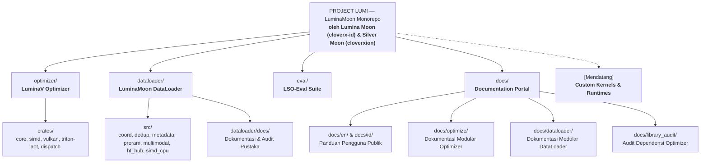

# PROJECT LUMI

[English Version (README.md)](README.md)

**LuminaMoon (`luminamoon`)** adalah monorepo utama dan implementasi referensi resmi dari **PROJECT LUMI**, menyediakan mesin optimasi numerik presisi rendah, streaming dataset multimodal, serta rangkaian verifikasi formal yang dikembangkan oleh **Lumina Moon ([@cloverx-id](https://github.com/cloverx-id))** dan **Silver Moon ([@cloverxion](https://github.com/cloverxion))**.

Dibangun dengan arsitektur modular di bawah spesifikasi **PROJECT LUMI**, `luminamoon` menghubungkan komponen khusus untuk eksekusi langsung pada CPU/GPU, streaming latensi rendah, serta stabilitas numerik terverifikasi:

## Arsitektur Ruang Kerja (Workspace)



## Proyek & Komponen

| Proyek / Komponen | Jalur | Status | Deskripsi | Dokumentasi |
| :--- | :--- | :--- | :--- | :--- |
| **LuminaV Optimizer** | [`optimizer/`](optimizer/README.id.md) | `Aktif` (v1.0.0) | Optimizer numerik presisi rendah dengan SIMD CPU (AVX-512/AVX2), Vulkan UMA, dan kernel Triton AOT/JIT. | [Panduan Optimizer](optimizer/README.id.md) |
| **LuminaMoon DataLoader** | [`dataloader/`](dataloader/README.id.md) | `Aktif` (v1.0.0) | Mesin streaming lokal/HTTP-206 $O(1)$, buffer watermark PRE-RAM 100-batch, pemulihan crash GPU dual-metadata, deduplikasi XXH3-64 dua tahap, kernel SIMD AVX-512/AVX2, Parquet/JSONL/JSON multimodal, dan pipeline HuggingFace Hub. | [Panduan DataLoader](dataloader/README.id.md) |
| **LSO-Eval Suite** | [`eval/`](eval/README.id.md) | `Aktif` | Rangkaian verifikasi formal: pembuktian invarian solver Z3 SMT, tolok ukur lintasan 2D, dan audit keselarasan numerik. | [Panduan Eval](eval/README.id.md) |
| **Dokumentasi** | [`docs/`](docs/README.id.md) | `Aktif` | Portal dokumentasi terpusat, panduan internal pengembang (`docs/optimize/`, `docs/dataloader/`), dan audit versi dependensi. | [Portal Dokumentasi](docs/README.id.md) |
| **Paket Python** | [`python/luminamoon/`](python/luminamoon/__init__.py) | `Aktif` | Namespace Python *free-threaded* (`abi3t`) terpadu yang mengekspos LuminaV Optimizer, DataStreamLoader, serta interoperabilitas PyTorch/NumPy/HuggingFace. | [Referensi API](docs/id/03_configuration_api.md) |

## Memulai Cepat (Quickstart)

### Instalasi

Instal wheel paket terkompilasi dari PyPI:

```bash
pip install luminamoon
```

Atau kompilasi langsung dari kode sumber menggunakan Maturin dan toolchain Rust 2024:

```bash
git clone https://github.com/cloverx-id/luminamoon.git
cd luminamoon
pip install maturin
maturin develop --release
```

### Penggunaan Dasar (LuminaV Optimizer)

```python
import numpy as np
from luminamoon import LuminaV

# Inisialisasi parameter
weights = np.random.randn(64, 10).astype(np.float32)
biases = np.zeros(10, dtype=np.float32)

# Buat instance optimizer LuminaV
optimizer = LuminaV([weights, biases], lr=1e-3, buffer=2)

# Eksekusi langkah optimasi dengan gradien eksplisit
grad_w = np.random.randn(64, 10).astype(np.float32)
grad_b = np.random.randn(10, dtype=np.float32)
optimizer.step(grads=[grad_w, grad_b])
```

Untuk alur kerja deep learning dengan PyTorch, lihat [Panduan Integrasi PyTorch](docs/id/01_getting_started.md#quickstart-integrasi-pytorch).

### Penggunaan Dasar (LuminaMoon DataLoader & Pipeline HuggingFace)

```python
import luminamoon as lm

# 1. Streaming dataset lokal atau remote HuggingFace dengan resume instan O(1),
#    prefetching watermark PRE-RAM 100-batch, unduhan multi-core, dan deduplikasi XXH3-64
for batch in lm.stream(
    "hf://datasets/org/corpus@main/train/part-000.parquet",
    batch_size=64,
    preram_batches=100,
    refill_trigger=10,
    download_workers=4,
    deduplicate=True,
):
    # batch.records berisi string yang telah dinormalisasi via SIMD/Rayon; deferred auto_commit menyimpan status GPU
    pass

# 2. Unggah tabel multimodal (teks, byte gambar, JSON, angka, boolean) ke HuggingFace Hub
lm.push_to_hub(
    repo="cleaned-multimodal-dataset",
    data=[
        {"prompt": "Halo", "score": 0.99, "verified": True, "meta": {"lang": "id"}},
    ],
    path_in_repo="train/part-00000.parquet",
)
```

Untuk streaming Parquet multimodal, integrasi `datasets` / `transformers`, pemulihan crash dual-metadata, dan resolusi token rahasia Colab/Kaggle, lihat [Panduan DataLoader](dataloader/README.id.md).

## Verifikasi & CI/CD

Seluruh pull request dan rilis divalidasi pada platform Linux, Windows, dan macOS:

```bash
# Analisis statis tanpa peringatan pada seluruh workspace Rust
cargo clippy --workspace --all-targets -- -D warnings

# Jalankan pengujian unit dan keselarasan diferensial Rust (Optimizer + DataLoader)
cargo test --workspace

# Jalankan pemeriksaan tipe statis Python
npx pyright python/luminamoon

# Jalankan pengujian mandiri NumPy, PyTorch, dan DataLoader
python optimizer/tests/test_standalone_numpy.py
python optimizer/tests/test_end_to_end_training.py
python dataloader/tests/test_dataloader_python.py

# Jalankan rangkaian verifikasi formal LSO-Eval
python -m eval
```

## Sumber Daya Pengembang

Bagi kontributor dan perekayasa sistem yang membangun atau memperluas **PROJECT LUMI (`luminamoon`)**:
- **Dokumentasi Modular Optimizer**: [`docs/optimize/`](docs/optimize/README.id.md)
- **Dokumentasi Modular DataLoader**: [`docs/dataloader/`](docs/dataloader/README.id.md)
- **Audit Pustaka Optimizer**: [`docs/library_audit/`](docs/library_audit/README.md)
- **Audit Pustaka DataLoader Mandiri**: [`dataloader/docs/library_audit/`](dataloader/docs/library_audit/README.md)
- **Panduan Pengguna & Arsitektur DataLoader**: [`dataloader/README.id.md`](dataloader/README.id.md)
- **English Documentation**: [`docs/en/`](docs/en/README.md)
- **Dokumentasi Bahasa Indonesia**: [`docs/id/`](docs/id/README.md)

## Penulis & Pemeliharaan

PROJECT LUMI (`luminamoon`) direkayasa dan dipelihara secara aktif oleh:
- **Silver Moon ([@cloverxion](https://github.com/cloverxion))**
- **Lumina Moon ([@cloverx-id](https://github.com/cloverx-id))**

## Lisensi

Dilisensikan di bawah Apache License, Versi 2.0. Lihat [LICENSE](LICENSE) untuk informasi rinciannya.
