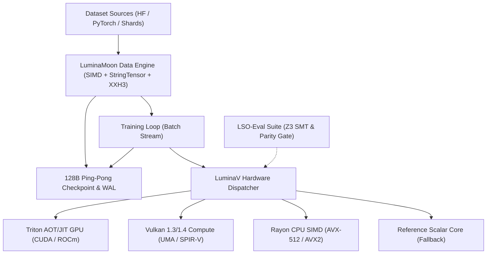

# PROJECT LUMI

**LuminaMoon (`luminamoon`)** is the official reference implementation and central monorepo of **PROJECT LUMI**, providing low-precision numerical optimization, multimodal dataset streaming, and formal verification suites developed by **Lumina Moon ([@cloverx-id](https://github.com/cloverx-id))** and **Silver Moon ([@cloverxion](https://github.com/cloverxion))**.

Built with a modular architecture under the **PROJECT LUMI** specification, `luminamoon` connects specialized components for CPU/GPU hardware execution, low-latency streaming, and verified numerical stability:

## System Architecture



## Projects & Components

| Project / Component | Path | Status | Description | Documentation |
| :--- | :--- | :--- | :--- | :--- |
| **LuminaV Optimizer** | [`optimizer/`](optimizer/README.md) | `Active` (v1.0.0) | Low-precision numerical optimizer with CPU SIMD (AVX-512/AVX2), Vulkan UMA, and Triton AOT/JIT kernels. | [Optimizer Guide](optimizer/README.md) |
| **LuminaMoon Data Engine** | [`data/`](data/README.md) | `Active` (v1.0.2) | Modular preprocessing engine: AVX-512/AVX2/NEON SIMD text normalization, dual-layout StringTensor (CPU StringView & GPU contiguous buffers), heuristic Shannon quality filtering, MinHash/XXH3-64 deduplication, PII masking, and 128B Ping-Pong crash recovery. | [Data Engine Guide](data/README.md) |
| **LSO-Eval Suite** | [`eval/`](eval/README.md) | `Active` | Formal verification suite: Z3 SMT solver invariants, 2D trajectory benchmarks, and numerical parity audits. | [Eval Guide](eval/README.md) |
| **Documentation** | [`docs/`](docs/README.md) | `Active` | Centralized documentation portal, developer internal blueprints (`docs/optimize/`, `docs/dataloader/`), and ecosystem version audits. | [Docs Portal](docs/README.md) |
| **Python Package** | [`python/luminamoon/`](python/luminamoon/__init__.py) | `Active` | Unified free-threaded (`abi3t`) Python namespace exposing LuminaV Optimizer, DataStreamLoader, and PyTorch/NumPy/HuggingFace interop. | [API Reference](docs/en/03_configuration_api.md) |

## Quickstart

### Installation

Install the compiled package wheel from PyPI:

```bash
pip install luminamoon
```

Or build from source using Maturin and the Rust 2024 toolchain:

```bash
git clone https://github.com/cloverx-id/luminamoon.git
cd luminamoon
pip install maturin
maturin develop --release
```

### Basic Usage (LuminaV Optimizer)

```python
import numpy as np
from luminamoon import LuminaV

# Initialize parameters
weights = np.random.randn(64, 10).astype(np.float32)
biases = np.zeros(10, dtype=np.float32)

# Instantiate LuminaV optimizer
optimizer = LuminaV([weights, biases], lr=1e-3, buffer=2)

# Execute optimization step with explicit gradients
grad_w = np.random.randn(64, 10).astype(np.float32)
grad_b = np.random.randn(10, dtype=np.float32)
optimizer.step(grads=[grad_w, grad_b])
```

For PyTorch deep learning workflows, see the [PyTorch Integration Guide](docs/en/01_getting_started.md#quickstart-pytorch-integration).

### Basic Usage (LuminaMoon Data Engine: Fused Preprocessing & Zero-Copy Pipeline)

```python
from luminamoon.data import FusedPipeline, StringTensor, create_resumable_collate, ResumablePipeline

# 1. Ultra-fast fused single-pass preprocessing (>400k records/s) in Rust
pipeline = FusedPipeline(
    trim_whitespace=True,
    normalize_newlines=True,  # AVX-512 / AVX2 / NEON SIMD
    min_chars=10,
    min_entropy=2.0,
)
string_tensor = pipeline(["  sample 1\r\n", "sample 2 with proper prose text"])

# 2. Zero-copy export to Apache Arrow, Polars, and GPU-ready PyTorch buffers
polars_series = string_tensor.to_polars()
arrow_array = string_tensor.to_arrow()
offsets_tensor, payload_tensor = string_tensor.to_torch_gpu(device="cuda")

# 3. Stream dataset with async prefetching & 128B Ping-Pong crash-recovery
pipe = ResumablePipeline(
    source=raw_data,
    fused_pipeline=pipeline,
    batch_size=64,
    prefetch_batches=4,
    checkpoint_path="./cache/checkpoint.meta",
)
for batch in pipe:
    # Training step...
    pipe.commit()  # Atomically persists Dual-Slot A/B checkpoint and deduplication WAL
```

For detailed architecture, Shannon entropy heuristics, MinHash deduplication, and PyTorch `collate_fn` adapters, see the [Data Engine Guide](data/README.md).

## Verification & CI/CD

All pull requests and releases are validated across Linux, Windows, and macOS:

```bash
# Enforce zero-warning static analysis across the Rust workspace
cargo clippy --workspace --all-targets -- -D warnings

# Run Rust workspace unit and differential parity tests (Optimizer + DataLoader)
cargo test --workspace

# Run Python static type check
npx pyright python/luminamoon

# Run standalone NumPy, PyTorch, and DataLoader verification suites
python optimizer/tests/test_standalone_numpy.py
python optimizer/tests/test_end_to_end_training.py
python -B tests/test_data_modular.py
python -B tests/test_gpu_vs_cpu_strings.py

# Run LSO-Eval formal verification suite
python -m eval
```

## Developer Resources

For contributors and systems engineers building on or extending **PROJECT LUMI (`luminamoon`)**:
- **Optimizer Modular Documentation**: [`docs/optimize/`](docs/optimize/README.md)
- **Data Engine Modular Documentation**: [`docs/dataloader/`](docs/dataloader/README.md)
- **Optimizer Library Audits**: [`docs/library_audit/`](docs/library_audit/README.md)
- **Data Standalone Library Audits**: [`data/docs/library_audit/`](data/docs/library_audit/README.md)
- **Data Engine Architecture & User Guide**: [`data/README.md`](data/README.md)
- **User Documentation**: [`docs/en/`](docs/en/README.md)

## Authors & Maintenance

PROJECT LUMI (`luminamoon`) is engineered and maintained by:
- **Silver Moon ([@cloverxion](https://github.com/cloverxion))**
- **Lumina Moon ([@cloverx-id](https://github.com/cloverx-id))**

## License

Licensed under the Apache License, Version 2.0. See [LICENSE](LICENSE) for details.
