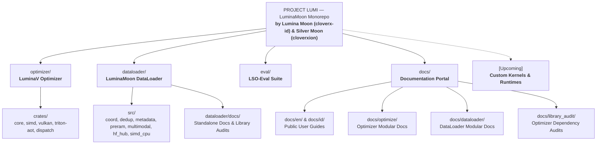

# PROJECT LUMI

[Versi Bahasa Indonesia (README.id.md)](README.id.md)

**LuminaMoon (`luminamoon`)** is the official reference implementation and central monorepo of **PROJECT LUMI**, providing low-precision numerical optimization, multimodal dataset streaming, and formal verification suites developed by **Lumina Moon ([@cloverx-id](https://github.com/cloverx-id))** and **Silver Moon ([@cloverxion](https://github.com/cloverxion))**.

Built with a modular architecture under the **PROJECT LUMI** specification, `luminamoon` connects specialized components for CPU/GPU hardware execution, low-latency streaming, and verified numerical stability:

## Workspace Architecture



## Projects & Components

| Project / Component | Path | Status | Description | Documentation |
| :--- | :--- | :--- | :--- | :--- |
| **LuminaV Optimizer** | [`optimizer/`](optimizer/README.md) | `Active` (v1.0.0) | Low-precision numerical optimizer with CPU SIMD (AVX-512/AVX2), Vulkan UMA, and Triton AOT/JIT kernels. | [Optimizer Guide](optimizer/README.md) |
| **LuminaMoon DataLoader** | [`dataloader/`](dataloader/README.md) | `Active` (v1.0.0) | High-throughput $O(1)$ local/HTTP-206 streaming engine, 100-batch PRE-RAM watermark buffer, dual-metadata GPU crash recovery, two-stage XXH3-64 deduplication, AVX-512/AVX2 SIMD kernels, multimodal Parquet/JSONL/JSON, and HuggingFace Hub pipeline. | [DataLoader Guide](dataloader/README.md) |
| **LSO-Eval Suite** | [`eval/`](eval/README.md) | `Active` | Formal verification suite: Z3 SMT solver invariants, 2D trajectory benchmarks, and numerical parity audits. | [Eval Guide](eval/README.md) |
| **Documentation** | [`docs/`](docs/README.md) | `Active` | Centralized documentation portal, developer internal blueprints (`docs/optimize/`, `docs/dataloader/`), and ecosystem version audits. | [Docs Portal](docs/README.md) |
| **Python Package** | [`python/luminamoon/`](python/luminamoon/__init__.py) | `Active` | Unified free-threaded (`abi3t`) Python namespace exposing LuminaV Optimizer, DataStreamLoader, and PyTorch/NumPy/HuggingFace interop. | [API Reference](docs/en/03_configuration_api.md) |

## Quickstart

### Installation

Install the compiled package wheel from PyPI:

```bash
pip install luminamoon
```

Or build from source using Maturin and the Rust 2024 toolchain:

```bash
git clone https://github.com/cloverx-id/luminamoon.git
cd luminamoon
pip install maturin
maturin develop --release
```

### Basic Usage (LuminaV Optimizer)

```python
import numpy as np
from luminamoon import LuminaV

# Initialize parameters
weights = np.random.randn(64, 10).astype(np.float32)
biases = np.zeros(10, dtype=np.float32)

# Instantiate LuminaV optimizer
optimizer = LuminaV([weights, biases], lr=1e-3, buffer=2)

# Execute optimization step with explicit gradients
grad_w = np.random.randn(64, 10).astype(np.float32)
grad_b = np.random.randn(10, dtype=np.float32)
optimizer.step(grads=[grad_w, grad_b])
```

For PyTorch deep learning workflows, see the [PyTorch Integration Guide](docs/en/01_getting_started.md#quickstart-pytorch-integration).

### Basic Usage (LuminaMoon DataLoader & Official HuggingFace Pipeline)

```python
import luminamoon as lm

# 1. Stream local or remote HuggingFace datasets with O(1) instant resume,
#    100-batch PRE-RAM watermark prefetching, multi-core download, and XXH3-64 deduplication
for batch in lm.stream(
    "hf://datasets/org/corpus@main/train/part-000.parquet",
    batch_size=64,
    preram_batches=100,
    refill_trigger=10,
    download_workers=4,
    deduplicate=True,
):
    # batch.records contains SIMD/Rayon-cleaned strings; deferred auto_commit persists GPU state
    pass

# 2. Push multimodal tables (text, image bytes, JSON, numbers, booleans) to HuggingFace Hub
lm.push_to_hub(
    repo="cleaned-multimodal-dataset",
    data=[
        {"prompt": "Hello", "score": 0.99, "verified": True, "meta": {"lang": "id"}},
    ],
    path_in_repo="train/part-00000.parquet",
)
```

For multimodal Parquet streaming, `datasets` / `transformers` integration, dual-metadata crash recovery, and Colab/Kaggle secret resolution, see the [DataLoader Guide](dataloader/README.md).

## Verification & CI/CD

All pull requests and releases are validated across Linux, Windows, and macOS:

```bash
# Enforce zero-warning static analysis across the Rust workspace
cargo clippy --workspace --all-targets -- -D warnings

# Run Rust workspace unit and differential parity tests (Optimizer + DataLoader)
cargo test --workspace

# Run Python static type check
npx pyright python/luminamoon

# Run standalone NumPy, PyTorch, and DataLoader verification suites
python optimizer/tests/test_standalone_numpy.py
python optimizer/tests/test_end_to_end_training.py
python dataloader/tests/test_dataloader_python.py

# Run LSO-Eval formal verification suite
python -m eval
```

## Developer Resources

For contributors and systems engineers building on or extending **PROJECT LUMI (`luminamoon`)**:
- **Optimizer Modular Documentation**: [`docs/optimize/`](docs/optimize/README.md)
- **DataLoader Modular Documentation**: [`docs/dataloader/`](docs/dataloader/README.md)
- **Optimizer Library Audits**: [`docs/library_audit/`](docs/library_audit/README.md)
- **DataLoader Standalone Library Audits**: [`dataloader/docs/library_audit/`](dataloader/docs/library_audit/README.md)
- **DataLoader Architecture & User Guide**: [`dataloader/README.md`](dataloader/README.md)
- **English Documentation**: [`docs/en/`](docs/en/README.md)
- **Dokumentasi Bahasa Indonesia**: [`docs/id/`](docs/id/README.md)

## Authors & Maintenance

PROJECT LUMI (`luminamoon`) is engineered and maintained by:
- **Silver Moon ([@cloverxion](https://github.com/cloverxion))**
- **Lumina Moon ([@cloverx-id](https://github.com/cloverx-id))**

## License

Licensed under the Apache License, Version 2.0. See [LICENSE](LICENSE) for details.
