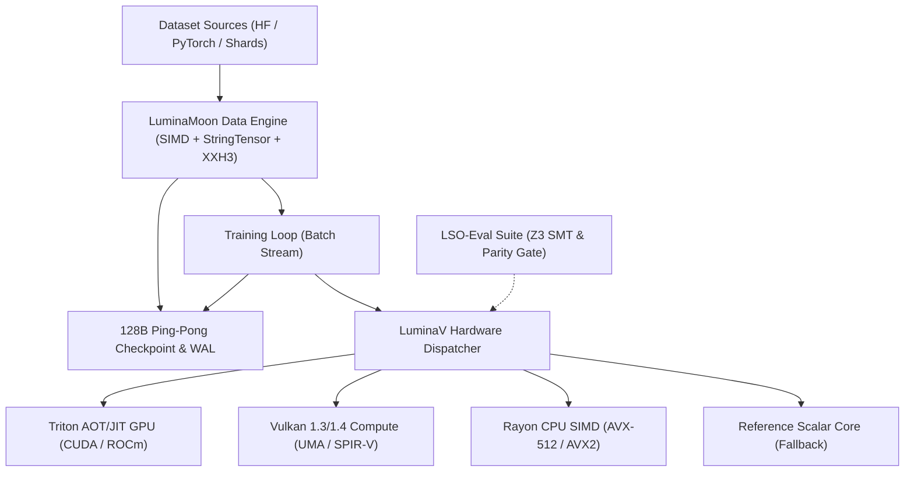

# PROJECT LUMI

<p align="left">
  <a href="https://pypi.org/project/luminamoon/"></a>
  <a href="https://github.com/cloverx-id/luminamoon/actions/workflows/ci.yml"></a>
  <a href="https://cloverx-id.github.io/luminamoon/"></a>
  <a href="https://pypi.org/project/luminamoon/"></a>
  <a href="LICENSE"></a>
</p>

**LuminaMoon (`luminamoon`)** is the official reference implementation and central monorepo of **PROJECT LUMI**, providing low-precision numerical optimization, multimodal dataset streaming, and formal verification suites developed by **Lumina Moon ([@cloverx-id](https://github.com/cloverx-id))** and **Silver Moon ([@cloverxion](https://github.com/cloverxion))**.

Built with a modular architecture under the **PROJECT LUMI** specification, `luminamoon` connects specialized components for CPU/GPU hardware execution, low-latency streaming, and verified numerical stability:

## System Architecture



## Projects & Components

| Project / Component | Path | Status | Description | Documentation |
| :--- | :--- | :--- | :--- | :--- |
| **LuminaV Optimizer** | [`optimizer/`](optimizer/README.md) | `Active` (Spec `v1.5.3`) | Canonical LuminaV v1.5.3 optimizer engine with CPU SIMD (AVX-512/AVX2), Vulkan UMA, and Triton AOT/JIT kernels. | [Optimizer Guide](optimizer/README.md) |
| **LuminaMoon Data Engine** | [`data/`](data/README.md) | `Active` (`v1.0.5`) | Modular preprocessing engine: AVX-512/AVX2/NEON SIMD text normalization, dual-layout StringTensor (CPU StringView & GPU contiguous buffers), heuristic Shannon quality filtering, MinHash/XXH3-64 deduplication, PII masking, and 128B Ping-Pong crash recovery. | [Data Engine Guide](data/README.md) |
| **LSO-Eval Suite** | [`eval/`](eval/README.md) | `Active` | Formal verification suite: Z3 SMT solver invariants, 2D trajectory benchmarks, and numerical parity audits. | [Eval Guide](eval/README.md) |
| **Changelogs** | [`changelogs/`](changelogs/README.md) | `Active` | Dedicated version histories separating Software Package releases (`v1.0.0`–`v1.0.5`) and LuminaV Algorithm Specifications (`v1.0.0`–`v1.5.3`). | [Changelogs](changelogs/README.md) |
| **Documentation** | [`docs/`](docs/README.md) | `Active` | Centralized documentation portal, developer internal blueprints (`docs/optimize/`, `docs/dataloader/`), and ecosystem version audits. | [Docs Portal](docs/README.md) |
| **Python Package** | [`python/luminamoon/`](python/luminamoon/__init__.py) | `Active` (`v1.0.5`) | Unified free-threaded (`abi3t`) Python namespace exposing LuminaV Optimizer, DataStreamLoader, and PyTorch/NumPy/HuggingFace interop. | [API Reference](docs/en/03_configuration_api.md) |

## Quickstart

### Installation

Install the compiled package wheel from PyPI:

```bash
pip install luminamoon
```

Or build from source using Maturin and the Rust 2024 toolchain:

```bash
git clone https://github.com/cloverx-id/luminamoon.git
cd luminamoon
pip install maturin
maturin develop --release
```

### Basic Usage (LuminaV Optimizer)

```python
import numpy as np
from luminamoon import LuminaV

# Initialize parameters
weights = np.random.randn(64, 10).astype(np.float32)
biases = np.zeros(10, dtype=np.float32)

# Instantiate LuminaV optimizer (uses calibrated default hyperparameters)
optimizer = LuminaV([weights, biases], lr=8e-4, weight_decay=0.08, buffer=2)

# Execute optimization step with explicit gradients
grad_w = np.random.randn(64, 10).astype(np.float32)
grad_b = np.random.randn(10, dtype=np.float32)
optimizer.step(grads=[grad_w, grad_b])
```

For PyTorch deep learning workflows, see the [PyTorch Integration Guide](docs/en/01_getting_started.md#quickstart-pytorch-integration).

### LuminaV Hyperparameter Quick Reference

All default values below are exposed directly in IDE autocompletion and `LuminaV.__init__` docstrings:

| Parameter | Type | Default | Description |
| :--- | :--- | :--- | :--- |
| `lr` | `float` | `8e-4` (`0.0008`) | Learning rate ($\eta$). |
| `betas` | `Tuple[float, float]` | `(0.9, 0.999)` | Exponential moving average factors $(\beta_1, \beta_2)$ for first moment and second moment / temporal defect. |
| `eps` | `float` | `1e-8` | Numerical stability constant ($\epsilon$) in the adaptive denominator. |
| `weight_decay` | `float` | `0.08` (`8e-2`) | Decoupled weight decay coefficient. |
| `tau` | `float` | `0.8` | Soft-projection temperature threshold ($\tau$) for denominator damping. |
| `lam` | `float` | `0.3` | Temporal defect sensitivity weight ($\lambda$) in Single-Buffer TD-CLM (`buffer=1`). |
| `cautious` | `bool` | `True` | Enables sign-aligned cautious update masking and lagged EMA scaling. |
| `cautious_clamp_min` | `float` | `0.5` | Lower bound in `(0.0, 1.0]` for cautious alignment scaling. |
| `buffer` | `int \| str` | `2` | State topology: `2` (`"dual"`, `"clm"`) for Dual-Buffer Convex Lookahead Momentum (CLM), or `1` (`"single"`, `"td-clm"`) for Single-Buffer Triangle-Defect Convex Lookahead Momentum (TD-CLM). |
| `centered_defect` | `bool` | `False` | Centers innovation defect $(g - m)$ across both Dual-Buffer CLM (`buffer=2`) and Single-Buffer TD-CLM (`buffer=1`) modes. |
| `stochastic_rounding` | `bool` | `True` | Applies stateless 32-bit MurmurHash3 bit-avalanche stochastic rounding when writing to `bfloat16` / `float16` weights. |
| `bound` | `bool` | `True` | Enables adaptive trust-region update bounding. |
| `bound_type` | `str \| int` | `"coordinate"` | Trust-region geometry: `"coordinate"` (element-wise clip, zero collective sync) or `"radial"` (global norm ratio). |
| `bound_ratio` | `float` | `0.05` | Maximum update magnitude relative to parameter scale. |
| `master_weights` | `str \| bool` | `"none"` | Mixed-precision master weight mode for `bfloat16`/`float16`: `"none"` (`False`), `"semi"`, or `"full"` (`True`). |
| `execution` | `str \| int` | `"auto"` | Hardware backend: `"auto"`, `"triton"`, `"vulkan"`, `"simd"`, or `"scalar"`. |
| `fused_single_pass` | `bool` | `True` | Fuses parameter update and scalar reduction statistics into a single kernel pass. |
| `ema_decay` | `str \| float` | `"auto"` | EMA decay for lagged cautious/radial scalars (`"auto"` resolves to `0.80` for `buffer=2` and `0.95` for `buffer=1`). |
| `fsdp_sync` | `bool` | `False` | Synchronizes global reduction scratch buffers across `torch.distributed` FSDP shards. |
| `seed` | `int` | `1337` | Deterministic PRNG seed for stateless stochastic rounding. |
| `version` | `Optional[str]` | `"1.5.3"` | Locks the active LuminaV mathematical specification version. |

### Software vs. Algorithm Versioning (`v1.0.5` / Spec `v1.5.3`)

`luminamoon` maintains two orthogonal version tracks (documented in [`changelogs/`](changelogs/README.md)):
- **Software Package Version (`1.0.5`)**: Tracks the unified Rust + Python wheel distribution (`luminamoon.__version__` and `luminamoon.data.get_version()`). See [`changelogs/SOFTWARE_CHANGELOG.md`](changelogs/SOFTWARE_CHANGELOG.md).
- **LuminaV Algorithm Specification (`1.5.3`)**: Tracks the canonical mathematical update rules (`LuminaV.ALGORITHM_SPEC` and `LuminaV.getVersion()`). See [`changelogs/LUMINAV_ALGORITHM_CHANGELOG.md`](changelogs/LUMINAV_ALGORITHM_CHANGELOG.md).

All version resolution operates 100% offline using local compatibility profiles:

```python
import luminamoon
from luminamoon import LuminaV
import luminamoon.data as lmd

# 1. Introspect Software Package Version vs. Algorithm Specification Version
print(luminamoon.__version__)    # "1.0.5.post1" (Software distribution)
print(lmd.get_version())         # "1.0.5.post1" (Data Engine module)
print(LuminaV.ALGORITHM_SPEC)    # "1.5.3" (Canonical mathematical specification)
print(LuminaV.getVersion())      # "1.5.3"

# 2. Lock or select a specific algorithm version per-instance or globally
opt = LuminaV([weights, biases], lr=8e-4, version="1.5.3")
opt.setVersion("1.5.3")          # Instance-level version lock
LuminaV.setVersion("1.5.3")      # Class-level default

# 3. Canonical specification lock (Note: Specifications prior to v1.5.0 are deprecated)
# LuminaV v1.5.3 TD-CLM is the canonical mathematical specification across CPU/GPU runtimes.
opt_canonical = LuminaV([weights, biases], version="1.5.3")
```

### Basic Usage (LuminaMoon Data Engine: Fused Preprocessing & Zero-Copy Pipeline)

```python
from luminamoon.data import FusedPipeline, StringTensor, create_resumable_collate, ResumablePipeline

# 1. Ultra-fast fused single-pass preprocessing (>400k records/s) in Rust
pipeline = FusedPipeline(
    trim_whitespace=True,
    normalize_newlines=True,  # AVX-512 / AVX2 / NEON SIMD
    min_chars=10,
    min_entropy=2.0,
)
string_tensor = pipeline(["  sample 1\r\n", "sample 2 with proper prose text"])

# 2. Zero-copy export to Apache Arrow, Polars, and GPU-ready PyTorch buffers
polars_series = string_tensor.to_polars()
arrow_array = string_tensor.to_arrow()
offsets_tensor, payload_tensor = string_tensor.to_torch_gpu(device="cuda")

# 3. Stream dataset with async prefetching & 128B Ping-Pong crash-recovery
pipe = ResumablePipeline(
    source=raw_data,
    fused_pipeline=pipeline,
    batch_size=64,
    prefetch_batches=4,
    checkpoint_path="./cache/checkpoint.meta",
)
for batch in pipe:
    # Training step...
    pipe.commit()  # Atomically persists Dual-Slot A/B checkpoint and deduplication WAL
```

For detailed architecture, Shannon entropy heuristics, MinHash deduplication, and PyTorch `collate_fn` adapters, see the [Data Engine Guide](data/README.md).

## Verification & CI/CD

All pull requests and releases are validated across Linux, Windows, and macOS:

```bash
# Enforce zero-warning static analysis across the Rust workspace
cargo clippy --workspace --all-targets -- -D warnings

# Run Rust workspace unit and differential parity tests (Optimizer + DataLoader)
cargo test --workspace

# Run Python static type check
npx pyright python/luminamoon

# Run standalone NumPy, PyTorch, and DataLoader verification suites
python optimizer/tests/test_standalone_numpy.py
python optimizer/tests/test_end_to_end_training.py
python -B tests/test_data_modular.py
python -B tests/test_gpu_vs_cpu_strings.py

# Run LSO-Eval formal verification suite
python -m eval
```

## Developer Resources

For contributors and systems engineers building on or extending **PROJECT LUMI (`luminamoon`)**:
- **Changelogs (Software & Algorithm)**: [`changelogs/`](changelogs/README.md)
- **Optimizer Modular Documentation**: [`docs/optimize/`](docs/optimize/README.md)
- **Data Engine Modular Documentation**: [`data/`](data/README.md)
- **Optimizer Library Audits**: [`docs/library_audit/`](docs/library_audit/README.md)
- **Data Standalone Library Audits**: [`data/docs/library_audit/`](data/docs/library_audit/README.md)
- **Data Engine Architecture & User Guide**: [`data/README.md`](data/README.md)
- **User Documentation**: [`docs/en/`](docs/en/README.md)

## Authors & Maintenance

PROJECT LUMI (`luminamoon`) is engineered and maintained by:
- **Silver Moon ([@cloverxion](https://github.com/cloverxion))**
- **Lumina Moon ([@cloverx-id](https://github.com/cloverx-id))**

## License

Licensed under the Apache License, Version 2.0. See [LICENSE](LICENSE) for details.
