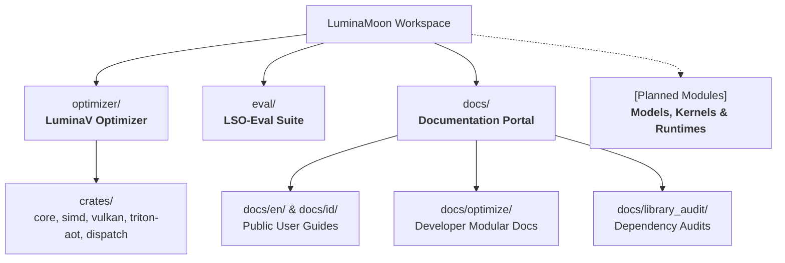

# LuminaMoon

LuminaMoon is a modular high-performance computing and AI systems workspace, engineered for low-precision mathematical computing, formal verification, and hardware-accelerated deep learning primitives.

## Workspace Architecture

The workspace is organized into modular components designed for high performance, zero unnecessary overhead, and multi-platform hardware execution:



## Modules & Components

| Module | Path | Description | Documentation |
| :--- | :--- | :--- | :--- |
| **LuminaV Optimizer** | [`optimizer/`](optimizer/) | Flagship low-precision mathematical optimizer (v1.0.0) with AVX-512/AVX2, Vulkan UMA, and Triton AOT/JIT kernels. | [Optimizer Guide](optimizer/README.md) |
| **LSO-Eval Suite** | [`eval/`](eval/) | Formal verification suite: Z3 SMT solver invariants, 2D trajectory benchmarks, and parity audits. | [Eval Specification](eval/lso_eval_specification.tex) |
| **Documentation** | [`docs/`](docs/) | Complete multilingual documentation portal, developer internal blueprints, and ecosystem version audits. | [Docs Portal](docs/README.md) |
| **Python Package** | [`python/luminamoon/`](python/luminamoon/) | Python interface exposing `LuminaV`, GPU mixins, and zero-copy NumPy/PyTorch bindings. | [API Reference](docs/en/03_configuration_api.md) |

## Quickstart

### Installation

Install the compiled wheel from PyPI:

```bash
pip install luminamoon
```

Or build from source using Maturin and the Rust 2024 toolchain:

```bash
git clone https://github.com/cloverx-id/luminamoon.git
cd luminamoon
pip install maturin
maturin develop --release
```

### Basic Usage

```python
import numpy as np
from luminamoon import LuminaV

# Initialize parameters
weights = np.random.randn(64, 10).astype(np.float32)
biases = np.zeros(10, dtype=np.float32)

# Instantiate LuminaV optimizer
optimizer = LuminaV([weights, biases], lr=1e-3, buffer=2)

# Execute optimization step with explicit gradients
grad_w = np.random.randn(64, 10).astype(np.float32)
grad_b = np.random.randn(10).astype(np.float32)
optimizer.step(grads=[grad_w, grad_b])
```

For PyTorch deep learning workflows, see the [PyTorch Integration Guide](docs/en/01_getting_started.md#quickstart-pytorch-integration).

## Verification & CI/CD

All pull requests and releases are validated across Linux, Windows, and macOS:

```bash
# Run Rust workspace unit and differential parity tests
cargo test --workspace

# Run Python static type check
npx pyright python/luminamoon

# Run standalone NumPy and PyTorch training verification
python optimizer/tests/test_standalone_numpy.py
python optimizer/tests/test_end_to_end_training.py

# Run LSO-Eval formal verification suite
python -m eval
```

## Developer Resources

For contributors and systems engineers building on or extending LuminaMoon:
- **Developer Modular Documentation**: [`docs/optimize/`](docs/optimize/)
- **Library Audits & ABI Notes**: [`docs/library_audit/`](docs/library_audit/)
- **English Documentation**: [`docs/en/`](docs/en/)
- **Dokumentasi Bahasa Indonesia**: [`docs/id/`](docs/id/)

## License

Licensed under the Apache License, Version 2.0. See [LICENSE](LICENSE) for details.
