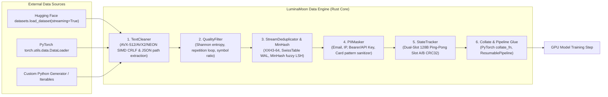

# LuminaMoon Data Engine v1.0.2

LuminaMoon Data (`luminamoon.data`) is a high-performance, modular post-processing, SIMD normalization, heuristic quality filtering, stateful deduplication, and crash-proof checkpointing engine designed to supercharge any data pipeline (PyTorch `DataLoader`, Hugging Face `datasets`, Ray, or WebDataset).

---

## 1. Modular Architecture & Responsibilities

Instead of maintaining redundant network fetching and file I/O protocols, LuminaMoon Data focuses strictly on ultra-low latency compute and deterministic state management:



---

## 2. Component Breakdown

| Module | Core Responsibility | Underlying Implementation |
| :--- | :--- | :--- |
| **`luminamoon.data.cleaner`** | Whitespace trimming, SIMD newline normalization (`\r\n` $\rightarrow$ `\n`), byte length boundaries, and JSON path extraction. | `simd_cpu.rs`, `postprocess.rs` (Rayon parallel multi-threading, AVX-512BW, AVX2, NEON) |
| **`luminamoon.data.quality`** | Shannon Character Entropy, loop repetition detector, and symbol-to-word ratio filtering. | `quality.rs` (Parallel Rayon heuristic quality engine) |
| **`luminamoon.data.dedup`** | Stateful 64-bit exact hashing and deduplication with write-ahead log (`.dedup`) persistence. | `dedup.rs` (`xxh3_64` + `IdentityBuildHasher` SwissTable) |
| **`luminamoon.data.minhash`** | Fuzzy near-duplicate detection via MinHash shingling and Jaccard similarity estimation. | `minhash.rs` (Permuted XXH3-64 MinHash signatures) |
| **`luminamoon.data.masker`** | High-performance PII sanitization for emails, IPs, API keys/tokens, and cards. | `masker.py` (Compiled multi-pattern regex sanitizer) |
| **`luminamoon.data.checkpoint`** | Crash-proof atomic coordinate checkpointing (`shard_id`, `row_offset`, `byte_offset`, `global_idx`). | `metadata.rs`, `coord.rs` (128-byte Dual-Slot Ping-Pong Slot A/B CRC32) |
| **`luminamoon.data.string_tensor`** | Columnar zero-copy string representation with CPU StringView (Pola 2) and GPU Contiguous Buffer (Pola 1). | `string_tensor.rs` (16-byte Umbra/DuckDB StringView, SIMD prefix filter, contiguous u32 offsets + u8 payload) |
| **`luminamoon.data.adapters`** | PyTorch native `collate_fn` adapter and streaming `ResumablePipeline`. | `adapters.py` (Dynamic token padding & tensor generation) |
| **`luminamoon.data.serialization`** | Direct conversion of Python dictionaries to Parquet, JSONL, or Arrow IPC bytes. | `serialize.rs` (Arrow RecordBatch & Parquet ArrowWriter with ZSTD) |

---

## 3. Quickstart & Usage

### 3.1. Text Cleaning with SIMD & Rayon
```python
from luminamoon.data import TextCleaner

cleaner = TextCleaner(
    trim_whitespace=True,
    normalize_newlines=True,      # AVX-512 / AVX2 / NEON SIMD
    min_byte_len=10,
    max_byte_len=2048,
    truncate_over_max=True,
    json_extract_key="data.text",  # Extracts dotted path without Python JSON parsing overhead
)

cleaned = cleaner.clean_batch(["  sample 1\r\n", "sample 2 "])
```

### 3.2. Quality Filtering (Shannon Entropy & Repetition Detector)
```python
from luminamoon.data import QualityFilter

qf = QualityFilter(
    min_entropy=2.5,             # Eliminates low-entropy noise / gibberish
    max_repetition_ratio=0.35,   # Catches degenerate looping
    max_symbol_ratio=0.30,       # Rejects code / log dumps
)

if qf.is_high_quality("High quality prose text for LLM pre-training."):
    ...
```

### 3.3. Exact & Fuzzy Near-Deduplication
```python
from luminamoon.data import StreamDeduplicator, MinHashDeduplicator

# Exact dedup with WAL
dedup = StreamDeduplicator(wal_path="./cache/dataset.dedup")
unique_batch = dedup.filter_batch(cleaned)
dedup.commit()

# Fuzzy near-dedup (> 85% similarity)
fuzzy = MinHashDeduplicator(threshold=0.85)
if fuzzy.is_unique("A document with slight punctuation differences."):
    ...
```

### 3.4. PII Sanitization
```python
from luminamoon.data import PIIMasker

masker = PIIMasker(mask_emails=True, mask_ips=True, mask_api_keys=True)
safe_text = masker.mask("Contact support@lumi.ai with key Bearer sk-1234567890abcdef1234567890abcdef")
# Result: "Contact [EMAIL] with key [API_KEY]"
```

### 3.5. Dual-Layout StringTensor (CPU StringView & GPU Buffers)
```python
from luminamoon.data import StringTensor

# 1. CPU Layout (Pola 2 - Umbra / DuckDB / Arrow 2.0 StringView)
# Strings <= 12 bytes are inlined directly in a 16-byte struct without heap dereference
st = StringTensor(["short", "this is a longer sample exceeding 12 bytes", "pref_sample"])
print(st.is_inlined_mask())  # [True, False, True]

# SIMD prefix and length filtering
filtered = st.filter_by_prefix("pref_")
hashes = st.hash_all()  # Multi-threaded XXH3-64 parallel hashing without Python GIL

# 2. GPU Layout (Pola 1 - Apache Arrow & TensorFlow Contiguous Offsets + Data Buffer)
offsets, payload = st.to_gpu_buffers()  # Raw uint32 offsets and uint8 payload
off_tensor, pay_tensor = st.to_torch_gpu()  # GPU-ready PyTorch tensors
off_arr, pay_arr = st.to_numpy_gpu()        # NumPy GPU buffers
arrow_array = st.to_arrow()                 # Zero-copy Apache Arrow 2.0 StringArray
polars_series = st.to_polars()              # Zero-copy Polars Series

### 3.6. Fused Single-Pass Pipeline (>400k records/s)
```python
from luminamoon.data import FusedPipeline, StreamDeduplicator

pipeline = FusedPipeline(
    trim_whitespace=True,
    normalize_newlines=True,
    min_chars=15,
    min_entropy=2.0,
    deduplicator=StreamDeduplicator(),
    commit_dedup=True,
)

# Process raw batch in a single multi-threaded Rayon pass in Rust without Python GIL
string_tensor = pipeline(raw_records)
```

### 3.7. PyTorch Native Collate & Async Prefetch Pipeline
```python
from torch.utils.data import DataLoader
from luminamoon.data import create_resumable_collate, ResumablePipeline, FusedPipeline

# 1. As PyTorch collate_fn
collate_fn = create_resumable_collate(
    fused_pipeline=FusedPipeline(),
    return_string_tensor=True,
    tokenizer=my_tokenizer,
    max_length=512,
)
loader = DataLoader(raw_dataset, batch_size=64, collate_fn=collate_fn)

# 2. Or as end-to-end streaming ResumablePipeline with async prefetcher
resumable_pipe = ResumablePipeline(
    source=raw_dataset,
    fused_pipeline=FusedPipeline(),
    batch_size=64,
    prefetch_batches=4,  # Background prefetch worker eliminates GPU starvation
    return_string_tensor=True,
)
for batch in resumable_pipe:
    ...
```

---

## 4. Verification & Testing

Run Rust tests:
```bash
cargo test -p luminamoon-dataloader
```

Run Python modular test suite:
```bash
python -B tests/test_data_modular.py
```
