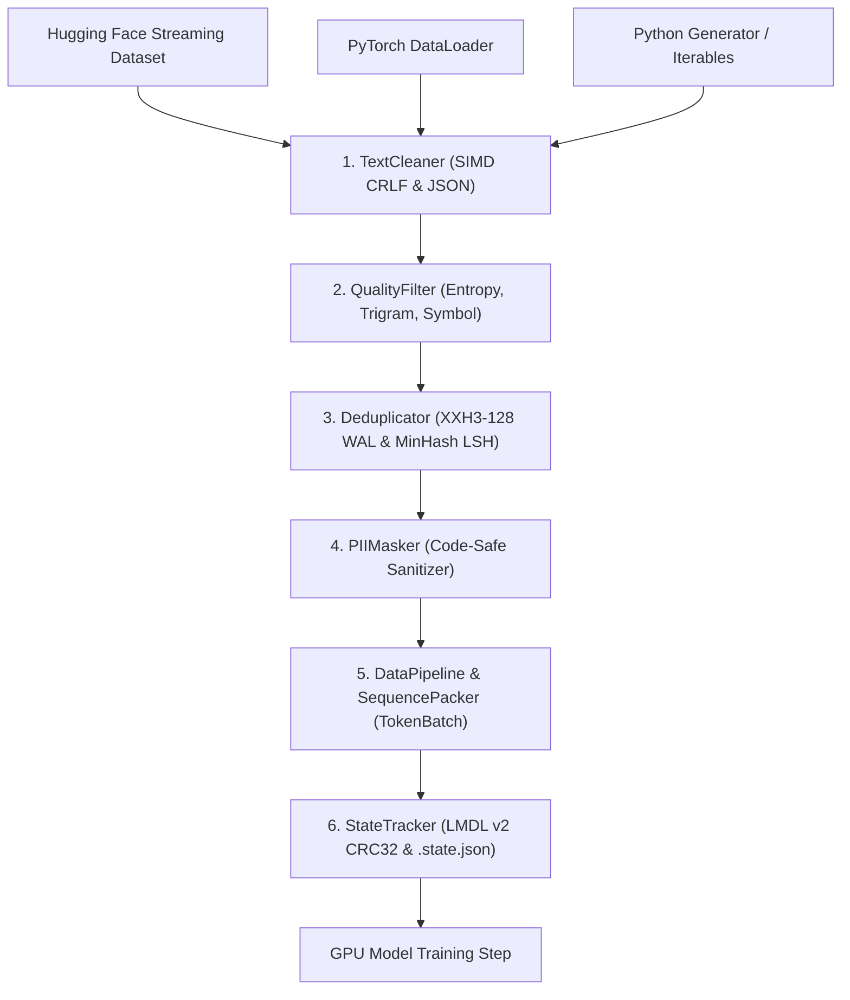

# LuminaMoon Data Engine v2.0.0

LuminaMoon Data (`luminamoon.data`) provides text cleaning, SIMD normalization, heuristic quality filtering, exact and fuzzy deduplication, and crash-resilient checkpointing for Python and Rust data pipelines, including PyTorch, Hugging Face datasets, Ray, and WebDataset.

---

## 1. Modular Architecture & Responsibilities

LuminaMoon Data focuses on in-memory text processing and deterministic state tracking, integrating smoothly with existing dataset readers:



---

## 2. Component Breakdown

| Module | Core Responsibility | Underlying Implementation |
| :--- | :--- | :--- |
| **`luminamoon.data.loader`**, **`packing`** | `DataPipeline`, packed `TokenBatch` (`causal_doc_mask()`, `as_xy()`, `.to()`), and `SequencePacker` (`best_fit`, `concat`, `pad`). | `loader.py`, `_sources.py`, `packing.py` |
| **`luminamoon.data.cleaner`** | Whitespace trimming, SIMD newline normalization (`\r\n` $\rightarrow$ `\n`), byte length boundaries, and JSON path extraction. | `simd_cpu.rs`, `postprocess.rs` (Rayon parallel multi-threading, AVX-512BW, AVX2, NEON) |
| **`luminamoon.data.quality`** | Shannon Character Entropy, trigram repetition detector, and visible symbol ratio (`symbols / visible`) filtering (`QualityFilter.for_pretraining()`). | `quality.rs` (Parallel Rayon heuristic quality filter) |
| **`luminamoon.data.dedup`** | Stateful 128-bit exact hashing and deduplication with $O(\Delta)$ append-only `LMWL v2` WAL persistence (`LMWP v2` in pure-Python `BLAKE2b-128` fallback). | `dedup.rs` (`xxh3_128` + `IdentityBuildHasher` SwissTable) |
| **`luminamoon.data.minhash`** | Fuzzy near-duplicate detection via single-pass XXH3-128 double-hashed MinHash LSH (adapted from Kirsch-Mitzenmacher) and Jaccard similarity. | `minhash.rs` (Auto-tuned LSH bands + Rayon parallel `filter_batch`) |
| **`luminamoon.data.masker`** | Code-safe PII masking for emails, IPs, API keys/tokens, phones, and Luhn-validated payment cards. | `masker.py` (Compiled multi-pattern regex sanitizer) |
| **`luminamoon.data.checkpoint`** | Dual-slot atomic checkpointing (`StreamCoordinate`: `shard_id`, `row_offset_in_page`, `byte_offset`, `global_row_idx`; plus `StateTracker.consumed_tokens`). | `metadata.rs`, `coord.rs` (256-byte `LMDL v2` Ping-Pong Slot A/B CRC32) |
| **`luminamoon.data.string_tensor`** | Columnar string container with Arrow `Utf8View`-aligned `StringView16`, `__arrow_c_array__` PyCapsule, and GPU contiguous offset/payload buffers. | `string_tensor.rs` (16-byte `StringView16`, SIMD prefix filter, contiguous u32 offsets + u8 payload) |
| **`luminamoon.data.collate`**, **`pipeline`**, **`ring_buffer`** | PyTorch `collate_fn` factory (`create_resumable_collate`), `ResumablePipeline`, and `TokenRingBuffer` circular token buffer. | `collate.py`, `pipeline.py`, `ring_buffer.py` |
| **`luminamoon.data.serialization`** | 64-bit columnar serialization (`LargeUtf8` / `LargeBinary`) of Python dictionaries to Parquet, JSONL, or Arrow IPC bytes. | `serialize.rs` (Arrow RecordBatch & Parquet ArrowWriter with ZSTD) |

---

## 3. Quickstart & Usage

### 3.0. Streaming Pipeline (`DataPipeline`)
```python
from luminamoon.data import DataPipeline

pipe = DataPipeline(
    source=raw_dataset,
    tokenizer=my_tokenizer,
    batch_size=4,
    seq_len=2048,
    packing="best_fit",
    quality="pretraining",
    dedup="exact",
    checkpoint="./cache/train",
)

for batch in pipe:
    attn_mask = batch.causal_doc_mask()
    # Model forward / backward / optimizer.step() ...
    pipe.commit()
```

### 3.1. Text Cleaning with SIMD & Rayon
```python
from luminamoon.data import TextCleaner

cleaner = TextCleaner(
    trim_whitespace=True,
    normalize_newlines=True,      # AVX-512 / AVX2 / NEON SIMD
    min_byte_len=10,
    max_byte_len=2048,
    truncate_over_max=True,
    json_extract_key="data.text",  # Extracts dotted path in Rust
)

cleaned = cleaner.clean_batch(["  sample 1\r\n", "sample 2 "])
```

### 3.2. Quality Filtering (Shannon Entropy & Repetition Detector)
```python
from luminamoon.data import QualityFilter

qf = QualityFilter(
    min_entropy=2.5,             # Filters low-entropy noise
    max_repetition_ratio=0.35,   # Filters repetitive text loops
    max_symbol_ratio=0.30,       # Filters symbol-heavy dumps
)

if qf.is_high_quality("Sample prose text for language model training."):
    ...
```

### 3.3. Exact & Fuzzy Near-Deduplication
```python
from luminamoon.data import StreamDeduplicator, MinHashDeduplicator

# Exact dedup with WAL
dedup = StreamDeduplicator(wal_path="./cache/dataset.dedup")
unique_batch = dedup.filter_batch(cleaned)
dedup.commit()

# Fuzzy near-dedup (> 85% similarity)
fuzzy = MinHashDeduplicator(threshold=0.85)
if fuzzy.is_unique("A document with slight punctuation differences."):
    ...
```

### 3.4. PII Sanitization
```python
from luminamoon.data import PIIMasker

masker = PIIMasker(mask_emails=True, mask_ips=True, mask_api_keys=True)
safe_text = masker.mask("Contact support@lumi.ai with key Bearer sk-1234567890abcdef1234567890abcdef")
# Result: "Contact [EMAIL] with key [API_KEY]"
```

### 3.5. Dual-Layout StringTensor (CPU StringView & GPU Buffers)
```python
from luminamoon.data import StringTensor

# 1. CPU Layout (Pattern 2 - Umbra / DuckDB / Arrow 2.0 StringView)
# Strings <= 12 bytes are stored inline in a 16-byte struct
st = StringTensor(["short", "this is a longer sample exceeding 12 bytes", "pref_sample"])
print(st.is_inlined_mask())  # [True, False, True]

# SIMD prefix and length filtering
filtered = st.filter_by_prefix("pref_")
hashes = st.hash_all()  # Multi-threaded XXH3-64 hashing in Rust

# 2. GPU Layout (Contiguous Offsets + Data Buffer) & Arrow PyCapsule
offsets_bytes, payload_bytes = st.to_gpu_buffers()  # Raw (bytes, bytes) for uint32 offsets and uint8 payload
off_tensor, pay_tensor = st.to_torch_gpu()          # PyTorch tensors (default device="cpu")
off_arr, pay_arr = st.to_numpy_gpu()                # NumPy uint32 / uint8 arrays
arrow_array = st.to_arrow()                         # Apache Arrow array via __arrow_c_array__
polars_series = st.to_polars()                      # Polars Series (pip install --pre "luminamoon[data]")
```

### 3.6. Fused Single-Pass Pipeline
```python
from luminamoon.data import FusedPipeline, StreamDeduplicator

pipeline = FusedPipeline(
    trim_whitespace=True,
    normalize_newlines=True,
    min_chars=15,
    min_entropy=2.0,
    deduplicator=StreamDeduplicator(),
    commit_dedup=True,
)

# Process a batch in a single multi-threaded Rayon pass
string_tensor = pipeline(raw_records)
```

### 3.7. PyTorch Collate & Async Prefetch Pipeline
```python
from torch.utils.data import DataLoader
from luminamoon.data import create_resumable_collate, ResumablePipeline, FusedPipeline

# 1. As PyTorch collate_fn
collate_fn = create_resumable_collate(
    fused_pipeline=FusedPipeline(),
    return_string_tensor=True,
    tokenizer=my_tokenizer,
    max_length=512,
)
loader = DataLoader(raw_dataset, batch_size=64, collate_fn=collate_fn)

# 2. Or as batch ResumablePipeline with background prefetcher
resumable_pipe = ResumablePipeline(
    source=raw_dataset,
    fused_pipeline=FusedPipeline(),
    batch_size=64,
    prefetch_batches=4,  # Background prefetch worker for processed batches
    return_string_tensor=True,
)
for batch in resumable_pipe:
    ...
```

---

## 4. Verification & Testing

Run Rust tests:

```bash
cargo test -p luminamoon-dataloader
```

Run Python tests:

```bash
pytest -q tests/test_data_core_v2.py tests/test_data_pipeline_v2.py
```

---

## 5. Version Inspection

Query the installed package version:

```python
import luminamoon as lm

print(lm.get_version())
```

> **Note**: LuminaMoon Data uses a Rust SIMD engine. Package releases follow `luminamoon.__version__`.
