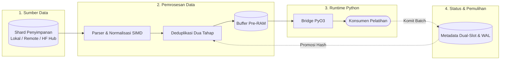

# LuminaMoon DataLoader v1.0.0

[English Version (README.md)](README.md)

LuminaMoon DataLoader (`luminamoon-dataloader`) adalah mesin streaming dataset dan Parquet/JSONL/JSON multimodal dengan integrasi HuggingFace Hub, dibangun menggunakan Rust (Edition 2024) serta binding ekstensi C Python bebas-GIL (`PyO3 0.30.1` `abi3-py310` & `abi3t`).

## Fitur

- **Streaming Jarak Jauh HTTP 206 Konkuren & Lokal Bebas Salin (Zero-Copy)**:
  - **`mmap` Lokal (`LocalMmapLineSource`) & Parquet (`LocalParquetSource`)**: Pencarian offset byte $O(1)$ instan serta lompatan row-group `RowSelection` Arrow tanpa mendekode halaman yang dilewati.
  - **Streaming HTTP 206 Multi-Range Konkuren (`RemoteLineSource` & `RemoteParquetSource`)**: Streaming shard `.jsonl`, `.txt`, dan `.parquet` langsung dari `hf://datasets/...` atau `https://...` melalui beberapa worker rentang konkuren (`download_workers`) tanpa mengunduh berkas utuh ke disk.
- **Akselerasi SIMD CPU Mandiri (`simd_cpu`)**:
  - Intrinsik vektor eksplisit `AVX-512BW` (ZMM 64-byte), `AVX2` (YMM 32-byte), dan `ARM64 NEON` (16-byte) untuk pemindaian baris baru maju/mundur (`find_newline_fast`, `rfind_newline_fast`), deteksi karakter `\r` (`contains_byte_fast`), serta buffer selaras garis cache 64-byte (`CacheAlignedBuffer`).
- **Ring Buffer Watermark Pre-RAM & Pemulihan Crash Metadata Ganda**:
  - Pool produsen Tokio multi-thread mengelola ring buffer 100-batch dengan pemicu isi ulang watermark otomatis (5/10 batch) dan penggabungan batch lintas-shard.
  - Slot checkpoint 64-byte Ping-Pong terproteksi CRC32 (`Slot A` / `Slot B`) melacak koordinat yang dikomit GPU (`mark_in_gpu` / `batch.commit()`) secara terpisah dari batch di Pre-RAM, dipadukan dengan deduplikator dua tahap `xxh3_64` (`TwoStageDeduplicator`) dan write-ahead log `.dedup`.
- **Pipeline Ekosistem HuggingFace (`datasets`, `transformers`, `huggingface_hub`)**:
  - **Penemuan Otomatis Repositori (`expand_hf_sources`)**: Membuka `hf://datasets/org/repo` atau `hf://datasets/org/repo@revision` langsung menjadi URI shard `.parquet` atau `.jsonl` melalui `huggingface_hub.HfApi.list_repo_files` atau Tree REST API HuggingFace.
  - **Pipeline `datasets.Dataset` & `IterableDataset` (`from_hf_dataset`)**: Membungkus setiap `datasets.Dataset`, `IterableDataset`, atau iterable Python dengan normalisasi SIMD + Rayon bebas-GIL di Rust serta deduplikasi `xxh3_64` (`postprocess_and_dedup_records`).
  - **Hook Tokenizer & Pasca-Pemrosesan**: Parameter bawaan `tokenizer` dan `postprocess_fn` pada `lm.stream` dan `lm.from_hf_dataset` mengisi `batch.tokens` secara otomatis.
  - **Serialisasi Tabel Rust Hibrida + Unggah Aman Hub LFS/Xet (`push_to_hub` & `serialize_table_to_bytes`)**: Melakukan serialisasi skema arbitrer (`Text`, `Bytes`/Gambar, `Json`, `Int64`, `Float64`, `Bool`) ke `.parquet` (kompatibel dengan penampil dataset HuggingFace `struct<bytes: binary, path: string>`), `.jsonl`, atau `.json` di Rust tanpa menahan GIL, dan mengunggahnya via `huggingface_hub.HfApi` atau klien komit NDJSON Rust (`HfHubUploader`).

## Arsitektur & Pipeline



## Struktur Crate & Paket

```
dataloader/
├── Cargo.toml                  # Manifest crate Rust mandiri (luminamoon-dataloader)
├── README.md                   # Panduan pengguna dan arsitektur DataLoader (EN)
├── README.id.md                # Panduan pengguna dan arsitektur DataLoader (ID)
├── src/
│   ├── lib.rs                  # Titik ekspor publik dan pengujian unit/integrasi
│   ├── coord.rs                # StreamCoordinate 32-byte little-endian untuk resume O(1)
│   ├── dedup.rs                # TwoStageDeduplicator dengan xxh3_64 dan IdentityBuildHasher
│   ├── error.rs                # Definisi terpadu DataLoaderError dan Result
│   ├── hf_hub.rs               # HfCredentials (Debug tersensor, pengaman HTTPS) & HfHubClient
│   ├── metadata.rs             # Checkpoint CRC32 128-byte Ping-Pong (Slot A/B) & WAL .dedup
│   ├── multimodal.rs           # Pembaca Parquet multimodal lokal/remote & serializer Parquet/JSONL/JSON
│   ├── postprocess.rs          # Normalisasi UTF-8 paralel Rayon, ekstraksi JSON, pemindaian SIMD CRLF
│   ├── preram.rs               # PreRamDataLoader ring buffer watermark 100-batch & worker pool Tokio
│   ├── py_bridge.rs            # Binding PyO3 0.30.1 abi3t & fungsi tabel/pasca-proses bebas-GIL
│   ├── simd_cpu.rs             # Kernel pemindaian byte AVX-512BW, AVX2, NEON, Skalar & CacheAlignedBuffer
│   ├── source_hf.rs            # HttpRangeClient konkuren, HttpParquetReader, RemoteLine/ParquetSource
│   └── source_local.rs         # LocalMmapLineSource (memmap2) dan LocalParquetSource (RowSelection)
├── docs/
│   ├── README.md               # Dokumentasi DataLoader, matriks verifikasi & indeks audit (EN)
│   ├── README.id.md            # Dokumentasi DataLoader, matriks verifikasi & indeks audit (ID)
│   └── library_audit/          # Audit pustaka eksternal (Rust, PyO3, Tokio, Arrow, SIMD/Hash)
└── tests/
    └── test_dataloader_python.py # Rangkaian verifikasi Python end-to-end (Langkah 4–9)
```

## Instalasi & Kompilasi

### Dari Wheel (PyPI)

```bash
pip install luminamoon
```

### Dari Kode Sumber (Maturin)

```bash
git clone https://github.com/cloverx-id/luminamoon.git
cd luminamoon
pip install maturin
maturin develop --release
```

## Panduan Cepat

### 1. Streaming Satu Baris, Penemuan Repositori & Hook Tokenizer (`lm.stream`)

```python
import luminamoon as lm

# Menyelesaikan secara otomatis token HF_TOKEN, HF_ORG, HF_USERNAME dari env, Google Colab, atau Kaggle.
# Melewatkan root repositori ("hf://datasets/org/corpus") otomatis menemukan shard .parquet / .jsonl.
for batch in lm.stream(
    "hf://datasets/org/corpus@main",
    split="train",
    batch_size=64,
    download_workers=4,
    json_extract_key="text",
    tokenizer=lambda texts, **kw: {"input_ids": [[len(t)] for t in texts]},
):
    # Akses string bersih melalui batch.records / batch[0] dan hasil tokenisasi via batch.tokens
    ids = batch.tokens["input_ids"]
    # auto_commit tertunda menyimpan progres GPU secara otomatis pada iterasi berikutnya
```

### 2. Pipeline `datasets.Dataset` / `IterableDataset` Resmi (`lm.from_hf_dataset`)

```python
import luminamoon as lm

raw_hf_dataset = [
    {"text": "  Sample pertama \r\n"},
    {"text": "Sample pertama"},  # Disaring oleh deduplikator Rust XXH3-64
    {"text": "Sample kedua\r\n"},
]

for batch in lm.from_hf_dataset(
    raw_hf_dataset,
    column="text",
    batch_size=32,
    deduplicate=True,
    tokenizer=lambda texts, **kw: {"input_ids": [len(t.split()) for t in texts]},
):
    print(batch.records, batch.tokens)
```

### 3. Unggah Hub Multimodal Hibrida (`lm.push_to_hub` & `lm.serialize_table_to_bytes`)

```python
import luminamoon as lm

# Melakukan serialisasi di Rust (Parquet/JSONL/JSON) dengan GIL bebas dan mengunggah via HfApi atau HfHubUploader
uri = lm.push_to_hub(
    "multimodal-ds",
    [
        {"prompt": "seekor kucing", "image": b"\x89PNG...", "score": 0.95, "verified": True},
        {"prompt": "seekor anjing", "image": b"\x89PNG...", "score": 0.88, "verified": False},
    ],
    path_in_repo="train/part-000.parquet",
)

for batch in lm.stream(uri, columns=["prompt", "image", "score", "verified"], batch_size=32):
    first_row = batch[0]
    prompts = batch["prompt"]
```

## Verifikasi Perangkat Keras

Untuk menginspeksi set instruksi SIMD CPU yang terdeteksi (`AVX-512`, `AVX2`, `NEON`, atau `SCALAR`):

```python
import luminamoon as lm

print(lm.dataloader_cpu_isa())
```

## Dokumentasi & Audit Pustaka

- **[Dokumentasi Modular Pengembang (`docs/dataloader/README.id.md`)](../docs/dataloader/README.id.md)** / **[Versi Inggris (`docs/dataloader/README.md`)](../docs/dataloader/README.md)**
- **[Dokumentasi DataLoader & Laporan Verifikasi Akhir (`dataloader/docs/README.id.md`)](docs/README.id.md)** / **[Versi Inggris (`dataloader/docs/README.md`)](docs/README.md)**
- **[Audit Pustaka Eksternal Mandiri (`dataloader/docs/library_audit/README.md`)](docs/library_audit/README.md)**

## Menjalankan Pengujian

```bash
# Analisis lint workspace tanpa peringatan
cargo clippy --workspace --all-targets -- -D warnings

# Kompilasi rilis optimal & jalankan 15 uji unit/integrasi DataLoader
cargo test --release -p luminamoon-dataloader

# Jalankan pemeriksaan tipe statis Python (0 error, 0 warning)
npx pyright python/luminamoon

# Jalankan rangkaian pengujian Python DataLoader, Multimodal, dan HuggingFace Pipeline
python -B dataloader/tests/test_dataloader_python.py
```

## Lisensi

Dilisensikan di bawah Apache License, Versi 2.0. Lihat [LICENSE](../LICENSE) untuk informasi rinciannya.
