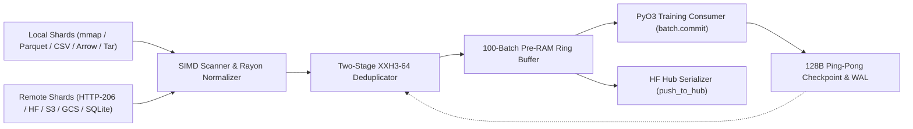

# LuminaMoon DataLoader v1.0.0

LuminaMoon DataLoader (`luminamoon-dataloader`) is a universal dataset streaming and multimodal Parquet/JSONL/JSON/CSV/Arrow/WebDataset engine with HuggingFace Hub integration, built in Rust (Edition 2024) with Python C-extension bindings (`PyO3 0.30.1` `abi3-py310` & `abi3t`).

## Features

- **Zero-Copy Local, Cloud Object Storage & Concurrent HTTP 206 Remote Streaming**:
  - **Local `mmap` (`LocalMmapLineSource`) & Parquet (`LocalParquetSource`)**: Instant $O(1)$ byte-offset seeking, transparent stream decompression (`.gz`, `.zst`, `.lz4`), and Arrow `RowSelection` row-group skipping without decoding skipped pages.
  - **Concurrent Multi-Range HTTP 206 Streaming (`RemoteLineSource` & `RemoteParquetSource`)**: Streams `.jsonl`, `.txt`, `.parquet`, `.csv`, `.tsv`, `.arrow`, `.feather`, and `.tar` (WebDataset) shards directly from `hf://datasets/...`, `https://...`, `s3://...`, `gs://...`, or `sqlite://...` across multiple concurrent range workers (`download_workers`).
- **Self-Contained CPU SIMD Acceleration (`simd_cpu`)**:
  - Explicit `AVX-512BW` (64-byte ZMM), `AVX2` (32-byte YMM), and `ARM64 NEON` (16-byte) vector intrinsics for forward/backward newline scanning (`find_newline_fast`, `rfind_newline_fast`), `\r` carriage-return detection (`contains_byte_fast`), and 64-byte cache-line aligned buffers (`CacheAlignedBuffer`).
- **Pre-RAM Watermark Ring Buffer & Dual-Metadata Crash Recovery**:
  - Multi-threaded Tokio producer pool maintains a 100-batch ring buffer with automatic watermark refill triggers (5/10 batches) and cross-shard batch coalescing.
  - Ping-pong 64-byte CRC32-protected checkpoint slots (`Slot A` / `Slot B`) track GPU-committed coordinates (`mark_in_gpu` / `batch.commit()`) separately from Pre-RAM staged batches, paired with a two-stage `xxh3_64` deduplicator (`TwoStageDeduplicator`) and `.dedup` write-ahead log.
- **Universal Ecosystem & Developer Diagnostics (`datasets`, `transformers`, `huggingface_hub`)**:
  - **Repository Auto-Discovery (`expand_hf_sources`)**: Expands `hf://datasets/org/repo` or `hf://datasets/org/repo@revision` directly into underlying `.parquet`, `.jsonl`, `.csv`, `.arrow`, or `.tar` shard URIs via `huggingface_hub.HfApi.list_repo_files` or the HuggingFace Tree REST API.
  - **`datasets.Dataset` & Multi-Source Mixing (`from_hf_dataset` & `interleave`)**: Wraps any `datasets.Dataset`, `IterableDataset`, or Python iterable with GIL-free Rust SIMD + Rayon normalization and `xxh3_64` deduplication (`postprocess_and_dedup_records`), and interleaves multiple streams with deterministic sampling weights.
  - **Zero-Overhead Tensor Conversion & Typo Diagnostics**: Native `.to_numpy()`, `.to_torch(device=...)`, `tokenizer`, and `postprocess_fn` hooks on `DataBatch` and `MultimodalBatch`, backed by Damerau-Levenshtein edit-distance typo suggestions (`Did you mean ...?`) across URI schemes, column names, and keyword arguments.
  - **Hybrid Rust Table Serialization + Safe LFS/Xet Hub Upload (`push_to_hub` & `serialize_table_to_bytes`)**: Serializes arbitrary schemas (`Text`, `Bytes`/Image, `Json`, `Int64`, `Float64`, `Bool`, `List`) to `.parquet` (HuggingFace Dataset Viewer `struct<bytes: binary, path: string>` compatible), `.jsonl`, or `.json` in Rust without holding the GIL, and uploads via `huggingface_hub.HfApi` (for Git LFS / Xet multipart safety) or the built-in Rust NDJSON commit client (`HfHubUploader`).

## Architecture & Pipeline



## Crate & Package Structure

```
dataloader/
├── Cargo.toml                        # Self-contained Rust crate manifest (luminamoon-dataloader)
├── README.md                         # DataLoader architecture and user guide
├── src/
│   ├── lib.rs                        # Module manifest and public API re-exports
│   ├── constants.rs                  # Centralized endpoints, URI schemes, magic bytes, and sizing defaults
│   ├── coord.rs                      # 32-byte little-endian StreamCoordinate for O(1) resume
│   ├── dedup.rs                      # TwoStageDeduplicator with xxh3_64 and IdentityBuildHasher
│   ├── error.rs                      # Unified DataLoaderError, Damerau-Levenshtein typo suggestions & hints
│   ├── hf_hub.rs                     # HfCredentials (redacted Debug, HTTPS guard) & HfHubClient
│   ├── metadata.rs                   # 128-byte Ping-Pong (Slot A/B) CRC32 checkpoint & .dedup WAL
│   ├── multimodal.rs                 # MultimodalValue, Arrow array decoders & Local/Remote sources
│   ├── multimodal_formats.rs         # Universal stream decompression (.gz/.zst/.lz4) & JSONL/CSV/Arrow/Tar parsers
│   ├── multimodal_serialize.rs       # GIL-free Parquet (struct<bytes, path>), JSONL, and JSON serializers
│   ├── postprocess.rs                # Rayon parallel UTF-8 normalization, JSON extraction, SIMD CRLF scan
│   ├── preram.rs                     # PreRamDataLoader 100-batch watermark ring buffer & Tokio worker pool
│   ├── py_bridge.rs                  # PyO3 0.30.1 abi3t bindings & GIL-free table/postprocess functions
│   ├── simd_cpu.rs                   # AVX-512BW, AVX2, NEON, Scalar byte-scanning kernels & CacheAlignedBuffer
│   ├── source_hf.rs                  # Concurrent HttpRangeClient, HttpParquetReader, RemoteLine/ParquetSource
│   ├── source_local.rs               # LocalMmapLineSource (memmap2) and LocalParquetSource (RowSelection)
│   └── tests.rs                      # 18 Rust unit and integration tests
├── docs/
│   ├── README.md                     # DataLoader documentation, verification matrix & library audit index
│   └── library_audit/                # External dependency audits (Rust, PyO3, Tokio, Arrow, SIMD, Compression)
└── tests/
    └── test_dataloader_python.py     # End-to-end Python verification suite
```

```
python/luminamoon/dataloader/
├── __init__.py                       # Public package facade (__all__ exports)
├── constants.py                      # Centralized URI schemes, typo maps, extensions, and kwarg registries
├── _ffi.py                           # Native Rust C-extension (_luminamoon_optimizer_rs) loader & wrappers
├── diagnostics.py                    # Damerau-Levenshtein typo correction & developer-friendly error hints
├── batch.py                          # DataBatch & MultimodalBatch (.to_numpy(), .to_torch(), tokenizer hooks)
├── hub.py                            # HuggingFace secret resolution, repo shard discovery, S3/GCS/SQLite adapters
└── loader.py                         # DataStreamLoader, MultimodalParquetLoader, stream(), from_hf_dataset(), interleave()
```

## Installation & Build

### From Wheel (PyPI)

```bash
pip install luminamoon
```

### From Source (Maturin)

```bash
git clone https://github.com/cloverx-id/luminamoon.git
cd luminamoon
pip install maturin
maturin develop --release
```

## Quickstart

### 1. One-Line Streaming, Repo Auto-Discovery & Tokenizer Hook (`lm.stream`)

```python
import luminamoon as lm

# Auto-resolves HF_TOKEN, HF_ORG, HF_USERNAME from os.environ, Google Colab userdata, or Kaggle Secrets.
# Passing a repository root ("hf://datasets/org/corpus") auto-discovers all .parquet / .jsonl shards.
for batch in lm.stream(
    "hf://datasets/org/corpus@main",
    split="train",
    batch_size=64,
    download_workers=4,
    json_extract_key="text",
    tokenizer=lambda texts, **kw: {"input_ids": [[len(t)] for t in texts]},
):
    # Access cleaned strings via batch.records / batch[0] and tokenized output via batch.tokens
    ids = batch.tokens["input_ids"]
    # Deferred auto_commit persists GPU progress automatically on the next iteration
```

### 2. Official `datasets.Dataset` / `IterableDataset` Pipeline (`lm.from_hf_dataset`)

```python
import luminamoon as lm

raw_hf_dataset = [
    {"text": "  First sample \r\n"},
    {"text": "First sample"},  # Filtered by Rust XXH3-64 deduplicator
    {"text": "Second sample\r\n"},
]

for batch in lm.from_hf_dataset(
    raw_hf_dataset,
    column="text",
    batch_size=32,
    deduplicate=True,
    tokenizer=lambda texts, **kw: {"input_ids": [len(t.split()) for t in texts]},
):
    print(batch.records, batch.tokens)
```

### 3. Hybrid Multimodal Hub Upload (`lm.push_to_hub` & `lm.serialize_table_to_bytes`)

```python
import luminamoon as lm

# Serializes in Rust (Parquet/JSONL/JSON) with GIL released and uploads via HfApi (LFS/Xet) or HfHubUploader
uri = lm.push_to_hub(
    "multimodal-ds",
    [
        {"prompt": "a cat", "image": b"\x89PNG...", "score": 0.95, "verified": True},
        {"prompt": "a dog", "image": b"\x89PNG...", "score": 0.88, "verified": False},
    ],
    path_in_repo="train/part-000.parquet",
)

for batch in lm.stream(uri, columns=["prompt", "image", "score", "verified"], batch_size=32):
    first_row = batch[0]
    prompts = batch["prompt"]
```

## Hardware Verification

To inspect the detected CPU SIMD instruction set (`AVX-512`, `AVX2`, `NEON`, or `SCALAR`) used by the DataLoader byte-scanning engine:

```python
import luminamoon as lm

print(lm.dataloader_cpu_isa())
```

## Documentation & Library Audits

- **[Developer Modular Documentation (`docs/dataloader/README.md`)](../docs/dataloader/README.md)**
- **[DataLoader Documentation & Final Verification Report (`dataloader/docs/README.md`)](docs/README.md)**
- **[Standalone External Library Audits (`dataloader/docs/library_audit/`)](docs/library_audit/README.md)**

## Building & Running Tests

```bash
# Lint workspace with zero warnings
cargo clippy --workspace --all-targets -- -D warnings

# Build optimized release binary & run all 18 DataLoader unit/integration tests
cargo test --release -p luminamoon-dataloader

# Run Python static type check (0 errors, 0 warnings)
npx pyright python/luminamoon

# Run Python end-to-end DataLoader, Multimodal, and HuggingFace Pipeline test suite
python -B dataloader/tests/test_dataloader_python.py
```

## License

Licensed under the Apache License, Version 2.0. See [LICENSE](../LICENSE) for details.
