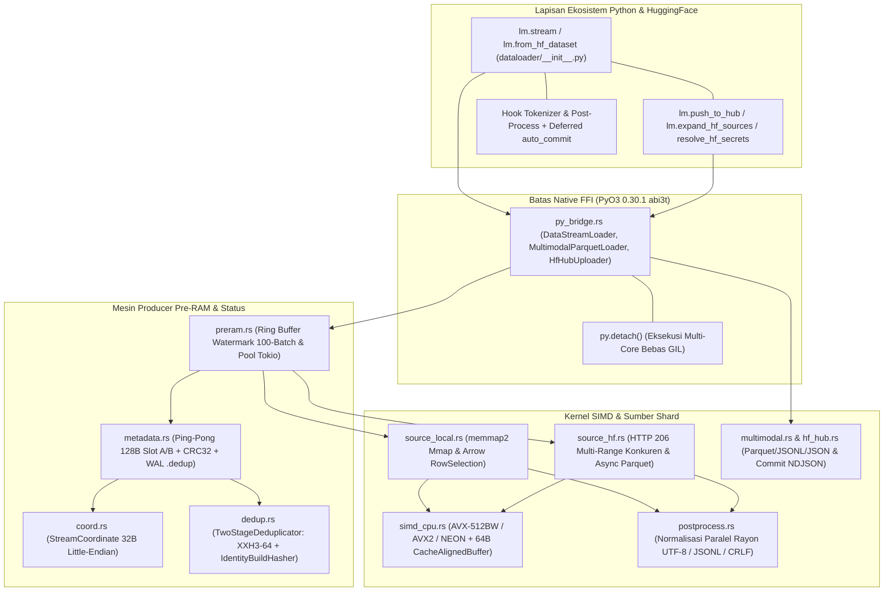

# LuminaMoon DataLoader: Panduan Rekayasa & Arsitektur Developer

Dokumen ini merupakan spesifikasi teknis internal utama bagi *systems engineer*, arsitek pipeline data, dan peneliti yang berkontribusi pada subsistem **LuminaMoon DataLoader (`luminamoon-dataloader`)** di dalam workspace LuminaMoon.

[English Version (README.md)](README.md)

---

## 1. Arsitektur Subsistem & Modularitas

Mesin DataLoader dirancang dengan arsitektur berlapis dan mandiri (*self-contained*): antarmuka ekosistem Python/HuggingFace di lapisan terluar, jembatan FFI bebas-GIL `PyO3 0.30.1` (`abi3t`), serta crate streaming dan komputasi SIMD Rust tingkat rendah (`dataloader/src/`):



---

## 2. Navigasi Direktori & Spesifikasi Teknis

| Modul | Jalur Sumber | Fokus & Invarian Utama | Dokumen Spesifikasi |
| :--- | :--- | :--- | :--- |
| **Koordinat & Dual Metadata** | `dataloader/src/coord.rs`, `metadata.rs` | `StreamCoordinate` 32-byte, checkpoint Ping-Pong 128-byte (`Slot A`/`Slot B`) CRC32, WAL `.dedup` | [01. Coord & Metadata](coord_and_metadata/README.id.md) |
| **Deduplikasi Dua Tahap** | `dataloader/src/dedup.rs` | `TwoStageDeduplicator`, `xxh3_64`, bypass SwissTable `IdentityBuildHasher`, pemisahan staged vs GPU | [02. Deduplication](dedup/README.id.md) |
| **SIMD & Post-Process Paralel** | `dataloader/src/simd_cpu.rs`, `postprocess.rs` | Kernel byte `AVX-512BW` / `AVX2` / `NEON`, `CacheAlignedBuffer`, normalisasi UTF-8/CRLF/JSONL Rayon | [03. SIMD & Post-Process](simd_and_postprocess/README.id.md) |
| **Sumber Lokal & HTTP 206** | `dataloader/src/source_local.rs`, `source_hf.rs` | Zero-copy `memmap2`, lompatan `RowSelection` Arrow, worker HTTP 206 konkuren (`download_workers`) | [04. Sources & Streaming](sources_and_streaming/README.id.md) |
| **Mesin Watermark Pre-RAM** | `dataloader/src/preram.rs` | Ring buffer 100-batch, pemicu isi ulang *low-watermark*, pool Tokio multi-thread, penggabungan lintas-shard | [05. Pre-RAM Engine](preram/README.id.md) |
| **Multimodal & Klien HF Hub** | `dataloader/src/multimodal.rs`, `hf_hub.rs` | `MultimodalValue`, Parquet `struct<bytes, path>`, serializer JSONL/JSON, proteksi token HTTPS, commit NDJSON | [06. Multimodal & HF Hub](multimodal_and_hf_hub/README.id.md) |
| **Jembatan FFI & Runtime Python** | `dataloader/src/py_bridge.rs`, `python/luminamoon/dataloader/` | Binding `abi3t`, `py.detach()`, `lm.stream`, `lm.from_hf_dataset`, `lm.push_to_hub`, `auto_commit` tertunda | [07. Python FFI & Runtime](python_ffi_and_runtime/README.id.md) |

---

## 3. Invarian Pengembang & Standar Rekayasa

1. **Memori Lokal Zero-Copy & Resume Deterministik $O(1)$**:
   - Shard `.jsonl` dan `.txt` lokal dipetakan langsung melalui halaman memori virtual OS (`memmap2::Mmap`), sedangkan shard `.parquet` lokal maupun remote melewati baris yang telah di-commit dalam waktu $O(1)$ melalui `RowSelection` Apache Arrow tanpa mendekode halaman yang dilewati.
2. **Dual Metadata Tahan-Crash & Deduplikasi Dua Tahap**:
   - Batch yang di-*prefetch* ke dalam ring buffer Pre-RAM hanya memperbarui `in_flight_coord` dan `staged_lookup`. Status disk persisten (`Slot A` / `Slot B` dengan IEEE CRC32 serta *write-ahead log* `.dedup`) hanya dimutasi ketika `commit_gpu_batch(batch_id)` dipanggil.
3. **Isolasi SIMD Mandiri (Self-Contained)**:
   - `luminamoon-dataloader` memiliki kernel `AVX-512BW`, `AVX2`, `NEON`, dan `Scalar` tersendiri di dalam `simd_cpu.rs` (di-cache via `OnceLock<CpuIsa>`) tanpa ketergantungan silang terhadap crate `optimizer`.
4. **Keamanan Transportasi & Redaksi Kredensial**:
   - `HfCredentials` menyensor token pada implementasi `fmt::Debug` (`[REDACTED]`) dan menegakkan validasi transportasi HTTPS (`validate_url_security`), menolak pengiriman header `Authorization: Bearer` melalui koneksi HTTP teks biasa non-loopback.
5. **Pembebasan GIL (`py.detach()`)**:
   - Seluruh operasi I/O jaringan Tokio multi-thread, serialisasi Parquet/JSONL, hashing `xxh3_64`, dan normalisasi string Rayon wajib dieksekusi di dalam blok `py.detach()`, menjamin konkurensi penuh pada CPython 3.10–3.15+ (`abi3` dan `abi3t`).

---

## 4. Instruksi Kompilasi & Verifikasi Lokal

```bash
# Jalankan analisis statis tanpa warning pada seluruh workspace Rust
cargo clippy --workspace --all-targets -- -D warnings

# Kompilasi ekstensi biner rilis secara lokal
maturin develop --release

# Jalankan seluruh 15 pengujian unit dan integrasi Rust DataLoader
cargo test --release -p luminamoon-dataloader

# Jalankan pemeriksaan tipe statis Python (0 error, 0 warning)
npx pyright python/luminamoon

# Jalankan suite verifikasi end-to-end Python DataLoader, Multimodal, dan HuggingFace
python -B dataloader/tests/test_dataloader_python.py
```
