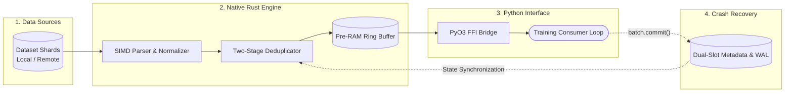

# LuminaMoon DataLoader: Developer Architecture & Engineering Guide

This portal serves as the primary internal technical specification for systems engineers, data pipeline architects, and researchers contributing to the **LuminaMoon DataLoader (`luminamoon-dataloader`)** subsystem within the LuminaMoon workspace.

[Versi Bahasa Indonesia (README.id.md)](README.id.md)

---

## 1. Subsystem Architecture & Modularity

The DataLoader engine is structured as a layered, self-contained system consisting of a high-level Python/HuggingFace ecosystem interface, a GIL-free `PyO3 0.30.1` (`abi3t`) FFI bridge, and a low-level Rust streaming and SIMD compute crate (`dataloader/src/`):



---

## 2. Directory Navigation & Technical Specs

| Module | Source Path | Focus & Core Invariants | Spec Document |
| :--- | :--- | :--- | :--- |
| **Coordinates & Dual Metadata** | `dataloader/src/coord.rs`, `metadata.rs` | 32-byte `StreamCoordinate`, 128-byte Ping-Pong (`Slot A`/`Slot B`) CRC32 checkpoint, `.dedup` WAL | [01. Coord & Metadata](coord_and_metadata/README.md) |
| **Two-Stage Deduplication** | `dataloader/src/dedup.rs` | `TwoStageDeduplicator`, `xxh3_64`, `IdentityBuildHasher` SwissTable bypass, staged vs GPU-committed | [02. Deduplication](dedup/README.md) |
| **SIMD & Parallel Post-Process** | `dataloader/src/simd_cpu.rs`, `postprocess.rs` | `AVX-512BW` / `AVX2` / `NEON` byte kernels, `CacheAlignedBuffer`, Rayon UTF-8/CRLF/JSONL filtering | [03. SIMD & Post-Process](simd_and_postprocess/README.md) |
| **Local & HTTP 206 Sources** | `dataloader/src/source_local.rs`, `source_hf.rs` | Zero-copy `memmap2`, Arrow `RowSelection` skipping, concurrent HTTP 206 range workers (`download_workers`) | [04. Sources & Streaming](sources_and_streaming/README.md) |
| **Pre-RAM Watermark Engine** | `dataloader/src/preram.rs` | 100-batch ring buffer, low-watermark refill trigger, multi-threaded Tokio producer pool, shard coalescing | [05. Pre-RAM Engine](preram/README.md) |
| **Multimodal & HF Hub Client** | `dataloader/src/multimodal.rs`, `hf_hub.rs` | `MultimodalValue`, Parquet `struct<bytes, path>`, JSONL/JSON serializers, HTTPS token guard, NDJSON upload | [06. Multimodal & HF Hub](multimodal_and_hf_hub/README.md) |
| **Python FFI & HF Runtime** | `dataloader/src/py_bridge.rs`, `python/luminamoon/dataloader/` | `abi3t` bindings, `py.detach()`, `lm.stream`, `lm.from_hf_dataset`, `lm.push_to_hub`, deferred `auto_commit` | [07. Python FFI & Runtime](python_ffi_and_runtime/README.md) |

---

## 3. Developer Invariants & Coding Standards

1. **Zero-Copy Local Memory & $O(1)$ Deterministic Resume**:
   - Local `.jsonl` and `.txt` shards are mapped directly via OS virtual memory pages (`memmap2::Mmap`), while local and remote `.parquet` shards skip already-committed rows in $O(1)$ via Apache Arrow `RowSelection` without decoding skipped pages.
2. **Crash-Safe Dual Metadata & Two-Stage Deduplication**:
   - Batches prefetched into the Pre-RAM ring buffer only mutate `in_flight_coord` and `staged_lookup`. Persistent disk state (`Slot A` / `Slot B` with IEEE CRC32 and the append-only `.dedup` write-ahead log) is updated strictly when `commit_gpu_batch(batch_id)` is invoked.
3. **Self-Contained SIMD Isolation**:
   - `luminamoon-dataloader` maintains its own hardware-probed `AVX-512BW`, `AVX2`, `NEON`, and `Scalar` kernels in `simd_cpu.rs` (cached via `OnceLock<CpuIsa>`) with zero cross-crate coupling to `optimizer`.
4. **Transport Security & Credential Redaction**:
   - `HfCredentials` redacts tokens in `fmt::Debug` (`[REDACTED]`) and enforces an unconditional HTTPS transport guard (`validate_url_security`), refusing to transmit `Authorization: Bearer` headers over non-loopback plaintext HTTP.
5. **GIL Liberation (`py.detach()`)**:
   - All multi-threaded Tokio network I/O, Parquet/JSONL serialization, `xxh3_64` hashing, and Rayon string normalization execute inside `py.detach()`, ensuring zero GIL contention on CPython 3.10–3.15+ (`abi3` and `abi3t`).

---

## 4. Local Build & Test Verification

```bash
# Enforce zero-warning static analysis across the Rust workspace
cargo clippy --workspace --all-targets -- -D warnings

# Build release extension locally
maturin develop --release

# Run all 15 Rust DataLoader unit and integration tests
cargo test --release -p luminamoon-dataloader

# Run Python static type check (0 errors, 0 warnings)
npx pyright python/luminamoon

# Run end-to-end Python DataLoader, Multimodal, and HuggingFace pipeline verification suite
python -B dataloader/tests/test_dataloader_python.py
```
