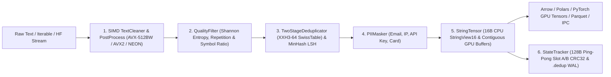

# LuminaMoon Data Engine: Developer Architecture & Engineering Guide

This portal serves as the primary internal technical specification for systems engineers, data pipeline architects, and researchers contributing to the **LuminaMoon Data Engine (`luminamoon.data` / `luminamoon-dataloader`)** subsystem within the LuminaMoon workspace.

---

## 1. Subsystem Architecture & Modularity

The Data Engine is structured as a layered, self-contained system consisting of a modular Python interface (`python/luminamoon/data/` with pure-Python `fallbacks/`), a GIL-free `PyO3 0.30.1` (`abi3t`) FFI bridge (`data/src/py_bridge.rs`), and a low-level Rust SIMD, deduplication, and columnar compute crate (`data/src/`):



---

## 2. Directory Navigation & Technical Specs

| Module | Source Path | Focus & Core Invariants | Spec Document |
| :--- | :--- | :--- | :--- |
| **Coordinates, Constants & Dual Metadata** | `data/src/constants.rs`, `error.rs`, `coord.rs`, `metadata.rs` | 32-byte `StreamCoordinate`, 128-byte Ping-Pong (`Slot A`/`Slot B`) CRC32 checkpoint, `.dedup` WAL, Damerau-Levenshtein suggestions | [01. Coord & Metadata](coord_and_metadata/README.md) |
| **Two-Stage XXH3-64 Deduplication** | `data/src/dedup.rs` | `TwoStageDeduplicator`, `xxh3_64`, `IdentityBuildHasher` SwissTable bypass, staged vs committed sets | [02. Deduplication](dedup/README.md) |
| **SIMD & Parallel Post-Process** | `data/src/simd_cpu.rs`, `postprocess.rs` | `AVX-512BW` / `AVX2` / `NEON` byte kernels, `CacheAlignedBuffer`, Rayon UTF-8/CRLF/JSON dotted-path extraction | [03. SIMD & Post-Process](simd_and_postprocess/README.md) |
| **Heuristic Quality & MinHash LSH** | `data/src/quality.rs`, `minhash.rs` | Shannon character entropy, n-gram repetition ratio, symbol ratio, and 64-permutation MinHash Jaccard similarity | [04. Quality & MinHash](sources_and_streaming/README.md) |
| **Dual-Layout `StringTensor` & Adapters** | `data/src/string_tensor.rs`, `python/luminamoon/data/adapters.py` | 16-byte Umbra `StringView16` (<=12B inline), GPU contiguous `uint32` offsets + `uint8` payload, `ResumablePipeline` async prefetch | [05. StringTensor & Adapters](preram/README.md) |
| **Columnar Serialization Engine** | `data/src/serialize.rs`, `python/luminamoon/data/serialization.py` | `DataValue` enum, ZSTD Parquet (`hf_image_struct`), Apache Arrow IPC (`ARROW1`), and NDJSON | [06. Serialization](multimodal_and_hf_hub/README.md) |
| **Python FFI & Modular Runtime** | `data/src/py_bridge.rs`, `python/luminamoon/data/` | `abi3t` bindings, `FusedPipeline`, `TextCleaner`, `PIIMasker`, `StateTracker`, and `fallbacks/` | [07. Python FFI & Runtime](python_ffi_and_runtime/README.md) |

---

## 3. Developer Invariants & Coding Standards

1. **Dual-Layout Zero-Copy String Representation (`StringTensor`)**:
   - CPU operations leverage a 16-byte `StringView16` struct (inlining strings $\le 12$ bytes directly inside the view and comparing 4-byte prefixes in a single register), while GPU/Arrow exports emit contiguous `uint32` offset and `uint8` UTF-8 payload buffers.
2. **Crash-Safe Dual Metadata & Two-Stage Deduplication**:
   - In-flight batches staged via `StateTracker.update()` and `StreamDeduplicator.filter_batch()` only mutate RAM state. Persistent disk state (`Slot A` / `Slot B` protected by IEEE CRC32 and the `.dedup` WAL) is updated strictly when `.commit()` is invoked.
3. **Self-Contained SIMD Isolation**:
   - `luminamoon-dataloader` maintains its own hardware-probed `AVX-512BW`, `AVX2`, `NEON`, and `Scalar` kernels in `simd_cpu.rs` (cached via `OnceLock<CpuIsa>`) with zero cross-crate coupling to `optimizer`.
4. **GIL Liberation (`py.detach()`)**:
   - All multi-threaded Rayon batch cleaning, quality evaluation, `xxh3_64` hashing, `FusedPipeline` execution, and Parquet/Arrow IPC/JSONL serialization execute inside `py.detach()`, ensuring zero GIL contention on CPython 3.10–3.15+ (`abi3` and `abi3t`).

---

## 4. Local Build & Test Verification

```bash
# Enforce zero-warning static analysis across the Rust workspace
cargo clippy --workspace --all-targets -- -D warnings

# Build release extension locally
maturin develop --release

# Run all Rust DataLoader unit and integration tests
cargo test -p luminamoon-dataloader

# Run Python static type check (0 errors, 0 warnings)
npx pyright python/luminamoon

# Run end-to-end Python Data Engine & StringTensor verification suites
python -B tests/test_data_modular.py
python -B tests/test_gpu_vs_cpu_strings.py
```
