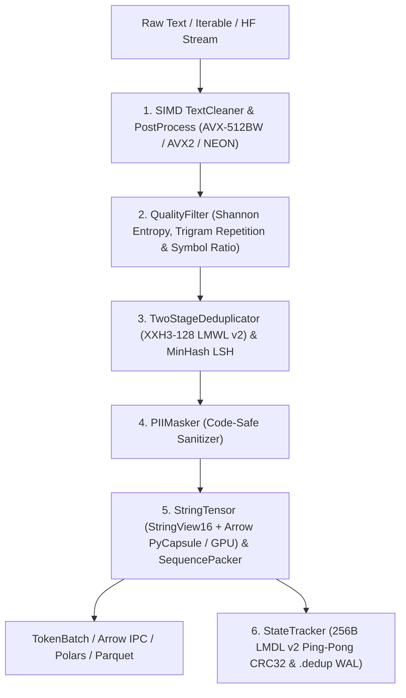

# LuminaMoon Data Engine Architecture

Technical architecture and module reference for the **LuminaMoon Data Engine (`luminamoon.data` / `luminamoon-dataloader`)**.

---

## 1. Subsystem Architecture & Modularity

The Data Engine consists of a modular Python interface (`python/luminamoon/data/` with pure-Python `fallbacks/`), a `PyO3 0.30.1` (`abi3t`) FFI bridge (`data/src/py_bridge/`), and a Rust SIMD, deduplication, and columnar processing crate (`data/src/`):



---

## 2. Directory Navigation & Technical Specs

| Module | Source Path | Focus & Core Invariants | Spec Document |
| :--- | :--- | :--- | :--- |
| **Coordinates, Constants & Dual Metadata** | `data/src/constants.rs`, `error.rs`, `coord.rs`, `metadata.rs` | 32-byte `StreamCoordinate`, 256-byte `LMDL v2` Ping-Pong (`Slot A`/`Slot B`) CRC32 checkpoint, `LMWL v2` WAL, Damerau-Levenshtein suggestions | [01. Coord & Metadata](coord_and_metadata/README.md) |
| **Two-Stage XXH3-128 Deduplication** | `data/src/dedup.rs` | `TwoStageDeduplicator`, `xxh3_128`, `IdentityBuildHasher` SwissTable, staged vs committed sets, `O(delta)` WAL | [02. Deduplication](dedup/README.md) |
| **SIMD & Parallel Post-Process** | `data/src/simd_cpu.rs`, `postprocess.rs` | `AVX-512BW` / `AVX2` / `NEON` byte kernels, Rayon UTF-8/CRLF/JSON dotted-path extraction | [03. SIMD & Post-Process](simd_and_postprocess/README.md) |
| **Heuristic Quality & MinHash LSH** | `data/src/quality.rs`, `minhash.rs` | Shannon character entropy, trigram repetition ratio, symbol ratio, and double-hashed MinHash LSH (adapted from Kirsch-Mitzenmacher) | [04. Quality & MinHash](sources_and_streaming/README.md) |
| **StringTensor, Packing & Streaming Pipelines** | `data/src/string_tensor.rs`, `python/luminamoon/data/{loader,_sources,packing,collate,pipeline,ring_buffer}.py` | 16-byte `StringView16` + Arrow PyCapsule (`__arrow_c_array__`), `DataPipeline`, `TokenBatch`, `SequencePacker`, `ResumablePipeline`, `TokenRingBuffer` | [05. StringTensor & Pipelines](preram/README.md) |
| **Columnar Serialization Engine** | `data/src/serialize.rs`, `python/luminamoon/data/serialization.py` | `DataValue` enum, 64-bit `LargeUtf8`/`LargeBinary` ZSTD Parquet (`hf_image_struct`), Apache Arrow IPC (`ARROW1`), and NDJSON | [06. Serialization](multimodal_and_hf_hub/README.md) |
| **Python FFI & Modular Runtime** | `data/src/py_bridge/`, `python/luminamoon/data/` | `abi3t` bindings, `DataPipeline`, `FusedPipeline`, `TextCleaner`, `PIIMasker`, `StateTracker`, and `fallbacks/` | [07. Python FFI & Runtime](python_ffi_and_runtime/README.md) |

---

## 3. Developer Invariants & Coding Standards

1. **Dual-Layout String Representation (`StringTensor`)**:
    - CPU operations use a 16-byte Arrow `Utf8View`-aligned `StringView16` struct (storing strings $\le 12$ bytes inline and comparing 4-byte prefixes in a register), while Arrow/Polars exports use `__arrow_c_array__` PyCapsules and GPU exports emit contiguous offset (`uint32` in Rust/NumPy, `torch.int32` in PyTorch) + `uint8` UTF-8 payload buffers.
2. **Dual-Slot Metadata & Two-Stage Deduplication**:
    - In-flight batches staged via `StateTracker.update()` and `StreamDeduplicator.filter_batch()` update in-memory state first. On-disk state (256B `LMDL v2` `Slot A` / `Slot B` protected by IEEE CRC32 and `O(delta)` `LMWL v2` `.dedup` WAL) is written when `.commit()` is called.
3. **Self-Contained SIMD Module**:
    - `luminamoon-dataloader` maintains its own `AVX-512BW`, `AVX2`, `NEON`, and `Scalar` kernels in `simd_cpu.rs` (cached via `OnceLock<CpuIsa>`) independent of the `optimizer` crates.
4. **GIL Release (`py.detach()`)**:
    - Multi-threaded Rayon batch cleaning, quality filtering, `xxh3_128` hashing, `FusedPipeline` execution, and Parquet/Arrow IPC/JSONL serialization execute inside `py.detach()` on CPython 3.10–3.15+ (`abi3` and `abi3t`).

---

## 4. Local Build & Test Verification

```bash
# Run static analysis across the Rust workspace
cargo clippy --workspace --all-targets -- -D warnings

# Build release extension locally
maturin develop --release

# Run Rust DataLoader unit and integration tests
cargo test -p luminamoon-dataloader

# Run Python static type check
npx pyright python/luminamoon

# Run Python Data Engine & StringTensor tests
pytest -q tests/test_data_core_v2.py tests/test_data_fallbacks_modular.py tests/test_data_pipeline_v2.py tests/test_data_v2_unified.py
python -B tests/test_gpu_vs_cpu_strings.py
```
