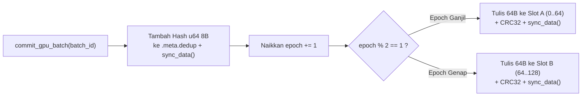

# `coord.rs` & `metadata.rs`: Koordinat Stream $O(1)$ & Pemulihan Crash Ping-Pong

[`dataloader/src/coord.rs`](../../../dataloader/src/coord.rs) dan [`dataloader/src/metadata.rs`](../../../dataloader/src/metadata.rs) mendefinisikan representasi koordinat deterministik dan mesin checkpoint dua-slot atomik yang memungkinkan proses *resume* dataset secara instan dalam kompleksitas $O(1)$ tanpa membaca ulang atau menghitung ulang hash pada shard historis.

[English Version (README.md)](README.md)

---

## 1. Tata Letak Biner `StreamCoordinate` 32-Byte (`src/coord.rs`)

Setiap posisi pembacaan di seluruh shard `.jsonl`, `.txt`, maupun `.parquet` direpresentasikan secara presisi oleh struktur 32-byte *little-endian* berukuran tetap:

| Offset Byte | Field | Tipe Rust | Lebar | Deskripsi |
| :--- | :--- | :--- | :--- | :--- |
| `0..4` | `shard_id` | `u32` | 4 B | Indeks shard aktif di dalam daftar URI sumber data. |
| `4..12` | `byte_offset` | `u64` | 8 B | Offset byte eksak untuk stream `mmap` `.jsonl` / `.txt` atau HTTP 206 Range. |
| `12..16` | `row_group_idx` | `u32` | 4 B | Indeks Row Group Parquet yang sedang aktif. |
| `16..20` | `page_idx` | `u32` | 4 B | Indeks halaman di dalam Row Group. |
| `20..24` | `row_offset_in_page` | `u32` | 4 B | Offset baris eksak di dalam Row Group Parquet aktif (`RowSelector::skip`). |
| `24..32` | `global_row_idx` | `u64` | 8 B | Akumulasi jumlah baris mentah yang telah dipindai lintas seluruh shard. |

```rust
#[derive(Debug, Clone, Copy, PartialEq, Eq, Default)]
pub struct StreamCoordinate {
    pub shard_id: u32,
    pub byte_offset: u64,
    pub row_group_idx: u32,
    pub page_idx: u32,
    pub row_offset_in_page: u32,
    pub global_row_idx: u64,
}
```

---

## 2. Berkas Checkpoint Ping-Pong 128-Byte (`src/metadata.rs`)

Untuk mencegah kerusakan berkas checkpoint apabila terjadi kegagalan daya atau *preemption* node GPU di tengah penulisan disk, `DualMetadataManager` mengelola berkas `.meta` berukuran tetap 128-byte yang terbagi menjadi dua slot 64-byte (`Slot A` pada offset `0..64` dan `Slot B` pada offset `64..128`):



### Format Biner `DiskSlot` 64-Byte

| Rentang Byte | Field | Tipe | Deskripsi |
| :--- | :--- | :--- | :--- |
| `0..4` | `SLOT_MAGIC` | `[u8; 4]` | Header magic konstan `*b"LMDL"`. |
| `4..8` | `SLOT_VERSION` | `u32` | Versi format slot (`1`). |
| `8..16` | `epoch` | `u64` | Nomor urut komit yang selalu bertambah secara monotonik. |
| `16..24` | `committed_batch_id` | `u64` | ID batch terakhir yang telah dikonfirmasi selesai diproses oleh step GPU. |
| `24..56` | `coord` | `[u8; 32]` | `StreamCoordinate` terenkode tepat setelah batch yang di-commit. |
| `56..60` | `dedup_count` | `u32` | Jumlah total hash `xxh3_64` 8-byte yang sah di dalam berkas `.meta.dedup`. |
| `60..64` | `crc32` | `u32` | Checksum IEEE CRC32 terakselerasi hardware (`crc32fast`) atas byte `0..60`. |

---

## 3. Invarian Pemulihan & Pemangkasan WAL

Saat `DualMetadataManager::open(meta_path)` dijalankan:
1. `Slot A` dan `Slot B` didekode dan diverifikasi terhadap `SLOT_MAGIC`, `SLOT_VERSION`, serta checksum IEEE CRC32 32-bit.
2. Apabila kedua slot valid, slot dengan nilai `epoch` tertinggi dipilih sebagai status aktif:
   $$\text{Slot}_{\text{active}} = \arg\max_{S \in \{A, B\}} S.\text{epoch}$$
3. Apabila salah satu slot mengalami penulisan parsial (*torn write*) saat crash, verifikasi CRC32 pada slot tersebut gagal dan sistem otomatis beralih ke slot pasangan yang utuh.
4. Berkas pendamping `.meta.dedup` dipangkas (*truncate*) tepat sepanjang $\text{dedup}_{\text{count}} \times 8$ byte (`dedup_file.set_len(valid_dedup_bytes)`), membuang sisa hash yang belum ter-commit sebelum membangun ulang `TwoStageDeduplicator::with_committed`.
