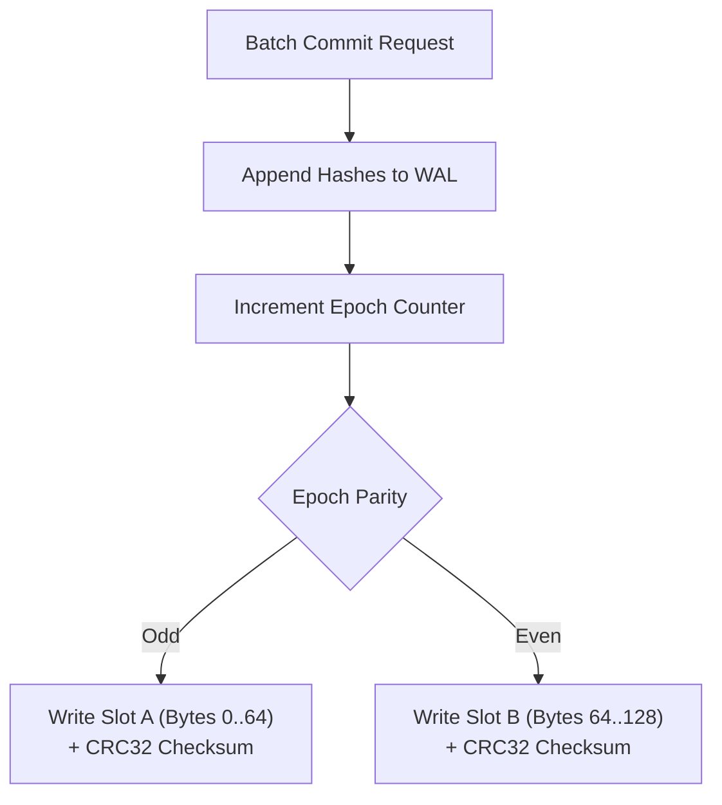

# `coord.rs` & `metadata.rs`: $O(1)$ Stream Coordinates & Ping-Pong Crash Recovery

[`dataloader/src/coord.rs`](../../../dataloader/src/coord.rs) and [`dataloader/src/metadata.rs`](../../../dataloader/src/metadata.rs) define the deterministic coordinate representation and atomic dual-slot checkpointing engine that enable instant $O(1)$ dataset resume without re-reading or re-hashing historical shards.

[Versi Bahasa Indonesia (README.id.md)](README.id.md)

---

## 1. 32-Byte `StreamCoordinate` Binary Layout (`src/coord.rs`)

Every position across a multi-shard `.jsonl`, `.txt`, or `.parquet` stream is uniquely addressed by a fixed 32-byte little-endian struct:

| Byte Offset | Field | Rust Type | Width | Description |
| :--- | :--- | :--- | :--- | :--- |
| `0..4` | `shard_id` | `u32` | 4 B | Active index in the expanded shard URI list. |
| `4..12` | `byte_offset` | `u64` | 8 B | Exact byte offset for `.jsonl` / `.txt` `mmap` or HTTP 206 Range streams. |
| `12..16` | `row_group_idx` | `u32` | 4 B | Active Parquet Row Group index. |
| `16..20` | `page_idx` | `u32` | 4 B | Reserved page index within the Row Group. |
| `20..24` | `row_offset_in_page` | `u32` | 4 B | Exact row offset within the active Parquet Row Group (`RowSelector::skip`). |
| `24..32` | `global_row_idx` | `u64` | 8 B | Cumulative number of raw records scanned across all shards. |

```rust
#[derive(Debug, Clone, Copy, PartialEq, Eq, Default)]
pub struct StreamCoordinate {
    pub shard_id: u32,
    pub byte_offset: u64,
    pub row_group_idx: u32,
    pub page_idx: u32,
    pub row_offset_in_page: u32,
    pub global_row_idx: u64,
}
```

---

## 2. 128-Byte Ping-Pong Checkpoint File (`src/metadata.rs`)

To prevent corrupted checkpoints if power is lost or a GPU node is preempted mid-write, `DualMetadataManager` maintains a fixed 128-byte `.meta` file divided into two 64-byte slots (`Slot A` at offset `0..64` and `Slot B` at offset `64..128`):



### 64-Byte `DiskSlot` Wire Format

| Byte Range | Field | Type | Description |
| :--- | :--- | :--- | :--- |
| `0..4` | `SLOT_MAGIC` | `[u8; 4]` | Constant magic header `*b"LMDL"`. |
| `4..8` | `SLOT_VERSION` | `u32` | Format version (`1`). |
| `8..16` | `epoch` | `u64` | Monotonically increasing commit sequence number. |
| `16..24` | `committed_batch_id` | `u64` | Last batch ID confirmed consumed by the GPU training step. |
| `24..56` | `coord` | `[u8; 32]` | Encoded `StreamCoordinate` immediately following the committed batch. |
| `56..60` | `dedup_count` | `u32` | Total number of committed 8-byte `xxh3_64` hashes valid in `.meta.dedup`. |
| `60..64` | `crc32` | `u32` | Hardware-accelerated IEEE CRC32 (`crc32fast`) over bytes `0..60`. |

---

## 3. Recovery & Truncation Invariants

When `DualMetadataManager::open(meta_path)` initializes:
1. Both `Slot A` and `Slot B` are decoded and verified against `SLOT_MAGIC`, `SLOT_VERSION`, and their 32-bit IEEE CRC32 checksum.
2. If both slots are valid, the slot with the higher `epoch` is selected:
   $$\text{Slot}_{\text{active}} = \arg\max_{S \in \{A, B\}} S.\text{epoch}$$
3. If one slot was torn during a system crash, its CRC32 check fails and the manager falls back to the intact partner slot.
4. The companion `.meta.dedup` write-ahead log is truncated to exactly $\text{dedup}_{\text{count}} \times 8$ bytes (`dedup_file.set_len(valid_dedup_bytes)`), discarding any uncommitted partial hash appends before reconstructing `TwoStageDeduplicator::with_committed`.
