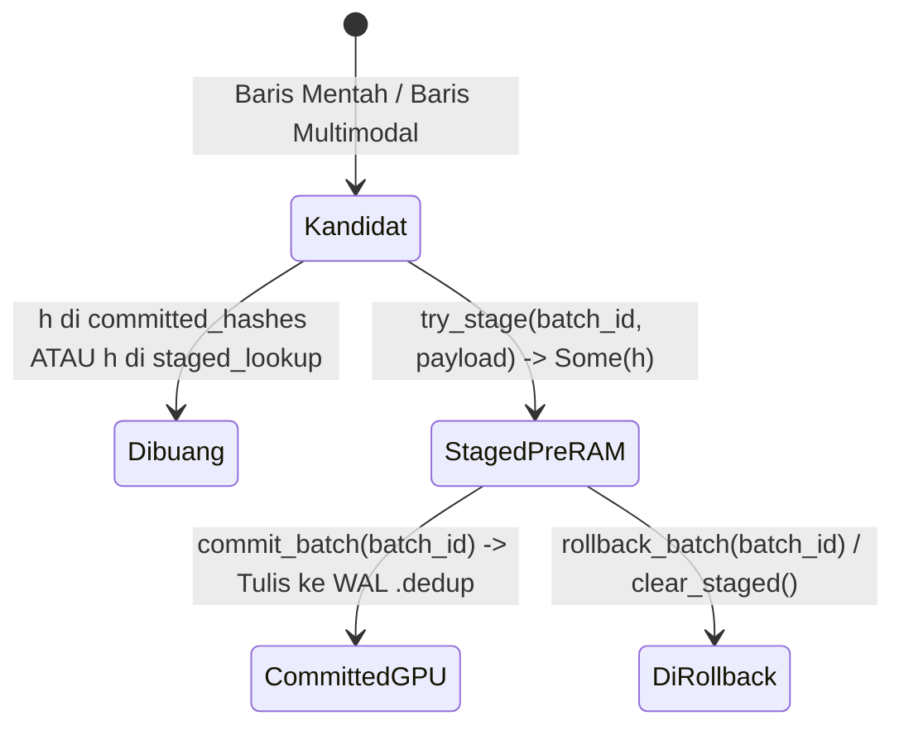

# `dedup.rs`: Deduplikasi Dua Tahap XXH3-64 & Identity SwissTable

[`dataloader/src/dedup.rs`](../../../dataloader/src/dedup.rs) mengimplementasikan mesin deduplikasi streaming eksak yang tahan-crash (*crash-safe*) dengan memisahkan rekaman yang sedang di-*prefetch* di dalam ring buffer Pre-RAM dari rekaman yang telah di-commit secara permanen oleh loop pelatihan GPU.

[English Version (README.md)](README.md)

---

## 1. Mesin Status Dua Tahap (`TwoStageDeduplicator`)

Pada arsitektur *producer-consumer* asinkron, hingga 100 batch dapat berada di dalam antrean RAM mendahului step GPU yang sedang berjalan. Jika deduplikator hanya menggunakan satu himpunan hash yang langsung menandai data saat *prefetch* dan proses mengalami crash sebelum GPU memproses batch tersebut, proses *resume* berikutnya akan kehilangan sinkronisasi status deduplikasi.

`TwoStageDeduplicator` mengatasi masalah ini dengan mempartisi ruang hash ke dalam dua himpunan terpisah:

$$\mathcal{H}_{\text{committed}} \cap \mathcal{H}_{\text{staged}} = \emptyset$$



### Operasi Inti

1. **`try_stage(batch_id, payload) -> Option<u64>`**:
   - Menghitung nilai digest $h = \text{XXH3}_{64}(\text{payload})$.
   - Menolak baris (`None`) apabila $h \in \text{committed}_{\text{hashes}} \cup \text{staged}_{\text{lookup}}$.
   - Jika unik, memasukkan $h$ ke dalam `staged_lookup` serta mencatatnya pada daftar `staged_batches[batch_id]`.
2. **`commit_batch(batch_id) -> Vec<u64>`**:
   - Mempromosikan seluruh hash pada `staged_batches[batch_id]` secara atomik dari `staged_lookup` menuju `committed_hashes`, lalu mengembalikan vektor hash tersebut untuk ditulis ke berkas `.meta.dedup`.
3. **`rollback_batch(batch_id)` & `clear_staged()`**:
   - Menghapus hash batch yang belum ter-commit dari `staged_lookup` tanpa menyentuh `committed_hashes`, mengembalikan paritas status tepat ke step GPU terakhir yang sah.

---

## 2. SwissTable Bebas Re-Hash (`IdentityBuildHasher`)

Karena setiap kunci `u64` yang disimpan di dalam `committed_hashes` dan `staged_lookup` sudah merupakan hasil digest 64-bit `xxh3_64` yang terdistribusi merata (entropi tinggi), menjalankan algoritma hash bawaan `hashbrown` (`foldhash`) di atas kunci `u64` tersebut akan membuang siklus CPU secara percuma.

`dedup.rs` mendefinisikan `IdentityHasher` yang meneruskan nilai 64-bit `xxh3_64` secara langsung ke mekanisme *control-byte probe* SIMD SwissTable (`h1` / `h2`):

```rust
#[derive(Default)]
pub struct IdentityHasher(u64);

impl Hasher for IdentityHasher {
    #[inline]
    fn finish(&self) -> u64 {
        self.0
    }

    #[inline]
    fn write_u64(&mut self, i: u64) {
        self.0 = i;
    }
}

pub type IdentityBuildHasher = BuildHasherDefault<IdentityHasher>;
```

---

## 3. Hashing Baris Multimodal

Untuk aliran data Parquet multimodal (`MultimodalBatch`), nilai hash deduplikasi dihitung di atas rangkaian biner kanonis dari seluruh kolom yang diproyeksikan pada satu baris menggunakan buffer 64-byte selaras cache (`CacheAlignedBuffer`). Setiap kolom diawali dengan tag tipe varian (`0` = `Null`, `1` = `Text`, `2` = `Bytes`, `3` = `Json`, `4` = `Int`, `5` = `Float`, `6` = `Bool`) beserta panjang byte *little-endian* untuk mencegah kolisi batas antar-kolom.
