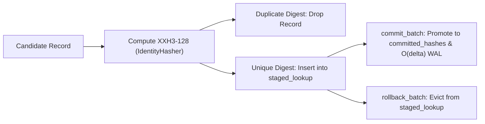

# Two-Stage XXH3-128 Deduplication & Identity SwissTable

[`data/src/dedup.rs`](https://github.com/cloverx-id/luminamoon/blob/main/data/src/dedup.rs) provides a two-stage streaming deduplicator that separates prefetched records from records committed by training steps.

---

## 1. Two-Stage State Machine (`TwoStageDeduplicator`)

In asynchronous pipelines, multiple batches can be staged in memory ahead of the active training step. If a single set marked hashes as seen upon prefetch and the process stopped before training consumed them, resuming would either skip unread samples or lose deduplication consistency.

`TwoStageDeduplicator` avoids this by partitioning tracked 128-bit hashes into two disjoint sets:

$$
\mathcal{H} _ {\text{committed}} \cap \mathcal{H} _ {\text{staged}} = \emptyset
$$

### Core Operations

1. **`try_stage(batch_id, payload) -> Option<u128>`**:
    - Computes $h = \text{XXH3} _ {128}(\text{payload})$.
    - Rejects the record (`None`) if $h \in \text{committed} _ {\text{hashes}} \cup \text{staged} _ {\text{lookup}}$.
    - Otherwise inserts $h$ into `staged_lookup` and appends $h$ to `staged_batches[batch_id]`.
2. **`commit_batch(batch_id) -> Vec<u128>`**:
    - Atomically promotes all hashes in `staged_batches[batch_id]` from `staged_lookup` into `committed_hashes` and returns the delta vector of newly promoted hashes for $O(\Delta)$ append-only flushing to the `LMWL v2` `.dedup` WAL.
3. **`rollback_batch(batch_id)` & `clear_staged()`**:
    - Evicts uncommitted batch hashes from `staged_lookup` without touching `committed_hashes`, restoring state parity with the last committed step.

### WAL Format Isolation (`LMWL` vs `LMWP`)
- Native Rust `StreamDeduplicator` writes `LMWL` v2 WAL files (16-byte `XXH3-128` digests, with atomic temp-file + `sync_data` + `rename` on initial creation and $O(\Delta)$ append thereafter).
- Pure-Python fallback `fallbacks/dedup.py` writes `LMWP` v2 WAL files (16-byte `BLAKE2b-128` digests) and raises a clear `ValueError` if asked to load a native `LMWL` file (and vice versa) so incompatible hash algorithms never mix silently.

---

## 2. Zero-Rehash SwissTable (`IdentityBuildHasher`)

Because keys stored in `committed_hashes` and `staged_lookup` are already uniformly distributed 128-bit `xxh3_128` digests, hashing them again with `hashbrown`'s default hasher would waste CPU cycles. `dedup.rs` uses an `IdentityHasher` that folds the 128-bit digest directly into the table probe.

---

## 3. MinHash LSH Near-Duplicate Shingling (`src/minhash.rs`)

For fuzzy near-duplicate rejection alongside exact 128-bit `xxh3_128` deduplication, `MinHashDeduplicator` computes one `xxh3_128` hash per $k$-character shingle, derives $P$ universal permutations via Kirsch-Mitzenmacher double hashing + SplitMix64 mixing, and indexes signatures into auto-tuned LSH bands with Rayon parallel `filter_batch`.
