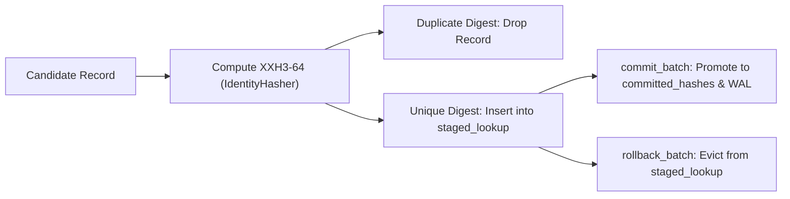

# `dedup.rs`: Two-Stage XXH3-64 Deduplication & Identity SwissTable

[`data/src/dedup.rs`](https://github.com/cloverx-id/luminamoon/blob/main/data/src/dedup.rs) implements an exact, crash-safe streaming deduplicator that separates records prefetched in the Pre-RAM ring buffer from records permanently committed by the GPU training loop.

---

## 1. Two-Stage State Machine (`TwoStageDeduplicator`)

In asynchronous producer-consumer pipelines, up to 100 batches may be staged in RAM ahead of the active GPU step. If a naïve single-set deduplicator marked hashes as seen immediately upon prefetching and the process crashed before the GPU consumed those batches, a subsequent resume would either skip unseen samples or lose deduplication consistency.

`TwoStageDeduplicator` solves this by partitioning state into two disjoint sets:

$$\mathcal{H}_{\text{committed}} \cap \mathcal{H}_{\text{staged}} = \emptyset$$



### Core Operations

1. **`try_stage(batch_id, payload) -> Option<u64>`**:
   - Computes $h = \text{XXH3}_{64}(\text{payload})$.
   - Rejects the record (`None`) if $h \in \text{committed}_{\text{hashes}} \cup \text{staged}_{\text{lookup}}$.
   - Otherwise inserts $h$ into `staged_lookup` and appends $h$ to `staged_batches[batch_id]`.
2. **`commit_batch(batch_id) -> Vec<u64>`**:
   - Atomically promotes all hashes in `staged_batches[batch_id]` from `staged_lookup` into `committed_hashes` and returns the vector of promoted hashes to be flushed to the `.meta.dedup` write-ahead log.
3. **`rollback_batch(batch_id)` & `clear_staged()`**:
   - Evicts uncommitted batch hashes from `staged_lookup` without touching `committed_hashes`, restoring exact state parity with the last committed GPU step.

---

## 2. Zero-Rehash SwissTable (`IdentityBuildHasher`)

Because each key stored in `committed_hashes` and `staged_lookup` is already a uniformly distributed 64-bit `xxh3_64` digest, running `hashbrown`'s default `foldhash` over the `u64` key would waste CPU cycles hashing a hash.

`dedup.rs` defines an `IdentityHasher` that passes the 64-bit `xxh3_64` digest directly to the SwissTable SIMD control-byte probe (`h1` / `h2` split):

```rust
#[derive(Default)]
pub struct IdentityHasher(u64);

impl Hasher for IdentityHasher {
    #[inline]
    fn finish(&self) -> u64 {
        self.0
    }

    #[inline]
    fn write_u64(&mut self, i: u64) {
        self.0 = i;
    }
}

pub type IdentityBuildHasher = BuildHasherDefault<IdentityHasher>;
```

---

## 3. MinHash LSH Near-Duplicate Shingling (`src/minhash.rs`)

For fuzzy near-duplicate rejection alongside exact 64-bit `xxh3_64` deduplication, `MinHashDeduplicator` computes $K$-character UTF-8 shingles hashed across $P$ deterministic permuted `xxh3_64_with_seed` lanes and estimates pairwise Jaccard similarity against indexed document signatures.
