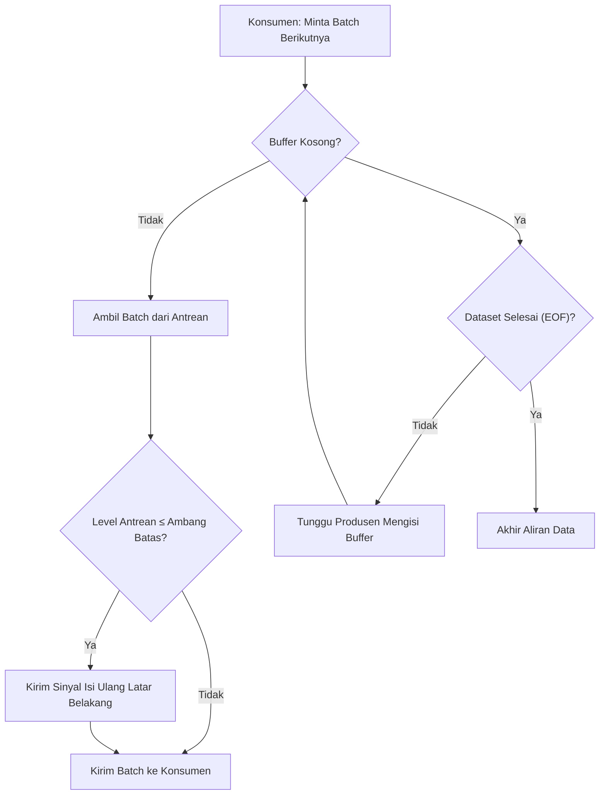

# `preram.rs`: Ring Buffer Watermark 100-Batch & Producer Tokio Multi-Thread

[`dataloader/src/preram.rs`](../../../dataloader/src/preram.rs) mengimplementasikan `PreRamDataLoader`, mesin *prefetch* produsen-konsumen latar belakang yang dirancang untuk melakukan tumpang-tindih (*overlap*) antara operasi I/O jaringan/disk, pemindaian SIMD, dan deduplikasi XXH3-64 dengan proses pelatihan GPU di dalam pool worker Tokio multi-thread.

[English Version (README.md)](README.md)

---

## 1. Mesin Status Ring Buffer Watermark

Secara bawaan, `PreRamConfig` memelihara kapasitas antrean sebesar $C = 100$ batch (`capacity_batches = 100`) dengan ambang pemicu isi ulang $\Delta = 10$ batch (`refill_trigger = 10`), membentuk batas bawah (*low-watermark*):

$$W_{\text{low}} = \max(0, C - \Delta) = 90\text{ batch}$$

---

## 2. Loop Producer Latar Belakang & Penggabungan Lintas-Shard

`PreRamDataLoader::open` melahirkan thread OS khusus (`luminamoon-preram-worker`) yang menjalankan runtime Tokio multi-thread (`worker_threads = config.download_workers`):
1. **Penggabungan Batch Lintas-Shard (Cross-Shard Coalescing)**:
   - Apabila shard aktif mencapai EOF ketika jumlah rekaman yang terkumpul masih kurang dari `batch_size` (misal baru terkumpul 40 rekaman saat `batch_size = 64`), worker secara otomatis memajukan `coord.shard_id += 1`, membuka shard berikutnya, dan mengambil sisa 24 rekaman sehingga konsumen selalu menerima ukuran batch yang utuh lintas batas berkas shard.
2. **Registrasi Staging Pre-RAM**:
   - Sebelum memasukkan `FetchedBatch` ke dalam `queue`, worker mendaftarkan `(batch_id, next_coord)` melalui `DualMetadataManager::stage_batch_in_ram(batch_id, coord)`, memajukan `in_flight_coord` di memori tanpa mengubah slot komit di dalam disk.
3. **Penghentian Bersih (`Drop`)**:
   - Saat `PreRamDataLoader` di-drop atau `.close()` dipanggil dari Python, bendera `shutdown = true` disetel di bawah proteksi `parking_lot::Mutex`, membangunkan `worker_cv` dan menggabungkan (*join*) thread latar belakang secara bersih tanpa kebocoran resource.
