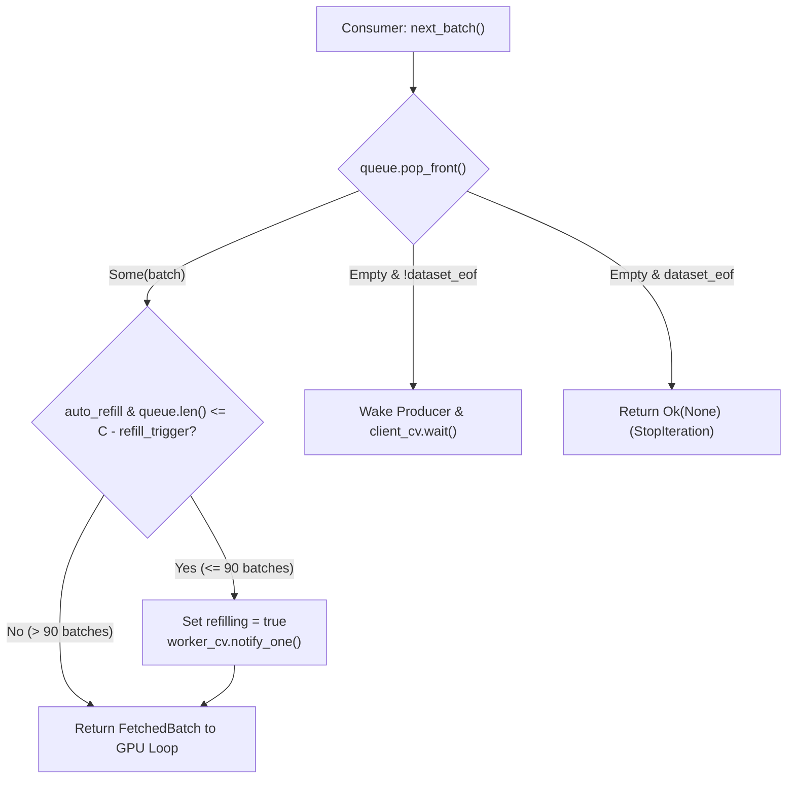

# `preram.rs`: 100-Batch Watermark Ring Buffer & Multi-Threaded Tokio Producer

[`dataloader/src/preram.rs`](../../../dataloader/src/preram.rs) implements `PreRamDataLoader`, a background producer-consumer prefetch engine designed to overlap network/disk I/O, SIMD scanning, and XXH3-64 deduplication with GPU training inside a multi-threaded Tokio worker pool.

[Versi Bahasa Indonesia (README.id.md)](README.id.md)

---

## 1. Watermark Ring Buffer State Machine

By default, `PreRamConfig` maintains a ring buffer capacity of $C = 100$ batches (`capacity_batches = 100`) with a refill delta of $\Delta = 10$ batches (`refill_trigger = 10`), defining a low-watermark threshold:

$$W_{\text{low}} = \max(0, C - \Delta) = 90\text{ batches}$$

---

## 2. Background Producer Loop & Cross-Shard Coalescing

`PreRamDataLoader::open` spawns a dedicated OS thread (`luminamoon-preram-worker`) hosting a multi-threaded Tokio runtime (`worker_threads = config.download_workers`):
1. **Cross-Shard Coalescing**:
   - If the active shard reaches EOF with fewer than `batch_size` records (e.g., 40 records when `batch_size = 64`), the producer automatically advances `coord.shard_id += 1`, opens the next shard in the list, and appends the remaining 24 records so full-sized batches are delivered consistently across shard boundaries without partial batch padding.
2. **Pre-RAM Staging Registration**:
   - Before pushing a completed `FetchedBatch` into `queue`, the worker registers `(batch_id, next_coord)` via `DualMetadataManager::stage_batch_in_ram(batch_id, coord)`, advancing `in_flight_coord` without altering the on-disk committed slot.
3. **Graceful Teardown (`Drop`)**:
   - When `PreRamDataLoader` is dropped or `.close()` is called from Python, `shutdown = true` is signaled under `parking_lot::Mutex`, waking `worker_cv` and joining the worker thread cleanly without leaked background tasks.
