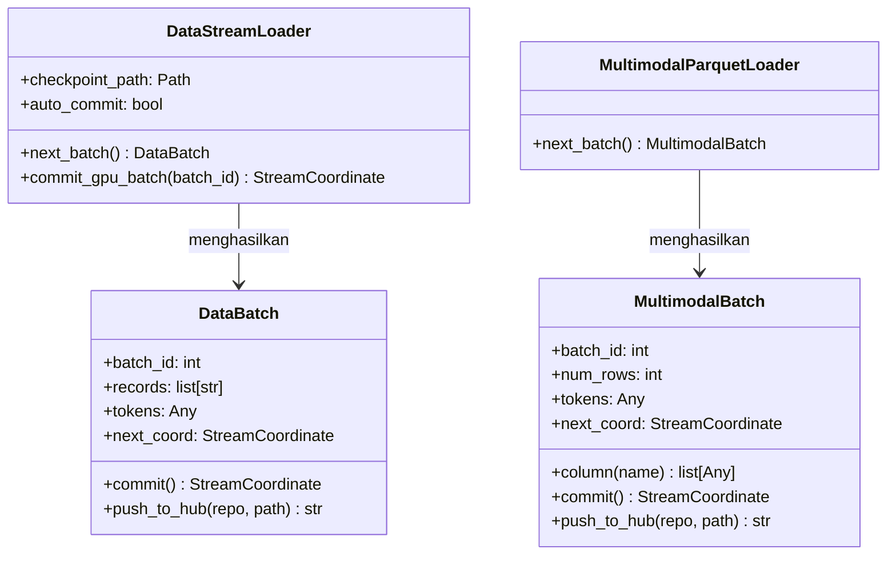

# `py_bridge.rs` & `python/luminamoon/dataloader/`: Jembatan FFI PyO3 `abi3t` & Pipeline HuggingFace

[`dataloader/src/py_bridge.rs`](../../../dataloader/src/py_bridge.rs) dan [`python/luminamoon/dataloader/__init__.py`](../../../python/luminamoon/dataloader/__init__.py) menyatukan mesin streaming native Rust dengan ekosistem Python `datasets`, `transformers`, dan `huggingface_hub` di atas standar CPython Stable ABI (`abi3-py310` & `abi3t` PEP 703).

[English Version (README.md)](README.md)

---

## 1. Arsitektur Kelas & Fungsi

---

## 2. Protokol Keamanan Crash `auto_commit` Tertunda (Deferred Auto-Commit)

Saat melakukan iterasi melalui `for batch in lm.stream(..., auto_commit=True):`, apabila batch $N$ langsung di-commit di dalam `__next__()` sebelum tubuh loop pelatihan dijalankan, maka batch $N$ akan tercatat selesai di disk *sebelum* komputasi forward/backward GPU benar-benar tuntas.

Untuk mencegah kehilangan batch saat crash, `DataStreamLoader` menerapkan **deferred auto-commit**:
1. Ketika batch $N$ dikeluarkan oleh `next_batch()`, sistem hanya mencatat `self._last_uncommitted_batch_id = N` di memori.
2. Hanya setelah tubuh loop menyelesaikan step $N$ dan meminta batch $N+1$ (atau keluar secara normal melalui blok `with lm.stream(...) as loader:` / `loader.close()`), barulah `_flush_pending_auto_commit()` memanggil `super().commit_gpu_batch(N)`.
3. Jika terjadi eksepsi di tengah blok `with`, metode `__exit__` membatalkan `_last_uncommitted_batch_id` sehingga batch yang gagal tidak pernah ter-commit ke disk.

---

## 3. Penemuan Otomatis Repositori & Paginasi RFC 5988 (`expand_hf_sources`)

Saat pengguna memberikan URI akar repositori seperti `"hf://datasets/org/corpus@main"` pada `lm.stream` atau `lm.expand_hf_sources`:
1. Sistem memanggil `huggingface_hub.HfApi.list_repo_files` jika tersedia, atau beralih ke endpoint REST Tree API HuggingFace (`/api/datasets/{org}/{repo}/tree/{revision}?recursive=true`).
2. Mengikuti header paginasi RFC 5988 `Link: <...>; rel="next"` hingga 50 halaman untuk repositori berskala ribuan shard, sambil memvalidasi transportasi HTTPS untuk setiap pengiriman token Bearer.
3. Menyaring berkas berdasarkan `split` dan `subset`, serta memprioritaskan shard `.parquet` / `.pq` di atas `.jsonl` / `.ndjson`.

---

## 4. Serialisasi Hibrida Rust + Unggahan LFS/Xet (`push_to_hub`)

`lm.push_to_hub` memadukan kecepatan serialisasi bebas-GIL Rust dengan protokol penyimpanan berkas besar HuggingFace Hub:
1. Memanggil `serialize_table_to_bytes(ordered_cols, path_in_repo, hf_image_struct)` di sisi Rust (`py.detach()`), mengubah dict Python, `DataBatch`, atau `MultimodalBatch` menjadi buffer byte `.parquet`, `.jsonl`, atau `.json`.
2. Mengunggah buffer byte tersebut melalui `huggingface_hub.HfApi.upload_file` jika terinstal (mendukung negosiasi otomatis Git LFS / Xet multipart untuk berkas besar) atau beralih secara mulus ke klien native Rust `HfHubUploader` berbasis komit NDJSON atomik.
