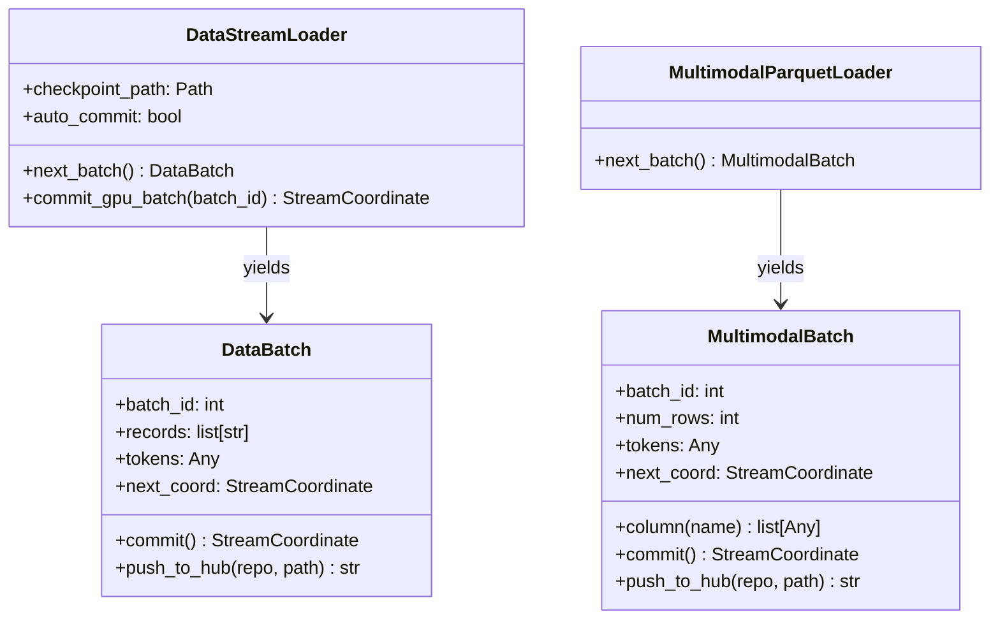

# `py_bridge.rs` & `python/luminamoon/dataloader/`: PyO3 `abi3t` FFI Bridge & HuggingFace Pipeline

[`dataloader/src/py_bridge.rs`](../../../dataloader/src/py_bridge.rs) and [`python/luminamoon/dataloader/__init__.py`](../../../python/luminamoon/dataloader/__init__.py) unite the native Rust streaming engine with Python's `datasets`, `transformers`, and `huggingface_hub` ecosystems under CPython Stable ABI (`abi3-py310` & `abi3t` PEP 703).

[Versi Bahasa Indonesia (README.id.md)](README.id.md)

---

## 1. Class & Function Architecture

---

## 2. Deferred `auto_commit` Crash-Safety Protocol

When iterating via `for batch in lm.stream(..., auto_commit=True):`, committing batch $N$ immediately inside `__next__()` before the loop body runs would mark batch $N$ as completed on disk *before* the GPU forward/backward step actually executes.

Instead, `DataStreamLoader` implements **deferred auto-commit**:
1. When batch $N$ is yielded by `next_batch()`, `self._last_uncommitted_batch_id = N` is recorded in memory.
2. Only when the loop body finishes step $N$ and requests batch $N+1$ (or exits cleanly via `with lm.stream(...) as loader:` / `loader.close()`) does `_flush_pending_auto_commit()` invoke `super().commit_gpu_batch(N)`.
3. If an unhandled exception occurs inside the `with` block, `__exit__` clears `_last_uncommitted_batch_id` without committing the failed batch.

---

## 3. Repository Auto-Discovery & RFC 5988 Pagination (`expand_hf_sources`)

Passing a repository root such as `"hf://datasets/org/corpus@main"` to `lm.stream` or `lm.expand_hf_sources`:
1. Queries `huggingface_hub.HfApi.list_repo_files` when installed, or falls back to the HuggingFace Tree REST API (`/api/datasets/{org}/{repo}/tree/{revision}?recursive=true`).
2. Follows RFC 5988 `Link: <...>; rel="next"` pagination headers across up to 50 pages for repositories with thousands of shards, enforcing HTTPS Bearer token checks on every page URL.
3. Filters by `split` and `subset`, prioritizing `.parquet` / `.pq` shards over `.jsonl` / `.ndjson` when both exist.

---

## 4. Hybrid Rust Serialization + LFS/Xet Upload (`push_to_hub`)

`lm.push_to_hub` combines Rust's GIL-free serialization speed with HuggingFace Hub's large-file storage protocols:
1. Calls `serialize_table_to_bytes(ordered_cols, path_in_repo, hf_image_struct)` in Rust (`py.detach()`), converting Python dicts, `DataBatch`, or `MultimodalBatch` into `.parquet`, `.jsonl`, or `.json` byte buffers in parallel.
2. Uploads the serialized bytes via `huggingface_hub.HfApi.upload_file` when available (automatically negotiating Git LFS / Xet multipart transfers for large shards) or falls back to the native Rust `HfHubUploader` atomic NDJSON commit endpoint.
