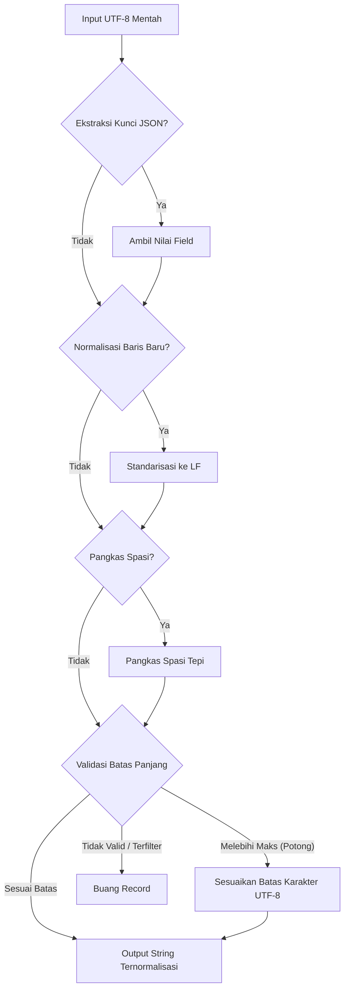

# `simd_cpu.rs` & `postprocess.rs`: Kernel SIMD CPU Mandiri & Normalisasi Paralel Rayon

[`dataloader/src/simd_cpu.rs`](../../../dataloader/src/simd_cpu.rs) dan [`dataloader/src/postprocess.rs`](../../../dataloader/src/postprocess.rs) menyediakan pemindaian byte tervektorisasi tingkat perangkat keras serta normalisasi teks multi-core berbasis Rayon tanpa ketergantungan pada crate SIMD eksternal.

[English Version (README.md)](README.md)

---

## 1. Dukungan Set Instruksi & Lebar Vektor (`src/simd_cpu.rs`)

`luminamoon-dataloader` mendeteksi kapabilitas instruksi CPU host satu kali saat runtime dan menyimpan nilai `CpuIsa` aktif ke dalam `std::sync::OnceLock<CpuIsa>` bebas-kunci menggunakan konstruksi `std::cfg_select!` Rust 2024:

| Target Arsitektur | Varian Enum | Register | Byte / Siklus | Intrinsik yang Digunakan |
| :--- | :--- | :--- | :--- | :--- |
| **x86 / x86_64 AVX-512BW** | `CpuIsa::Avx512` | ZMM (`__m512i`) | 64 byte | `_mm512_set1_epi8`, `_mm512_loadu_si512`, `_mm512_cmpeq_epi8_mask` |
| **x86 / x86_64 AVX2** | `CpuIsa::Avx2` | YMM (`__m256i`) | 32 byte | `_mm256_set1_epi8`, `_mm256_loadu_si256`, `_mm256_cmpeq_epi8`, `_mm256_movemask_epi8` |
| **ARM64 NEON** | `CpuIsa::Neon` | V-Reg (`uint8x16_t`) | 16 byte | `vdupq_n_u8`, `vld1q_u8`, `vceqq_u8`, `vmaxvq_u8` |
| **Portable Fallback** | `CpuIsa::Scalar` | General Purpose | 1 byte | Iterator `position` / `rposition` |

---

## 2. Kernel Pemindaian Byte Tervektorisasi

1. **`find_byte_fast(haystack: &[u8], needle: u8) -> Option<usize>`**:
   - Memindai maju dalam blok 64-byte (`AVX-512BW`), 32-byte (`AVX2`), atau 16-byte (`NEON`), menemukan posisi byte pertama yang cocok melalui instruksi hardware `trailing_zeros()` pada bitmask hasil komparasi.
   - Menjadi mesin utama `find_newline_fast` untuk pemotongan baris `.jsonl`/`.txt` pada `mmap` lokal maupun stream HTTP 206.
2. **`rfind_byte_fast(haystack: &[u8], needle: u8) -> Option<usize>`**:
   - Memindai mundur dari ujung akhir buffer jaringan menggunakan `leading_zeros()` pada mask komparasi.
   - Digunakan oleh `rfind_newline_fast` di dalam `RemoteLineSource` untuk menentukan batas baris utuh terakhir pada jendela unduhan HTTP 206 berukuran 256 KB.
3. **`contains_byte_fast(haystack: &[u8], needle: u8) -> bool`**:
   - Jalur cepat (*fast-path*) pada `postprocess.rs` yang melewati alokasi ulang string saat normalisasi CRLF (`\r\n`) apabila teks tidak mengandung karakter `\r` (`0x0D`).

---

## 3. Buffer Selaras Garis Cache 64-Byte (`CacheAlignedBuffer`)

```rust
#[repr(align(64))]
#[derive(Debug, Clone)]
pub struct CacheAlignedBuffer {
    pub data: Vec<u8>,
}
```

Membulatkan kapasitas alokasi buffer ke kelipatan garis cache 64-byte (`(cap + 63) & !63`) untuk mencegah penalti *cache-line split* selama pemindaian SIMD dan penghitungan hash baris multimodal.

---

## 4. Pipeline Normalisasi Paralel Rayon (`src/postprocess.rs`)

`PostProcessConfig` mengatur pembersihan rekaman teks di seluruh aliran lokal, remote, maupun `lm.from_hf_dataset`:



- **Eksekusi Paralel Terindeks**: `process_batch_parallel_indexed` memanfaatkan iterator paralel terindeks Rayon (`par_iter().map(...)`) untuk memproses batch di seluruh inti CPU sambil mempertahankan urutan indeks deterministik bagi pembaruan `StreamCoordinate`.
