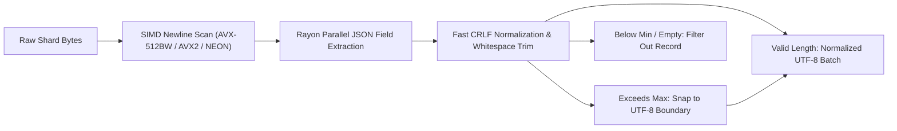

# `simd_cpu.rs` & `postprocess.rs`: Self-Contained CPU SIMD Kernels & Rayon Normalization

[`data/src/simd_cpu.rs`](https://github.com/cloverx-id/luminamoon/blob/main/data/src/simd_cpu.rs) and [`data/src/postprocess.rs`](https://github.com/cloverx-id/luminamoon/blob/main/data/src/postprocess.rs) provide explicit hardware-vectorized byte scanning and multi-core Rayon text normalization without external crate dependencies.

---

## 1. Instruction Set Support & Vector Widths (`src/simd_cpu.rs`)

`luminamoon-dataloader` probes host CPU capabilities once at runtime and caches the active `CpuIsa` inside a lock-free `std::sync::OnceLock<CpuIsa>` using Rust 2024 `std::cfg_select!`:

| Architecture Target | Enum Variant | Registers | Bytes / Cycle | Intrinsics Used |
| :--- | :--- | :--- | :--- | :--- |
| **x86 / x86_64 AVX-512BW** | `CpuIsa::Avx512` | ZMM (`__m512i`) | 64 bytes | `_mm512_set1_epi8`, `_mm512_loadu_si512`, `_mm512_cmpeq_epi8_mask` |
| **x86 / x86_64 AVX2** | `CpuIsa::Avx2` | YMM (`__m256i`) | 32 bytes | `_mm256_set1_epi8`, `_mm256_loadu_si256`, `_mm256_cmpeq_epi8`, `_mm256_movemask_epi8` |
| **ARM64 NEON** | `CpuIsa::Neon` | V-Reg (`uint8x16_t`) | 16 bytes | `vdupq_n_u8`, `vld1q_u8`, `vceqq_u8`, `vmaxvq_u8` |
| **Portable Fallback** | `CpuIsa::Scalar` | General Purpose | 1 byte | Iterator `position` / `rposition` |

---

## 2. Vectorized Byte Scanning Kernels

1. **`find_byte_fast(haystack: &[u8], needle: u8) -> Option<usize>`**:
   - Scans forward in 64-byte (`AVX-512BW`), 32-byte (`AVX2`), or 16-byte (`NEON`) unaligned chunks, locating the first matching byte offset via hardware bitmask `trailing_zeros()`.
   - Powers `find_newline_fast` for zero-copy `mmap` and HTTP 206 `.jsonl`/`.txt` line splitting.
2. **`rfind_byte_fast(haystack: &[u8], needle: u8) -> Option<usize>`**:
   - Scans backward from the end of a network chunk using `leading_zeros()` on the comparison mask.
   - Powers `rfind_newline_fast` in `RemoteLineSource` to find the exact last complete line boundary in a 256 KB HTTP 206 range window in $O(1)$ vector steps.
3. **`contains_byte_fast(haystack: &[u8], needle: u8) -> bool`**:
   - Fast-path guard in `postprocess.rs` that skips string reallocation during CRLF (`\r\n`) normalization whenever a record contains no `\r` (`0x0D`) byte.

---

## 3. 64-Byte Cache-Line Aligned Buffer (`CacheAlignedBuffer`)

```rust
#[repr(align(64))]
#[derive(Debug, Clone)]
pub struct CacheAlignedBuffer {
    pub data: Vec<u8>,
}
```

Rounds buffer capacities up to 64-byte cache-line multiples (`(cap + 63) & !63`) to avoid split-line penalties during SIMD scanning and multimodal row hashing.

---

## 4. Parallel Rayon Normalization Pipeline (`src/postprocess.rs`)

`PostProcessConfig` governs per-record sanitization across local and remote streams as well as `lm.from_hf_dataset`:



- **Order-Preserving Parallel Execution**: `process_batch_parallel_indexed` uses Rayon's indexed `par_iter().map(...)` to normalize batches across all CPU cores while preserving exact deterministic record ordering for `StreamCoordinate` progression.
