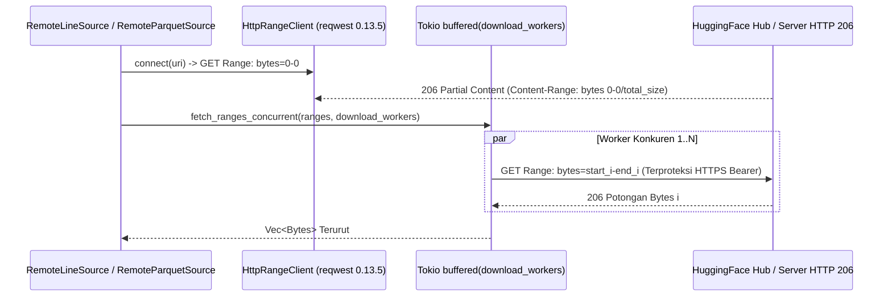

# `source_local.rs` & `source_hf.rs`: `mmap` Lokal Zero-Copy, `RowSelection` Arrow, & Streaming HTTP 206 Konkuren

[`dataloader/src/source_local.rs`](../../../dataloader/src/source_local.rs) dan [`dataloader/src/source_hf.rs`](../../../dataloader/src/source_hf.rs) mengimplementasikan pembaca shard lokal dan remote terpadu yang mampu melakukan pencarian posisi koordinat secara instan dalam waktu $O(1)$ serta pengunduhan potongan byte HTTP 206 secara paralel tanpa mengunduh berkas dataset utuh ke dalam disk.

[English Version (README.md)](README.md)

---

## 1. Sumber Shard Lokal (`src/source_local.rs`)

### 1.1 `LocalMmapLineSource` (`.jsonl`, `.ndjson`, `.txt`)
- Memetakan berkas lokal langsung ke dalam ruang alamat memori proses melalui `memmap2::Mmap`.
- Melanjutkan pembacaan (*resume*) dari `StreamCoordinate` mana pun cukup mengakses slice `&self.mmap[start_coord.byte_offset as usize..]` dalam waktu $O(1)$ tanpa panggilan sistem pembacaan atas area byte yang telah dilewati.
- Memindai baris demi baris secara maju menggunakan kernel vektor `simd_cpu::find_newline_fast`.

### 1.2 `LocalParquetSource` (`.parquet`, `.pq`)
- Menyimpan cache `ArrowReaderMetadata` satu kali saat membuka berkas shard guna mengeliminasi pembacaan ulang footer Parquet di setiap batch.
- Menerapkan proyeksi kolom (`ProjectionMask::roots`) sehingga hanya kolom target yang dibaca dari penyimpanan.
- Memanfaatkan `RowSelection::from(vec![RowSelector::skip(row_in_rg), RowSelector::select(actual_take)])` untuk melompati baris yang telah di-commit dalam kompleksitas waktu $O(1)$ tanpa mendekode halaman data yang dilewati.
- Mendukung tipe kolom `Utf8` (`StringArray`), `LargeUtf8` (`LargeStringArray`), serta `Utf8View` (`StringViewArray`) pada Arrow 60.

---

## 2. Streaming Multi-Range HTTP 206 Remote (`src/source_hf.rs`)

### 2.1 `resolve_hf_uri_with_creds`
Menerjemahkan URI ringkas `hf://datasets/` menjadi endpoint unduhan byte langsung HuggingFace Hub:
- `hf://datasets/<org>/<repo>@<revision>/<path>` $\rightarrow$ `https://huggingface.co/datasets/<org>/<repo>/resolve/<revision>/<path>`
- `hf://datasets/<repo>/<path>` secara otomatis menyubstitusikan `HF_ORG` atau `HF_USERNAME` sebagai `<org>` dan menyetel `<revision>` bawaan ke `main`.

### 2.2 `HttpParquetReader` (`AsyncFileReader`)
Mengimplementasikan trait `AsyncFileReader` Apache Parquet di atas `HttpRangeClient`:
- **`get_metadata`**: Hanya mengunduh byte footer Parquet di bagian akhir berkas remote dan menyimpan cache `Arc<ParquetMetaData>` di memori untuk seluruh batch berikutnya.
- **`get_byte_ranges`**: Menggantikan pembacaan sekuensial bawaan dengan `fetch_ranges_concurrent(pairs, self.download_workers)`, mengunduh halaman data kolom secara paralel melalui `download_workers` koneksi HTTP 206.

### 2.3 Jendela Unduhan Multi-Worker pada `RemoteLineSource`
- Membagi aliran byte mulai dari `start_coord.byte_offset` menjadi `download_workers` jendela rentang berurutan berukuran `chunk_bytes` (bawaan 256 KB per worker) dan mengunduhnya secara bersamaan melalui `fetch_ranges_concurrent`.
- Apabila terdapat satu baris raksasa yang melintasi gabungan jendela tanpa karakter `\n`, ukuran `window_bytes` digandakan secara eksponensial hingga menemukan batas baris baru atau EOF.
- Memotong buffer tepat pada batas baris utuh terakhir menggunakan `simd_cpu::rfind_newline_fast(&chunk)` sehingga potongan baris tidak utuh di ujung akhir tidak pernah bocor ke batch dan otomatis dibaca ulang secara presisi dari `byte_offset` berikutnya.
