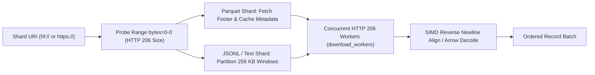

# `source_local.rs` & `source_hf.rs`: Zero-Copy Local `mmap`, Arrow `RowSelection`, & Concurrent HTTP 206 Streaming

[`dataloader/src/source_local.rs`](../../../dataloader/src/source_local.rs) and [`dataloader/src/source_hf.rs`](../../../dataloader/src/source_hf.rs) implement unified local and remote shard readers capable of instant $O(1)$ coordinate seeking and multi-worker HTTP 206 range fetching without downloading full dataset files to disk.

---

## 1. Local Shard Sources (`src/source_local.rs`)

### 1.1 `LocalMmapLineSource` (`.jsonl`, `.ndjson`, `.txt`)
- Maps local files directly into the process address space via `memmap2::Mmap`.
- Resuming from any `StreamCoordinate` indexes directly into `&self.mmap[start_coord.byte_offset as usize..]` in $O(1)$ time with zero read syscalls over skipped regions.
- Scans forward line-by-line using `simd_cpu::find_newline_fast`.

### 1.2 `LocalParquetSource` (`.parquet`, `.pq`)
- Caches `ArrowReaderMetadata` once when opening the shard to eliminate repeated footer parsing across batches.
- Applies column projection (`ProjectionMask::roots`) so only the target column is read from disk.
- Uses `RowSelection::from(vec![RowSelector::skip(row_in_rg), RowSelector::select(actual_take)])` to skip already-committed rows in $O(1)$ page-index time without decoding skipped data pages.
- Supports `Utf8` (`StringArray`), `LargeUtf8` (`LargeStringArray`), and Arrow 60 `Utf8View` (`StringViewArray`).

---

## 2. Remote HTTP 206 Multi-Range Streaming (`src/source_hf.rs`)

### 2.1 `resolve_hf_uri_with_creds`
Resolves shorthand `hf://datasets/` URIs into canonical HuggingFace Hub raw byte endpoints:
- `hf://datasets/<org>/<repo>@<revision>/<path>` $\rightarrow$ `https://huggingface.co/datasets/<org>/<repo>/resolve/<revision>/<path>`
- `hf://datasets/<repo>/<path>` automatically substitutes `HF_ORG` or `HF_USERNAME` as `<org>` and defaults `<revision>` to `main`.

### 2.2 `HttpParquetReader` (`AsyncFileReader`)
Implements Apache Parquet's `AsyncFileReader` trait over `HttpRangeClient`:
- **`get_metadata`**: Fetches only the Parquet footer bytes at the end of the remote file and caches `Arc<ParquetMetaData>` in memory across subsequent batches.
- **`get_byte_ranges`**: Overrides the sequential default with `fetch_ranges_concurrent(pairs, self.download_workers)`, downloading column-chunk data pages in parallel across `download_workers` connections.

### 2.3 `RemoteLineSource` Multi-Worker Windowing
- Partitions the upcoming byte stream from `start_coord.byte_offset` into `download_workers` contiguous range windows of size `chunk_bytes` (default 256 KB per worker) and fetches them concurrently via `fetch_ranges_concurrent`.
- If a single mega-record spans across the combined window without a `\n`, exponentially doubles `window_bytes` until a newline or EOF is reached.
- Truncates the buffer cleanly at the last complete line via `simd_cpu::rfind_newline_fast(&chunk)` so partial trailing lines are never emitted and are re-aligned on the next batch's `byte_offset`.
