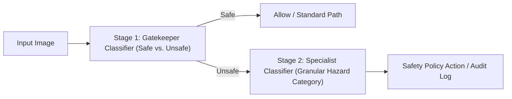

# Visual Safety & Content Moderation Datasets

Two companion Hugging Face repositories under **`cloverx-id`** designed for two-stage automated visual moderation benchmarking: a binary **Gatekeeper** classifier (`Safe` vs. `Unsafe`) followed by a fine-grained **Specialist** hazard classifier.

!!! warning "Strict Academic & AI Safety Research Notice"
    Both repositories contain **raw, unfiltered, explicit, and graphic visual material** (explicit adult/NSFW imagery, graphic violence/gore, and weaponry). They are restricted strictly to **AI safety engineering, institutional academic research, adversarial red-teaming, and content moderation benchmarking**. Neither repository contains Child Sexual Abuse Material (CSAM) or material violating fundamental human rights laws. Always review each repository's `LICENSE` and disclaimer before downloading.

---

## Two-Stage Moderation Pair

| Stage & Repository | Archive File | Scope & Class Structure | License |
| :--- | :--- | :--- | :--- |
| **Stage 1 — Gatekeeper**<br>[`cloverx-id/image-moderation-dataset`](https://huggingface.co/datasets/cloverx-id/image-moderation-dataset) | `DATASET_GATEKEEPER.zip` | Balanced **binary classification** (`30,000+` total): `SAFE` (`15,000+` SFW images) and `UNSAFE` (`15,000+` aggregated hazardous images). | Custom Research License (`LICENSE`) |
| **Stage 2 — Specialist**<br>[`cloverx-id/unsafe-image-dataset`](https://huggingface.co/datasets/cloverx-id/unsafe-image-dataset) | `DATASET_SPECIALIST.zip` | **Granular unsafe-only taxonomy** (no `Safe` class) categorizing specific hazardous visual domains (severe gore, graphic violence, explicit NSFW, weapons/firearms). | Custom Research License (`LICENSE`) |

---

## Architecture & Handling Notes



- **Class Index Verification**: When unpacking `DATASET_GATEKEEPER.zip` or `DATASET_SPECIALIST.zip` into standard vision loaders (e.g., `torchvision.datasets.ImageFolder`), explicitly inspect and pin `class_to_idx` before training to avoid silent label-index swaps.
- **Controlled Storage**: Store unpacked archives in access-controlled research directories excluded from public logs, screenshots, or unencrypted backups.

---

## Programmatic Retrieval (`huggingface_hub`)

Because both datasets are packaged as structured `.zip` archives rather than Parquet tables, retrieve them directly with `huggingface_hub`:

```python
from huggingface_hub import hf_hub_download

# Stage 1: Binary Gatekeeper (Safe vs. Unsafe)
gatekeeper_zip = hf_hub_download(
    repo_id="cloverx-id/image-moderation-dataset",
    filename="DATASET_GATEKEEPER.zip",
    repo_type="dataset",
)

# Stage 2: Granular Unsafe Specialist (Unsafe classes only)
specialist_zip = hf_hub_download(
    repo_id="cloverx-id/unsafe-image-dataset",
    filename="DATASET_SPECIALIST.zip",
    repo_type="dataset",
)
```
