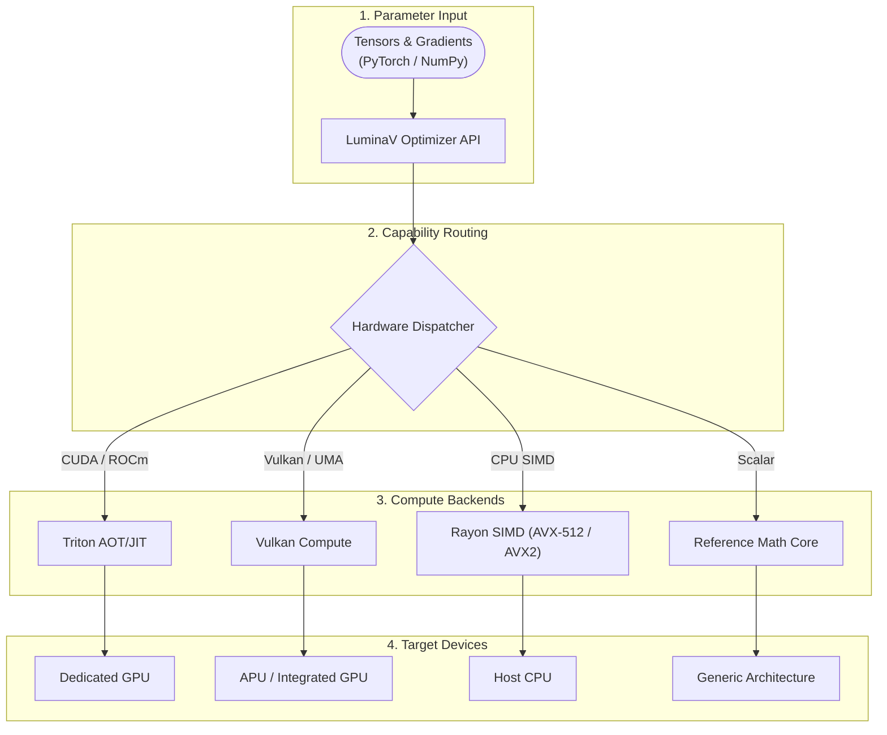
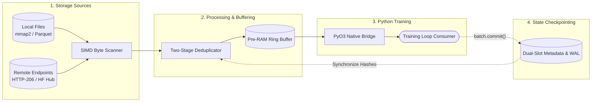

# Architecture & Hardware Acceleration

In-depth technical architecture of **LuminaMoon (`luminamoon`)**, covering the **LuminaV Optimizer** multi-tier compute hierarchy, the **LuminaMoon DataLoader** streaming and SIMD pipeline, zero-copy memory protocols, and free-threaded Python (`abi3t` / PEP 703) execution.

---

## 1. LuminaV Optimizer Architecture & Dispatch (`optimizer/`)

### Optimizer Rust Workspace Crates (`optimizer/crates/`)

1. **`luminav-core`**: Pure mathematical formulas (CLM & TD-CLM), state structs (`ParamState`), mode enums (`BufferMode`, `BoundType`, `DTypeMode`, `ExecutionMode`), XORShift/PCG PRNG generators, and heapless numeric conversions (`f32_to_f16_bits_rne`, `f16_bits_to_f32`).
2. **`luminav-simd`**: Explicit x86_64 SIMD vectorization via `__m512` (`AVX-512` F, DQ, BW, VL: 16 floats/register) and `__m256` (`AVX2 + FMA`: 8 floats/register) parallelized across CPU cores via Rayon (`8,192`-element cache-aligned chunks).
3. **`luminav-vulkan`**: Vulkan 1.3 / 1.4 compute shader pipeline via `ash` bindings, leveraging Unified Memory Architecture (UMA) zero-copy host buffers and Wave32 subgroup reductions (`subgroupAdd`).
4. **`luminav-dispatch`**: Runtime hardware capability detector (`detect_hardware`) and dynamic router (`N >= 16,384` elements routes to Vulkan UMA; `< 16,384` routes to Rayon CPU SIMD).
5. **`luminav-triton-aot`**: Ahead-of-Time (AOT) kernel runner with dynamic `libloading` CUDA (`nvcuda`) and ROCm HIP (`amdhip64_7`) driver bindings and a standalone C-API (`luminav_triton_standalone.h`).
6. **`optimizer/src/` (`_luminamoon_optimizer_rs`)**: Unified PyO3 0.30.1 `abi3t` extension linking both the Optimizer and DataLoader crates, releasing the GIL via `py.detach()`.

---

## 2. LuminaMoon DataLoader Architecture & SIMD Engine (`dataloader/`)

### DataLoader Rust Modules (`dataloader/src/`)

1. **`coord.rs` & `metadata.rs`**: 32-byte little-endian `StreamCoordinate` (`shard_id`, `byte_offset`, `row_group_idx`, `page_idx`, `row_offset_in_page`, `global_row_idx`) persisted inside a 128-byte Ping-Pong `.meta` file (`Slot A` / `Slot B` protected by hardware-accelerated `crc32fast`) and an append-only `.meta.dedup` write-ahead log.
2. **`dedup.rs`**: `TwoStageDeduplicator` computing 64-bit `xxh3_64` digests stored in `hashbrown` SwissTables with `IdentityBuildHasher` (zero re-hashing overhead), isolating `staged_lookup` (Pre-RAM) from `committed_hashes` (GPU).
3. **`simd_cpu.rs` & `postprocess.rs`**: Self-contained CPU SIMD byte-scanning kernels (`AVX-512BW` 64-byte ZMM, `AVX2` 32-byte YMM, `ARM64 NEON` 16-byte) for forward/backward newline detection (`find_newline_fast`, `rfind_newline_fast`), `\r` screening (`contains_byte_fast`), 64-byte `CacheAlignedBuffer`, and Rayon parallel UTF-8/JSONL normalization.
4. **`source_local.rs` & `source_hf.rs`**: Zero-copy `memmap2::Mmap` line reader, Apache Arrow 60 `RowSelection` $O(1)$ page-skipping Parquet reader, and concurrent HTTP 206 multi-range streaming (`fetch_ranges_concurrent` across `download_workers`).
5. **`preram.rs`**: `PreRamDataLoader` 100-batch watermark ring buffer (`low_watermark = capacity - refill_trigger`) driven by a dedicated background thread and multi-threaded Tokio worker pool with cross-shard batch coalescing.
6. **`multimodal.rs` & `hf_hub.rs`**: 7-variant `MultimodalValue` engine (`Null`, `Text`, `Bytes`, `Json`, `Int`, `Float`, `Bool`), HuggingFace Dataset Viewer `Struct<bytes: Binary, path: Utf8>` Parquet serializer, JSONL/JSON serializers, `HfCredentials` (redacted `Debug` + HTTPS Bearer token guard), and `HfHubClient` atomic NDJSON commit uploader.

---

## 3. Zero-Copy Memory Protocols

1. **Optimizer Tensor Pointers**: Extracts physical memory addresses directly via NumPy `__array_interface__['data'][0]` or PyTorch `tensor.data_ptr()`, validating C-contiguity and pointer anti-aliasing before mutating `&mut [f32]` slices in-place.
2. **DataLoader Virtual Memory & Page Skipping**: Maps local `.jsonl`/`.txt` shards directly into OS virtual memory pages via `memmap2::Mmap` and skips uncommitted/committed Parquet row ranges via Arrow `RowSelection` without decoding skipped pages.

---

## 4. CPython Stable ABI & Free-Threaded Runtime (`abi3t`)

The `luminamoon` binary wheel is compiled against CPython Stable ABI standards:
- **`abi3-py310`**: A single wheel compiled for Python 3.10 runs without recompilation across Python 3.10 through 3.15+.
- **`abi3t` (PEP 703)**: Fully compatible with Python 3.13+ free-threaded builds (`Py_GIL_DISABLED`). Both the Optimizer and DataLoader execute heavy compute and I/O inside `py.detach()`, enabling true multi-core parallelism without GIL contention.
