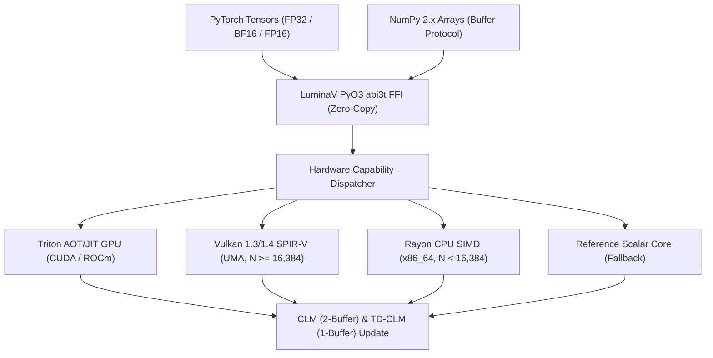
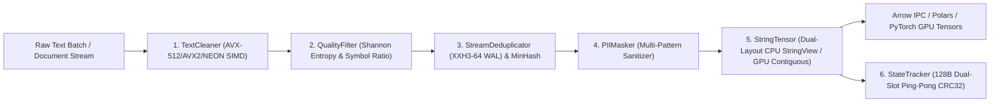

# Architecture & Hardware Acceleration

In-depth technical architecture of **LuminaMoon (`luminamoon`)**, covering the **LuminaV Optimizer** multi-tier compute hierarchy, the **LuminaMoon DataLoader** streaming and SIMD pipeline, zero-copy memory protocols, and free-threaded Python (`abi3t` / PEP 703) execution.

---

## 1. LuminaV Optimizer Architecture & Dispatch (`optimizer/`)

### Optimizer Rust Workspace Crates (`optimizer/crates/`)

1. **`luminav-core`**: Pure mathematical formulas (CLM & TD-CLM), state structs (`ParamState`), mode enums (`BufferMode`, `BoundType`, `DTypeMode`, `ExecutionMode`), XORShift/PCG PRNG generators, and heapless numeric conversions (`f32_to_f16_bits_rne`, `f16_bits_to_f32`).
2. **`luminav-simd`**: Explicit x86_64 SIMD vectorization via `__m512` (`AVX-512` F, DQ, BW, VL: 16 floats/register) and `__m256` (`AVX2 + FMA`: 8 floats/register) parallelized across CPU cores via Rayon (`8,192`-element cache-aligned chunks).
3. **`luminav-vulkan`**: Vulkan 1.3 / 1.4 compute shader pipeline via `ash` bindings, leveraging Unified Memory Architecture (UMA) zero-copy host buffers and Wave32 subgroup reductions (`subgroupAdd`).
4. **`luminav-dispatch`**: Runtime hardware capability detector (`detect_hardware`) and dynamic router (`N >= 16,384` elements routes to Vulkan UMA; `< 16,384` routes to Rayon CPU SIMD).
5. **`luminav-triton-aot`**: Ahead-of-Time (AOT) kernel runner with dynamic `libloading` CUDA (`nvcuda`) and ROCm HIP (`amdhip64_7`) driver bindings and a standalone C-API (`luminav_triton_standalone.h`).
6. **`optimizer/src/` (`_luminamoon_optimizer_rs`)**: Unified PyO3 0.30.1 `abi3t` extension linking both the Optimizer and DataLoader crates, releasing the GIL via `py.detach()`.

---

## 2. LuminaMoon Data Engine Architecture & SIMD Core (`data/`)

### Data Engine Rust Modules (`data/src/`)

1. **`constants.rs` & `error.rs`**: Centralized endpoints, buffer bounds, URI typo tables, and `DataLoaderError` with Damerau-Levenshtein suggestions (`did_you_mean`).
2. **`coord.rs` & `metadata.rs`**: 32-byte little-endian `StreamCoordinate` (`shard_id`, `byte_offset`, `row_group_idx`, `page_idx`, `row_offset_in_page`, `global_row_idx`) and 128-byte Dual-Slot Ping-Pong `.meta` checkpoints (`Slot A` / `Slot B` protected by IEEE CRC32) with write-ahead `.dedup` logging.
3. **`dedup.rs` & `minhash.rs`**: High-performance 64-bit `xxh3_64` deduplication via SwissTable `IdentityBuildHasher` and 64-permutation MinHash LSH fuzzy shingling for near-duplicate rejection.
4. **`simd_cpu.rs` & `postprocess.rs`**: Self-contained CPU SIMD byte-scanning kernels (`AVX-512BW` 64-byte ZMM, `AVX2` 32-byte YMM, `ARM64 NEON` 16-byte) for whitespace trimming and canonical newline normalization, backed by 64-byte cache-line aligned buffers.
5. **`string_tensor.rs`**: Dual-layout container maintaining CPU inlined `StringView` (<= 12 bytes inline with 4-byte prefix comparison) and contiguous GPU flat `uint32` offsets + `uint8` byte payload buffers.
6. **`quality.rs`**: Parallel Rayon heuristic quality engine computing Shannon Character Entropy, repetitiveness fraction, and symbol-to-word ratios.
7. **`serialize.rs`**: GIL-free serialization to Apache Arrow IPC (`LargeString`), Parquet, and NDJSON format buffers.
8. **`py_bridge.rs`**: Native PyO3 (`abi3t`) bindings exposing `FusedPipeline`, `StringTensor`, `StateTracker`, `clean_batch`, and `filter_quality` to Python with complete `py.detach()` GIL release.

---

## 3. Zero-Copy Memory Protocols

1. **Optimizer Tensor Pointers**: Extracts physical memory addresses directly via NumPy `__array_interface__['data'][0]` or PyTorch `tensor.data_ptr()`, validating C-contiguity and pointer anti-aliasing before mutating `&mut [f32]` slices in-place.
2. **DataLoader Virtual Memory & Page Skipping**: Streams local `.jsonl`/`.txt` shards via chunked buffered readers with zero heap reallocations and skips uncommitted/committed Parquet row ranges via Arrow `RowSelection` without decoding skipped pages.

---

## 4. CPython Stable ABI & Free-Threaded Runtime (`abi3t`)

The `luminamoon` binary wheel is compiled against CPython Stable ABI standards:
- **`abi3-py310`**: A single wheel compiled for Python 3.10 runs without recompilation across Python 3.10 through 3.15+.
- **`abi3t` (PEP 703)**: Fully compatible with Python 3.13+ free-threaded builds (`Py_GIL_DISABLED`). Both the Optimizer and DataLoader execute heavy compute and I/O inside `py.detach()`, enabling true multi-core parallelism without GIL contention.
