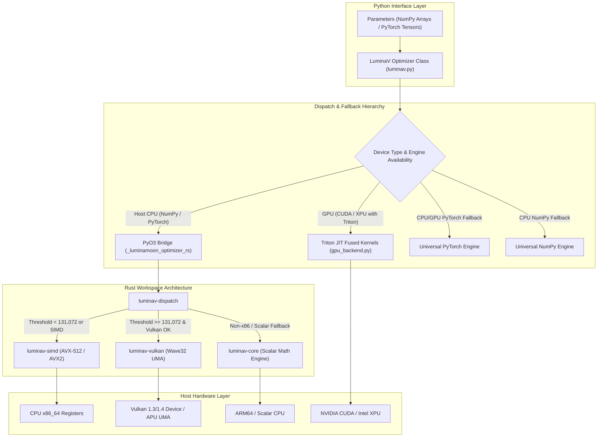

# Architecture & Hardware Acceleration

In-depth technical architecture of LuminaMoon, Rust Cargo workspace modularity, zero-copy buffer protocol, and multi-tier hardware acceleration dispatch.

## System Architecture Diagram

---

## Rust Workspace Crate Modularity (`optimizer/crates/`)

The core compute engine is structured as a modular Rust Cargo workspace:

### 1. `luminav-core`
- **Responsibility**: Pure mathematical formulas, state structs, mode enums (`BufferMode`, `BoundType`, `DTypeMode`, `ExecutionMode`), and XORShift/PCG PRNG generators.
- **Precision Helpers**: Fast, heapless numeric conversions (`f32_to_f16_bits_rne` and `f16_bits_to_f32`).

### 2. `luminav-simd`
- **Responsibility**: Low-level explicit SIMD vectorization via x86_64 compiler intrinsics.
- **Instruction Sets**:
  - **AVX-512**: Operates on 16 single-precision floats simultaneously (`__m512`) utilizing F, DQ, BW, and VL extensions.
  - **AVX2 & FMA**: Operates on 8 floats simultaneously (`__m256`) with hardware Fused Multiply-Add instructions.

### 3. `luminav-vulkan`
- **Responsibility**: Vulkan 1.3 / 1.4 compute shader pipeline via *Ash bindings*.
- **UMA Zero-Copy**: Leverages Unified Memory Architecture (UMA) on integrated GPUs/APUs to read and update host memory directly without PCIe transfer overhead.
- **Wave32 Subgroups**: Utilizes Wave32 subgroup operations for fast on-chip parallel reduction across compute threads.

### 4. `luminav-dispatch`
- **Responsibility**: Runtime hardware capability auditing (`detect_hardware`) and execution routing.
- **Dynamic Threshold**: If parameter element count $\ge 131,072$ and Vulkan is available, operations are automatically dispatched to Vulkan compute shaders; otherwise, they execute via Rayon multi-threaded AVX-512/AVX2 threadpools.

### 5. `luminav-triton-aot`
- **Responsibility**: Ahead-of-Time (AOT) compilation harness generating standalone C/C++ headers (`luminav_triton_standalone.h`) for embedded systems.

### 6. `optimizer/src/` (`_luminamoon_optimizer_rs`)
- **Responsibility**: PyO3 Python FFI binding module.
- **GIL-Free Execution**: Computes multi-threaded Rayon workloads inside `py.detach()`, completely releasing the Python Global Interpreter Lock (GIL) during step execution.

---

## Zero-Copy Buffer Protocol & Memory Alignment

LuminaMoon eliminates redundant memory copying:

1. **NumPy 2.x Buffer Protocol**:
   - Directly extracts raw physical memory addresses via `__array_interface__['data'][0]` or `ctypes.data`.
   - Casts memory pointers directly to Rust slices `&mut [f32]` without heap allocation.

2. **PyTorch Tensor Pointer Extraction**:
   - Accesses underlying storage for CPU tensors via `tensor.data_ptr()`.

3. **Memory Contiguity Requirement**:
   - All parameter arrays and tensors must be row-major C-contiguous.
   - Non-contiguous tensors (such as slices or transposed matrices `p.T`) are rejected with clear guidance to call `.contiguous()` or `np.ascontiguousarray()`, preventing silent memory corruption.

---

## CPython Stable ABI & Free-Threaded Runtime

The `luminamoon` binary package is compiled against CPython Stable ABI standards:
- **`abi3-py310`**: A single wheel compiled for Python 3.10 runs without recompilation on Python 3.11, 3.12, 3.13, 3.14, and 3.15+.
- **`abi3t` (PEP 703)**: Fully compatible with Python 3.13+ free-threaded builds (`Py_GIL_DISABLED`). The native Rust engine and Rayon worker threads operate with true thread concurrency free of GIL bottlenecks.
