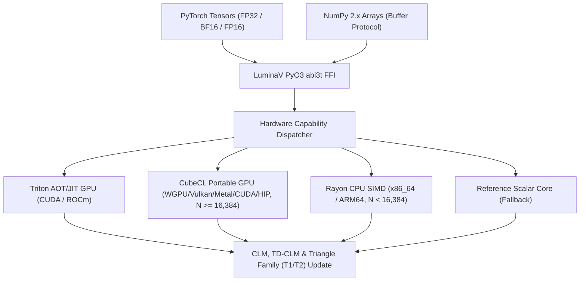
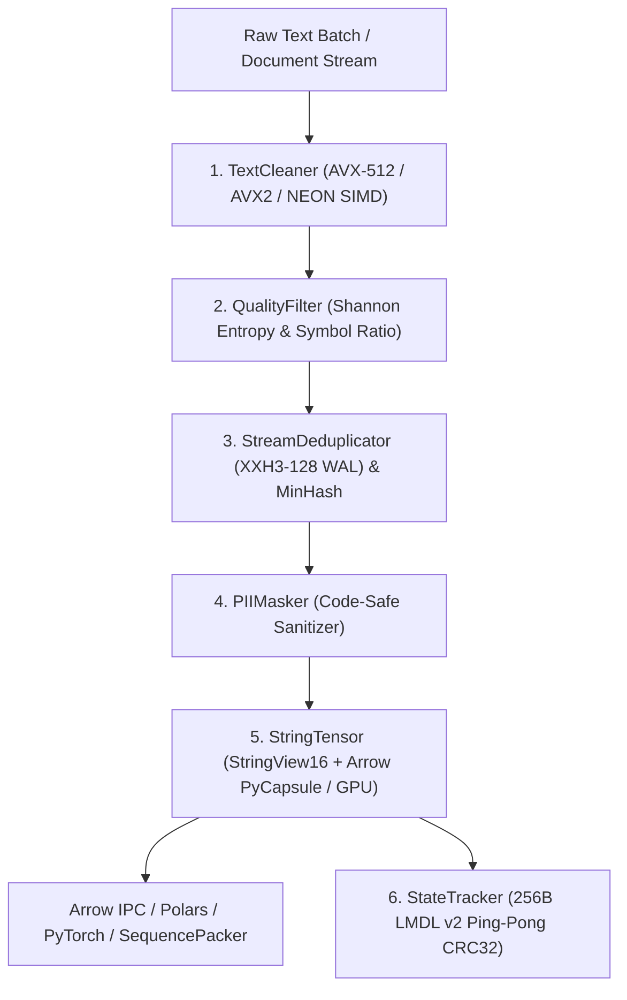

# Architecture & Hardware Acceleration

Technical architecture overview of **LuminaMoon (`luminamoon`)**, covering the **LuminaV Optimizer** compute hierarchy, the **LuminaMoon Data Engine** text preprocessing and SIMD pipeline, direct buffer memory protocols, and free-threaded Python (`abi3t` / PEP 803 for PEP 703) execution.

---

## 1. LuminaV Optimizer Architecture & Dispatch (`optimizer/`)

### Optimizer Rust Workspace Crates (`optimizer/crates/`)

1. **`luminav-core`**: Mathematical formulas (CLM, TD-CLM, Triangle Family `T1`/`T2`, CWD, RTV, and `bound_floor` in `reference_cpu/{dual,t2,tdclm}.rs`), state structs (`ParamState`), mode enums (`config/{mod,modes}.rs`), 32-bit MurmurHash3 spatial hashing (`_prng`) + 3D Weyl-Kronecker step offsets (`_prng_weyl`), and numeric conversions (`f32_to_f16_bits_rne`, `f16_bits_to_f32`).
2. **`luminav-simd`**: Explicit SIMD vectorization via x86_64 `__m512` (`AVX-512` F, DQ, BW, VL: 16 floats/register), `__m256` (`AVX2 + FMA`: 8 floats/register), and ARM64 `float32x4_t` (`NEON`: 4 floats/register), parallelized across CPU cores via Rayon (`ELEM_CHUNK_SIZE = 2,097,152`-element chunks in `src/parallel/mod.rs`).
3. **`luminav-cubecl`**: Optional CubeCL (`0.11.4`) portable GPU compute crate (`wgpu`, `vulkan`, `metal`, `cuda`, `hip`, `cpu` features) supporting all four optimizer modes (`Dual`, `TdClm`, `T1`, `T2`) and `luminamoon.nn` ops.
4. **`luminav-dispatch`**: Runtime hardware capability detector (`detect_hardware`) and dynamic router (`N >= 16,384` tries Triton AOT first for all 4 buffer modes, then CubeCL when compiled in, and falls back to Rayon CPU SIMD; `N < 16,384` runs directly on Rayon CPU SIMD).
5. **`luminav-triton-aot`**: Ahead-of-Time (AOT) kernel runner with 182 compiled GPU ELF64 binaries (14 kernels across 8 CUDA `sm_75..sm_120` and 5 ROCm `gfx908..gfx1103` targets), dynamic `libloading` CUDA (`nvcuda`) and ROCm HIP (`amdhip64_7`) driver bindings, and a standalone C-API (`optimizer/include/luminav_triton_standalone.h`).
6. **`optimizer/src/` (`_luminamoon_optimizer_rs`)**: Shared PyO3 0.30.1 `abi3t` extension linking both the Optimizer and Data Engine crates, releasing the GIL via `py.detach()`.

---

## 2. LuminaMoon Data Engine Architecture & SIMD Core (`data/`)

### Data Engine Rust Modules (`data/src/`)

1. **`constants.rs` & `error.rs`**: Centralized magic bytes, buffer bounds, and `DataLoaderError` with Damerau-Levenshtein suggestions (`did_you_mean`).
2. **`coord.rs` & `metadata.rs`**: 32-byte little-endian `StreamCoordinate` and 256-byte Dual-Slot Ping-Pong `LMDL v2` `.meta` checkpoints (`Slot A` / `Slot B` protected by IEEE CRC32, tracking `consumed_tokens`) with `O(delta)` append-only `LMWL v2` `.dedup` logging.
3. **`dedup.rs` & `minhash.rs`**: 128-bit `XXH3-128` deduplication via SwissTable `IdentityBuildHasher` and double-hashed MinHash LSH (adapted from Kirsch-Mitzenmacher) with Rayon parallel `filter_batch`.
4. **`simd_cpu.rs` & `postprocess.rs`**: Self-contained CPU SIMD byte-scanning kernels (`AVX-512BW` 64-byte ZMM, `AVX2` 32-byte YMM, `ARM64 NEON` 16-byte) for whitespace trimming and newline normalization.
5. **`string_tensor.rs`**: Dual-layout container maintaining 16-byte Arrow `Utf8View`-aligned `StringView16` views (<= 12 bytes inline with 4-byte prefix comparison), Arrow C-Data Interface (`__arrow_c_array__`) PyCapsule export, and contiguous GPU flat offset (`uint32` in Rust/NumPy, `torch.int32` in PyTorch) + `uint8` UTF-8 payload buffers.
6. **`quality.rs`**: Parallel Rayon heuristic quality filter computing Shannon Character Entropy, trigram repetition fraction, and symbol-to-visible-character ratios (`symbols / visible`).
7. **`serialize.rs`**: GIL-detached 64-bit columnar serialization (`LargeUtf8` / `LargeBinary`) to Apache Arrow IPC, ZSTD Parquet, and NDJSON format buffers.
8. **`py_bridge/` (`mod.rs`, `state.rs`, `text.rs`, `pipeline.rs`)**: Native PyO3 (`abi3t`) bindings exposing `FusedPipeline`, `StringTensor`, `StateTracker`, `StreamDeduplicator`, `QualityFilter`, `MinHashDeduplicator`, and `serialize_table_to_bytes` with `py.detach()` GIL release.

---

## 3. Buffer & Memory Interoperability

1. **Optimizer Tensor Pointers**: Extracts physical memory addresses directly via NumPy `__array_interface__['data'][0]` or PyTorch `tensor.data_ptr()`, validating C-contiguity and byte-range pointer anti-aliasing before mutating `&mut [f32]` slices in-place.
2. **Data Engine `StringTensor`**: Maintains 16-byte `Utf8View`-compatible `StringView16` views alongside contiguous offset (`uint32` via `to_numpy_gpu()`, `torch.int32` via `to_torch_gpu()`) + `uint8` UTF-8 payload buffers, exporting to Apache Arrow and Polars via `__arrow_c_array__` PyCapsules.

---

## 4. CPython Stable ABI & Free-Threaded Runtime (`abi3t`)

The `luminamoon` binary wheel is compiled against CPython Stable ABI standards:

- **`abi3-py310`**: A single wheel compiled for Python 3.10 runs without recompilation across Python 3.10 through 3.15+.
- **`abi3t` (PEP 803)**: Stable ABI for Python 3.13+ / 3.15+ free-threaded builds (PEP 703, `Py_GIL_DISABLED`). Both the Optimizer and Data Engine execute compute and data processing inside `py.detach()`, allowing multi-core execution without holding the GIL.

---

## 5. References

- **Optimizer Mathematical Foundations**: L. Maligranda, *Banach J. Math. Anal.*, 2008 (Triangle Inequality Defect); T. Dozat, *ICLR Workshop*, 2016 (`Nadam`); I. Loshchilov and F. Hutter, *ICLR*, 2019 (`AdamW`); M. R. Zhang *et al.*, *NeurIPS*, 2019 (`Lookahead`); J. Zhuang *et al.*, *NeurIPS*, 2020 (`AdaBelief`); S. Taniguchi *et al.*, *NeurIPS*, 2024 (`ADOPT`); W. Jiang *et al.*, *NeurIPS*, 2024 (`Ada-STORM`); K. Liang *et al.*, *ICLR*, 2026 (`Cautious Optimizers`); L. Chen *et al.*, *ICLR*, 2026 (`Cautious Weight Decay`, `arXiv:2510.12402`); A. Brock *et al.*, *ICML*, 2021 (`AGC`).
- **Low-Precision, Kernel Compilation & Distributed Training**: S. Gupta *et al.*, *ICML*, 2015 (Stochastic Rounding); P. Zamirai *et al.*, *arXiv:2010.06192*, 2021 (`BFloat16`); T. Yu *et al.*, *ICML*, 2024 (`COLLAGE`); K. Ozkara *et al.*, *AISTATS*, 2025 (BF16 Stochastic Rounding); A. Molina *et al.*, *ICLR*, 2020 (Padé Approximants); T. Dao *et al.*, *NeurIPS*, 2022 (`FlashAttention`); T. Zadouri *et al.*, *MLSys*, 2026 (`FlashAttention-4`, `arXiv:2603.05451`); P. Tillet *et al.*, *MAPL*, 2019 (Triton Compiler); Y. Zhao *et al.*, *PVLDB*, 2023 (`PyTorch FSDP`); W. Liang *et al.*, *ICLR*, 2025 (`TorchTitan` / FSDP2).
- **Data Engine String, Packing & Deduplication Structures**: T. Neumann and M. J. Freitag, *CIDR*, 2020 (Umbra 16-byte `StringView` prefix inlining); P. Pedreira *et al.*, *PVLDB*, 2022 (`Velox`); H. Ding *et al.*, *ICML*, 2024 (`Best-Fit Packing`, `arXiv:2404.10830`); A. Kirsch and M. Mitzenmacher, *Random Struct. Algorithms*, 2008 (double hashing for Bloom filters, adapted for MinHash); A. Z. Broder, *Compression and Complexity of Sequences*, 1997 (MinHash LSH); G. Penedo *et al.*, *NeurIPS*, 2024 (`FineWeb`).
