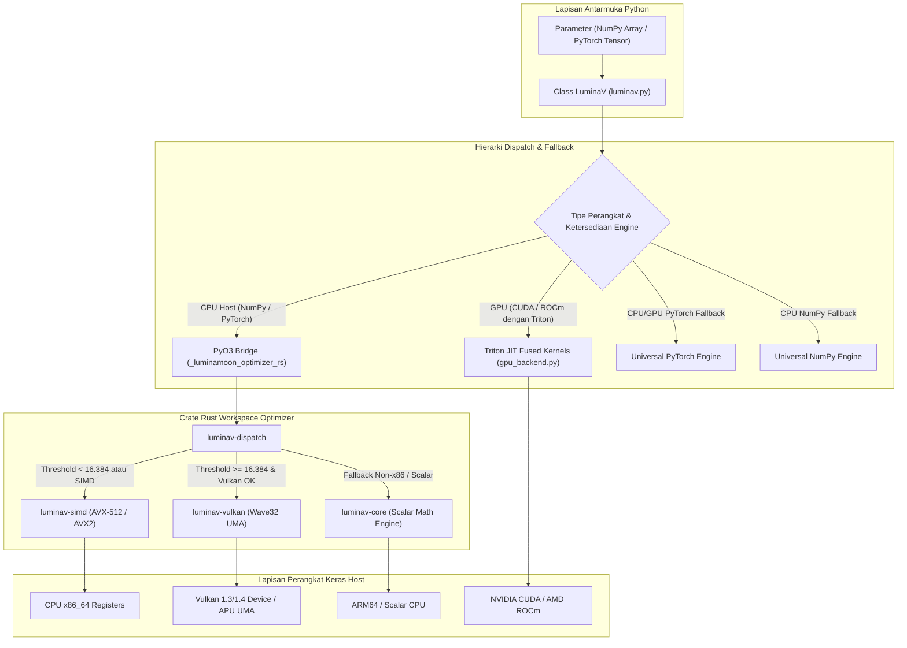
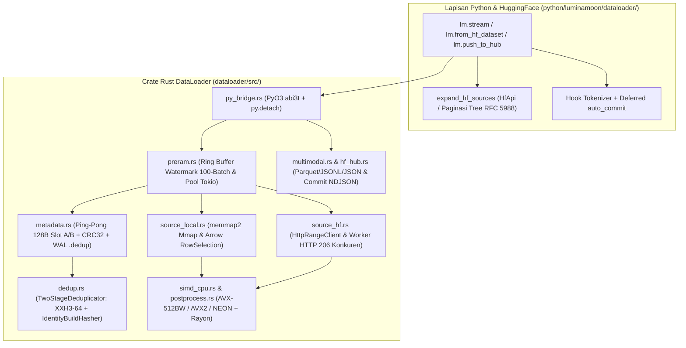

# Arsitektur & Akselerasi Hardware (Architecture & Hardware)

Penjelasan mendalam mengenai desain sistem internal **LuminaMoon (`luminamoon`)**, mencakup hierarki komputasi multi-tier **LuminaV Optimizer**, pipeline streaming dan SIMD **LuminaMoon DataLoader**, protokol memori zero-copy, serta eksekusi Python *free-threaded* (`abi3t` / PEP 703).

---

## 1. Arsitektur & Dispatch LuminaV Optimizer (`optimizer/`)

### Modularitas Crate Rust Optimizer (`optimizer/crates/`)

1. **`luminav-core`**: Fondasi matematika murni (CLM & TD-CLM), struktur data status (`ParamState`), enumerasi mode (`BufferMode`, `BoundType`, `DTypeMode`, `ExecutionMode`), generator PRNG XORShift/PCG, serta konversi presisi numerik tanpa alokasi heap (`f32_to_f16_bits_rne`, `f16_bits_to_f32`).
2. **`luminav-simd`**: Vektorisasi SIMD x86_64 eksplisit menggunakan register `__m512` (`AVX-512` F, DQ, BW, VL: 16 float/register) dan `__m256` (`AVX2 + FMA`: 8 float/register) yang diparalelkan lintas inti CPU melalui Rayon (partisi 8.192 elemen selaras cache).
3. **`luminav-vulkan`**: Pipeline compute shader Vulkan 1.3 / 1.4 melalui binding `ash`, memanfaatkan buffer memori host *Unified Memory Architecture* (UMA) secara *zero-copy* dan reduksi subgroup Wave32 (`subgroupAdd`).
4. **`luminav-dispatch`**: Pendeteksi kapabilitas hardware saat runtime (`detect_hardware`) dan perute dinamis ($\ge 16.384$ elemen diarahkan ke Vulkan UMA; $< 16.384$ diarahkan ke Rayon CPU SIMD).
5. **`luminav-triton-aot`**: Eksekutor kernel Ahead-of-Time (AOT) dengan pemuatan driver dinamis `libloading` untuk CUDA (`nvcuda`) serta ROCm HIP (`amdhip64_7`) dan antarmuka C-API mandiri (`luminav_triton_standalone.h`).
6. **`optimizer/src/` (`_luminamoon_optimizer_rs`)**: Modul ekstensi PyO3 0.30.1 `abi3t` terpadu yang menautkan crate Optimizer sekaligus DataLoader dengan pembebasan GIL penuh via `py.detach()`.

---

## 2. Arsitektur & Mesin SIMD LuminaMoon DataLoader (`dataloader/`)

### Modul Internal Rust DataLoader (`dataloader/src/`)

1. **`coord.rs` & `metadata.rs`**: `StreamCoordinate` *little-endian* 32-byte (`shard_id`, `byte_offset`, `row_group_idx`, `page_idx`, `row_offset_in_page`, `global_row_idx`) yang disimpan di dalam berkas Ping-Pong `.meta` 128-byte (`Slot A` / `Slot B` berproteksi IEEE CRC32 `crc32fast`) serta *write-ahead log* `.meta.dedup`.
2. **`dedup.rs`**: `TwoStageDeduplicator` berbasis digest 64-bit `xxh3_64` pada SwissTable `hashbrown` dengan `IdentityBuildHasher` (bebas *re-hashing*), memisahkan himpunan `staged_lookup` (Pre-RAM) dari `committed_hashes` (GPU).
3. **`simd_cpu.rs` & `postprocess.rs`**: Kernel pemindaian byte SIMD CPU mandiri (`AVX-512BW` ZMM 64-byte, `AVX2` YMM 32-byte, `ARM64 NEON` 16-byte) untuk pencarian baris maju/mundur (`find_newline_fast`, `rfind_newline_fast`), deteksi `\r` (`contains_byte_fast`), `CacheAlignedBuffer` 64-byte, serta normalisasi UTF-8/JSONL paralel Rayon.
4. **`source_local.rs` & `source_hf.rs`**: Pembaca baris `memmap2::Mmap` zero-copy, pembaca Parquet `RowSelection` Apache Arrow 60 dengan lompatan halaman $O(1)$, serta streaming multi-range HTTP 206 konkuren (`fetch_ranges_concurrent` menggunakan `download_workers`).
5. **`preram.rs`**: Ring buffer watermark 100-batch `PreRamDataLoader` (`low_watermark = capacity - refill_trigger`) yang digerakkan oleh thread produsen latar belakang dan pool Tokio multi-thread dengan penggabungan batch lintas-shard.
6. **`multimodal.rs` & `hf_hub.rs`**: Mesin 7-varian `MultimodalValue` (`Null`, `Text`, `Bytes`, `Json`, `Int`, `Float`, `Bool`), serializer Parquet `Struct<bytes: Binary, path: Utf8>` yang kompatibel dengan HuggingFace Dataset Viewer, serializer JSONL/JSON, `HfCredentials` (`Debug` tersensor + proteksi token Bearer HTTPS), serta pengunggah komit NDJSON atomik `HfHubClient`.

---

## 3. Protokol Memori Zero-Copy

1. **Ekstraksi Pointer Tensor Optimizer**: Mengekstrak alamat fisik memori langsung melalui NumPy `__array_interface__['data'][0]` atau PyTorch `tensor.data_ptr()`, memvalidasi kontiguitas baris (*C-contiguous*) dan anti-aliasing pointer sebelum memutasi slice `&mut [f32]` secara *in-place*.
2. **Pemetaan Memori Virtual & Lompatan Halaman DataLoader**: Memetakan shard `.jsonl`/`.txt` lokal langsung ke halaman memori virtual OS melalui `memmap2::Mmap` serta melompati baris Parquet yang telah di-commit melalui `RowSelection` Arrow tanpa mendekode halaman data yang dilewati.

---

## 4. Python Stable ABI & Free-Threaded Runtime (`abi3t`)

Paket wheel `luminamoon` dibangun menggunakan standar CPython Stable ABI:
- **`abi3-py310`**: Satu berkas wheel yang dikompilasi pada Python 3.10 dapat dijalankan langsung pada Python 3.10 hingga 3.15+ tanpa kompilasi ulang.
- **`abi3t` (PEP 703)**: Mendukung penuh mode *free-threaded* CPython 3.13+ (`Py_GIL_DISABLED`). Seluruh komputasi berat dan I/O jaringan pada Optimizer maupun DataLoader berjalan di dalam blok `py.detach()`, menghasilkan multithreading sejati tanpa hambatan GIL.
