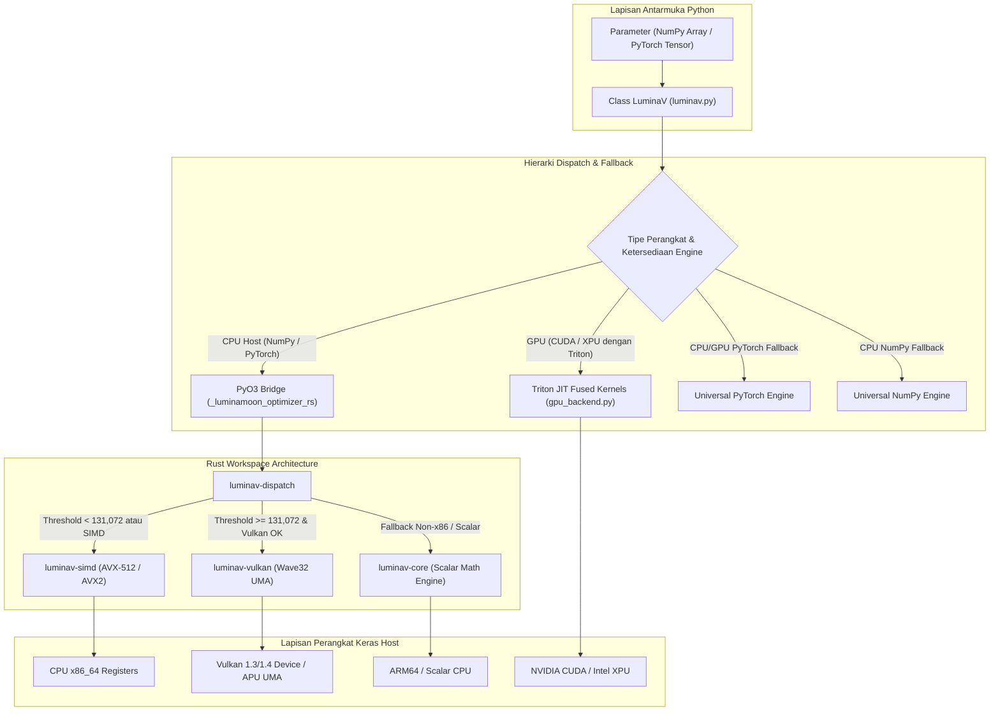

# Arsitektur & Akselerasi Hardware (Architecture & Hardware)

Penjelasan mendalam mengenai desain sistem internal LuminaMoon, pemisahan modular crate Rust, protokol memori zero-copy, dan hierarki fallback akselerasi multi-tier.

## Diagram Arsitektur Sistem

---

## Modularitas Crate Rust (`optimizer/crates/`)

Proyek ini dibangun di atas modularitas Rust Cargo Workspace yang memisahkan tanggung jawab komputasi secara tegas:

### 1. `luminav-core`
- **Tanggung Jawab**: Fondasi matematika murni, definisi struktur data state, enumerasi mode (`BufferMode`, `BoundType`, `DTypeMode`, `ExecutionMode`), dan generator bilangan acak semu (PRNG XORShift/PCG).
- **Fitur Khusus**: Konversi presisi numerik cepat tanpa alokasi memori heap (`f32_to_f16_bits_rne` dan `f16_bits_to_f32`).

### 2. `luminav-simd`
- **Tanggung Jawab**: Implementasi vektorisasi eksplisit tingkat rendah menggunakan *compiler intrinsics* x86_64.
- **Instruksi yang Didukung**:
  - **AVX-512**: Mengoptimalkan 16 elemen float sekaligus (`__m512`) dengan dukungan subset F, DQ, BW, dan VL.
  - **AVX2 & FMA**: Mengoptimalkan 8 elemen float sekaligus (`__m256`) dengan operasi Fused Multiply-Add terakselerasi hardware.

### 3. `luminav-vulkan`
- **Tanggung Jawab**: Pipeline komputasi berbasis driver Vulkan 1.3 / 1.4 menggunakan *Ash bindings*.
- **Keunggulan UMA**: Memanfaatkan *Unified Memory Architecture* (UMA) untuk membaca dan memodifikasi buffer memori host secara *zero-copy* tanpa overhead transfer PCIe.
- **Wave32 Subgroup**: Mendukung instruksi operasi subgroup Wave32 untuk reduksi paralel cepat di tingkat hardware shader.

### 4. `luminav-dispatch`
- **Tanggung Jawab**: Mendeteksi kemampuan hardware saat runtime (`detect_hardware`) dan merutekan eksekusi antara CPU SIMD dan Vulkan GPU Compute.
- **Threshold Otomatis**: Jika jumlah elemen parameter $\ge 131.072$ dan perangkat Vulkan tersedia, eksekusi diarahkan secara otomatis ke compute shader Vulkan; jika di bawah threshold, diarahkan ke threadpool Rayon AVX-512/AVX2.

### 5. `luminav-triton-aot`
- **Tanggung Jawab**: *Harness* kompilasi Ahead-of-Time (AOT) untuk menghasilkan berkas header C/C++ mandiri (`luminav_triton_standalone.h`) untuk integrasi embedded.

### 6. `optimizer/src/` (`_luminamoon_optimizer_rs`)
- **Tanggung Jawab**: Jembatan Python FFI menggunakan PyO3.
- **Zero-GIL Execution**: Mengeksekusi komputasi paralel Rayon di dalam blok `py.detach()`, membebaskan Python GIL (*Global Interpreter Lock*) sepenuhnya selama kalkulasi optimasi berlangsung.

---

## Protokol Memori Zero-Copy

LuminaMoon dirancang untuk menghindari penyalinan memori (*zero-copy allocation*):

1. **NumPy 2.x Buffer Interface**:
   - Mengekstrak pointer alamat memori fisik langsung melalui `__array_interface__['data'][0]` atau `ctypes.data`.
   - Data langsung dioper ke slice Rust `&mut [f32]` tanpa membuat salinan buffer perantara.

2. **PyTorch Host Pointer**:
   - Untuk tensor CPU, pointer diekstrak melalui metode native `tensor.data_ptr()`.

3. **Persyaratan Kontiguitas Memori**:
   - Seluruh buffer wajib berada dalam status contiguous memori baris (*C-contiguous*).
   - Jika tensor atau array bersifat *non-contiguous* (misal hasil transposisi atau slicing `p.T`), optimizer akan menolak eksekusi dan meminta pemanggilan `.contiguous()` atau `np.ascontiguousarray()` demi mencegah *silent memory corruption*.

---

## Python Stable ABI & Free-Threaded Runtime

Paket wheel `luminamoon` dibangun menggunakan standar CPython Stable ABI:
- **`abi3-py310`**: Satu file wheel binary yang dikompilasi pada Python 3.10 dapat dijalankan langsung pada Python 3.11, 3.12, 3.13, 3.14, hingga 3.15+ tanpa perlu dikompilasi ulang.
- **`abi3t` (PEP 703)**: Mendukung penuh mode *free-threaded* CPython 3.13+ (`Py_GIL_DISABLED`). Engine Rust dan kernel internal aman dari kondisi *race condition* dan memanfaatkan multithreading sejati di tingkat sistem operasi.
