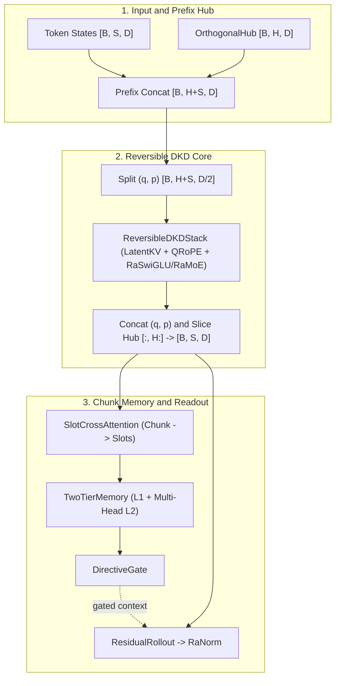
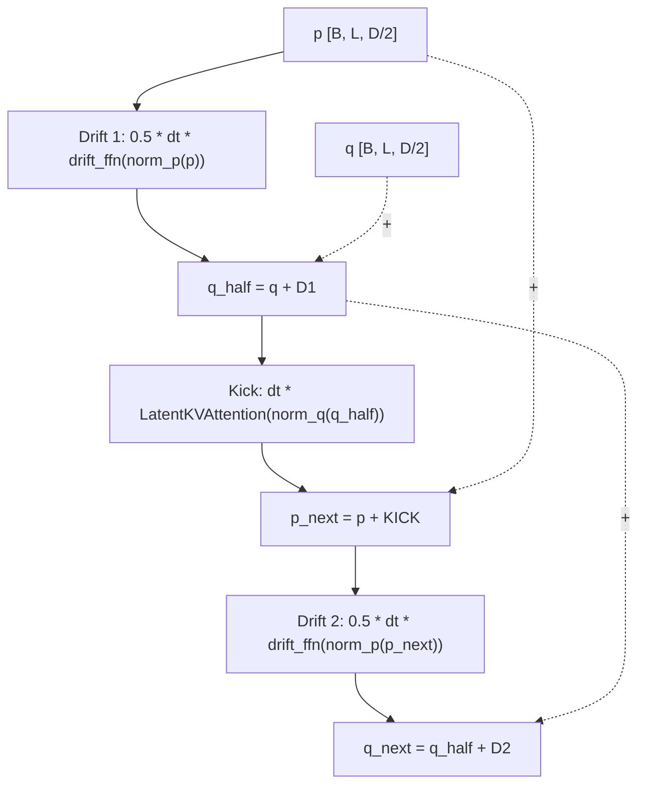

---
search:
  boost: 1.5
---

# Ra-Family: Rational Neural Architecture

The **Ra-Family (`luminamoon.nn`)** provides neural network components built around rational arithmetic and bounded polynomial approximations.

By avoiding $\tanh$, $\exp$, and square-root operations in normalization, activation, and attention layers, these components simplify arithmetic evaluation while keeping gradient propagation stable.

---

## Design Principles

Standard transformer and convolutional architectures rely on non-linear operations that map to specialized hardware circuits:

1. **Square-Root-Free Normalization**: Standard `LayerNorm` computes root-mean-square variance ($\sqrt{\sigma^2 + \epsilon}$), which translates to reciprocal square-root instructions (`rsqrt`) on CPUs and GPUs. `RaNorm` instead computes the mean-free $L_1$-mean ($\frac{1}{D}\sum |x_i|$), evaluating one scalar reciprocal per token vector (while `RaBatchNorm2d` uses centered mean absolute deviation).
2. **Rational Gated FFNs**: `RaSwiGLU` replaces `SiLU(x) = x / (1 + exp(-x))` with `x * pos_ra_gate(x)` (no per-element `exp()`), while `RaGLU` provides hard-bounded gating via `RaTanh(gate; b) * up` for tighter activation bounds under low-precision quantization (FP8 / INT4).
3. **Rational Softmax & Tiled Attention**: Standard softmax computes $\exp(x)$, which runs on GPU Special Function Units (SFU) at lower throughput than standard FMA pipelines. `ra_softmax` uses a Cayley-Padé rational approximation with compact support for large negative differences ($\Delta \ge 16$), while `ra_attention` and `RaAttention` tile the computation so the full $[B, H, N, N]$ matrix is not materialized in GPU memory.
4. **Optional PyTorch Dependency**: The core package declares `dependencies = []`. When PyTorch is installed, modules inherit from `torch.nn.Module`. When PyTorch is absent, components run on standalone NumPy arrays.

---

## Components

### 1. Normalization Layers

#### `RaNorm`
Token-level normalization using square-root-free, mean-free $L_1$-norm scaling:

$$\mu _ {|x|} = \frac{1}{D} \sum _ {i=1}^D |x _ i|, \qquad \mathrm{RaNorm}(x) = \frac{x}{\mu _ {|x|} + \epsilon} \odot \gamma + \beta$$

- Evaluates zero square roots and drops both mean subtraction and the Gaussian $C _ {L_1} = \sqrt{\pi/2}$ factor.
- Amortizes a single scalar reciprocal $(\mu _ {|x|} + \epsilon)^{-1}$ across all $D$ features.
- Scale-homogeneous: scaling $x$ by $\alpha > 0$ preserves the normalized output $\mathrm{RaNorm}(x)$.
- **Input pairing note**: Works well on dense Transformer activations (such as `RaGELU`, `RaSwiGLU`, `RaGLU`, and `RaTanh`). Because $L_1$ scaling can amplify a single isolated spike up to $\mathcal{O}(D)$ on highly sparse vectors (versus $\mathcal{O}(\sqrt{D})$ for $L_2$-based `RMSNorm`), avoid placing `RaNorm` directly after highly sparse activations with isolated spikes.

```python
import torch
from luminamoon.nn import RaNorm

norm = RaNorm(768, eps=1e-5)
x = torch.randn(2, 128, 768)
out = norm(x)
```

#### `RaBatchNorm2d`
2D batch normalization using cross-batch mean absolute deviation (MAD). On CUDA with Triton, uses Triton forward (3-kernel training, 1-kernel eval) and 2-kernel backward kernels (`python/luminamoon/nn/kernels/vision_act.py`) without saving intermediate 4D autograd buffers. Includes inference weight folding (`fold_into_conv`) to compute folded `(w_conv, b_conv)` tensors for preceding `torch.nn.Conv2d` layers:

```python
import torch.nn as nn
from luminamoon.nn import RaBatchNorm2d

conv = nn.Conv2d(32, 64, kernel_size=3, padding=1)
bn = RaBatchNorm2d(num_features=64)

# Before inference: compute folded (w_conv, b_conv) parameters
bn.eval()
w_folded, b_folded = bn.fold_into_conv(conv)
```

---

### 2. Rational Activation & Gating

#### `RaTanh`, `ra_tanh`, `RaGELU`, & `ra_gelu`
Rational approximation of hyperbolic tangent and GELU with scale parameter $b$, unit derivative at the origin, $C^2$ smoothness across $x = 0$, and algebraic $\mathcal{O}(1/|x|^3)$ gradient tails:

$$\mathrm{RaTanh}(x; b) = \frac{b (b + |x|) x}{b (b + |x|) + x^2}, \qquad \mathrm{RaGELU}(x) = \frac{1}{2} x \left(1 + \mathrm{RaTanh}\left(\sqrt{\frac{2}{\pi}}\,x;\, 1\right)\right)$$

```python
from luminamoon.nn import RaTanh, RaGELU, ra_tanh, ra_gelu

act = RaTanh(b=1.0)
gelu = RaGELU()
y = act(x)
```

#### `RaSwiGLU`, `ra_swiglu`, `RaGLU`, & `ra_glu`
Rational gated linear units built around the strictly positive rational gate `pos_ra_gate` and `RaTanh`:

$$\sigma _ {\text{Rat}}(z; b) = \frac{1}{2} \left( 1 + \frac{1}{b}\mathrm{RaTanh}(z; b) \right) \in (0, 1)$$

$$\mathrm{RaSwiGLU}(x) = W _ {\text{down}}\left(W _ {\text{up}}(x) \odot \left(W _ {\text{gate}}(x) \odot \sigma _ {\text{Rat}}(W _ {\text{gate}}(x); b)\right)\right)$$

$$\mathrm{RaGLU}(x) = W _ {\text{down}}\left(W _ {\text{up}}(x) \odot \mathrm{RaTanh}(W _ {\text{gate}}(x); b)\right)$$

- `RaSwiGLU` matches standard SwiGLU capacity without per-element `exp()` evaluations (default `hidden_features = int(in_features * 8 / 3)`).
- `RaGLU` bounds the gate to $(-b, b)$, keeping hidden activations linear in $\lVert W _ {\text{up}}(x)\rVert _ \infty$ for tighter FP8/INT4 quantization range.

```python
from luminamoon.nn import RaSwiGLU, RaGLU

ffn = RaSwiGLU(768)                        # defaults to hidden_features=2048
bounded_ffn = RaGLU(768, hidden_features=2048)
out = ffn(x)
```

---

### 3. Rational Attention & Softmax

#### `ra_softmax`
Cayley-Padé rational soft-argmax with compact support and closed-form autograd:

- Computes shift $\Delta _ i = x _ {\max} - x _ i \ge 0$.
- For $\Delta _ i < 16$, evaluates the rational numerator:

  $\displaystyle u _ i = \frac{\Delta _ i}{16}, \qquad q _ i = \frac{1 - u _ i}{1 + u _ i}, \qquad \phi _ i = q _ i^8$

- For $\Delta _ i \ge 16$ ($u _ i \ge 1$), $\phi _ i$ is set to $0.0$.
- Because $x _ {\max}$ produces $\Delta = 0$ ($\phi _ {\max} = 1.0$), the denominator satisfies $\sum \phi _ i \ge 1.0$, avoiding an artificial epsilon floor.
- **Closed-Form Backward Pass**: Evaluates the analytical derivative directly from output probabilities $p _ i$ and scaled shift $u _ i$ without saving intermediate power buffers ($q, q^2, q^4, \phi$):

  $\displaystyle \frac{\partial \phi _ i}{\partial u _ i} = -\frac{16}{1 - u _ i^2}\,\phi _ i \, \mathbb{I}(u _ i < 1)$

#### `ra_attention` & `RaAttention`
Fused tiled rational attention and multi-head / grouped-query attention module:

- Computes $(Q, K, V) \to O$ without materializing the $[B, H, N _ Q, N _ K]$ attention matrix in GPU memory.
- Supports Multi-Head Attention (MHA) and Grouped-Query Attention (GQA) via `num_kv_heads`, packed-sequence document isolation via `doc_ids: Optional[Tensor]` (`[B, N]`, `0` = padding, `> 0` = active document ID), and external additive or boolean `attn_mask` (`True` = attend, `False` = mask).
- On CUDA with Triton, executes a 2-pass SRAM tiled kernel (`@triton.autotune` across `BLOCK_M` in `{64, 128}` and `BLOCK_N` in `{32, 64}`) with block-sparse tile skipping whenever a query/key block pair shares no active document IDs under `doc_ids`.
- When Triton is unavailable or an external `attn_mask` is passed, falls back to PyTorch query-chunked tiling (`q_chunk_size=None` by default—using `128` for CPU causal $N _ Q \ge 384$, an adaptive element-budget chunk size otherwise, and an unchunked `cuda_fast` path for tiny unmasked CUDA decode sequences) and recomputes attention tiles in the backward pass so saved autograd state stays $\mathcal{O}(B \cdot H \cdot N _ Q \cdot D)$.
- **Initialization recommendation (`qk_norm=True`)**: Because `ra_softmax` sets $\phi _ i = 0$ for $\Delta _ i \ge 16$, large initial query/key logits can push attention scores outside compact support on step 1 and zero out gradients. Enabling `qk_norm=True` on `RaAttention` is recommended when training from scratch.

```python
from luminamoon.nn import RaAttention, ra_attention

# 1. Multi-Head / Grouped-Query Attention Module
attn = RaAttention(
    dim=768,
    num_heads=12,
    num_kv_heads=4,
    qk_norm=True,
    attn_drop=0.0,
    proj_drop=0.1,
    is_causal=True,
)
x = torch.randn(2, 128, 768)
out = attn(x)

# 2. Functional Tiled Attention
q = torch.randn(2, 12, 128, 64)
k = torch.randn(2, 12, 128, 64)
v = torch.randn(2, 12, 128, 64)
out_fn = ra_attention(q, k, v, is_causal=True)
```

---

### 4. Chunked Loss & Mixture-of-Experts

#### `LinearCrossEntropy` & `linear_cross_entropy`
Chunked linear projection and cross-entropy loss that avoids materializing the full `[B * N, V]` vocabulary logit tensor in memory:

- Supports stateful LM-head mode (`LinearCrossEntropy(in_features=..., vocab_size=...)`) and stateless criterion mode (`LinearCrossEntropy()` or `linear_cross_entropy(x, weight, target)`).
- Supports `ignore_index`, `reduction` (`"mean"`, `"sum"`, `"none"`), `label_smoothing`, `logit_scale`, `chunk_size`, and `save_logits=False` (set `save_logits=True` to trade VRAM for faster backward recomputation).

```python
from luminamoon.nn import LinearCrossEntropy

criterion = LinearCrossEntropy(in_features=768, vocab_size=32000)
hidden = torch.randn(2, 128, 768)
targets = torch.randint(0, 32000, (2, 128))
loss = criterion(hidden, targets)
```

#### `RaMoE` & `permute_tokens_by_expert`
Mixture-of-Experts block using `ra_softmax` routing, packed 3D expert weights with grouped GEMM (`expert_type="ra_swiglu"` or `"ra_glu"`), optional shared experts (`num_shared_experts`), optional `router_logit_bound` (bounding router logits via `ra_tanh` to avoid compact-support dead experts), and contiguous token permutation (`permute_tokens_by_expert`):

```python
from luminamoon.nn import RaMoE

moe = RaMoE(
    in_features=768,
    hidden_features=2048,
    num_experts=8,
    top_k=2,
    num_shared_experts=1,
    router_logit_bound=8.0,
)
x = torch.randn(2, 128, 768)
out = moe(x)
```

---

### 5. Position, Latent Attention, Reversible Blocks, and Memory (PyTorch)

These PyTorch modules are exported from `luminamoon.nn` alongside the Ra-Family components. `LatentKVAttention`, `SlotCrossAttention`, `ReversibleDKDBlock`, and `ReversibleDKDStack` default to `attention_backend="auto"`, which inherits an active `use_attention_backend(...)` context or otherwise calls PyTorch Scaled Dot-Product Attention (SDPA) without overriding external `torch.nn.attention.sdpa_kernel(...)` settings. They also accept short backend presets (`"sdpa"`, `"ra"`, `"flash"`, `"cudnn"`, `"fa3"`, `"flex"`) or a custom `attention_fn` callable.

#### 5.1 Position (`luminamoon.nn.position`)
- `QRoPE(head_dim=32, max_seq_len=4096, base=10000.0, freq_ratio=0.6180339887498949)` and `qrope(...)`: Double-Quaternion Rotary Position Embedding ($\mathrm{Spin}(4)$ left-right rotation on 4-element blocks, `head_dim % 4 == 0`), preserving $L _ 2$ norm and relative-position inner products across sequence offsets. Uses a fused Triton kernel (`python/luminamoon/nn/kernels/position.py`) with multi-row CTAs and a single-launch `apply_qk(q, k, offset=...)` path on CUDA, a Rayon Rust SIMD path on float32 CPU, and eager PyTorch fallback otherwise. Tensor offsets auto-grow the trig cache when needed and reject negative positions.
- `DistanceDecayBias(num_heads=8, hub_size=0, ..., mode="linear" | "rational", learnable=False, ...)`: additive per-head distance decay ($-s \cdot d$ or $-\log(1 + s \cdot d)$, clamped to $[-10.0, 0.0]$) with optional prefix hub-token damping and thread-safe, byte-bounded LRU geometry/bias caching.
- `Sinusoidal3DEmbedding(dim, theta=10000.0)`: sinusoidal positional embedding for 3D coordinates `(z, y, x)` (even `dim >= 6`, optional output `dtype`).

#### 5.2 Latent & Slot Attention (`luminamoon.nn.attention`)
- `LatentKVAttention(dim, num_heads=8, head_dim=None, kv_latent_dim=None, hub_size=0, ..., bias_mode="linear", attention_backend="auto", attention_fn=None, cache_mode="latent", ...)`: low-rank Key-Value (KV) latent projection with pre-transpose `QK-RaNorm`, full `QRoPE` applied after up-projection (distinct from decoupled-RoPE matrix absorption), `DistanceDecayBias`, and incremental KV-cache decoding (`cache_mode="latent"` for smaller cache footprint or `"kv"` for lower decode latency). Keeps `attn_mask=None, is_causal=True` when `bias_mode="none"`, `hub_size=0`, and `past_kv is None` so FlashAttention/cuDNN remain eligible; computes non-learnable `DistanceDecayBias` and hub causal masking in GPU on-chip shared memory (SRAM) via Triton `Flash-RaAttention` (`attention_backend="ra"`, with `torch.library.custom_op` support for `torch.compile`) or via `flex_attention` `score_mod` (compiled on CUDA) when `attention_backend="flex"`.
- `SlotCrossAttention(dim, num_heads=8, num_terminals=16, slots_per_terminal=4, attention_backend="auto", attention_fn=None, ...)`: multi-head cross-attention with orthogonally initialized per-slot queries and Feature-wise Linear Modulation (FiLM) from `terminal_base`. Returns zeros when `context_states` has zero length (`ctx_len == 0`). In causal language models, pass only past or prefix states.
- `use_attention_backend(backend)` / `get_attention_backend()`: thread-safe `ContextVar` helpers to set or inspect the backend inherited by `"auto"` modules.

#### 5.3 Reversible Blocks (`luminamoon.nn.blocks`)
- `ReversibleDKDBlock(dim, num_heads=8, ..., dt=0.5, num_layers=None, reversible=False, layer_idx=None, selective_type="none", every=2, selective_indices=None, compile_block=False, compile_kwargs=None, ..., attention_backend="auto", ..., kick_attn=None, drift_ffn=None, norm_cls=None, ...)`: volume-preserving Drift-Kick-Drift (DKD) split block on `(q, p)` halves of width `dim // 2`, supporting selective reversibility (`"none"`, `"all"`, `"every"`, `"even"`, `"odd"`, `"first_half"`, `"second_half"`, `"indices"`), `torch.compile` (`compile_block=True`, preserving `state_dict` keys), and custom `kick_attn`, `drift_ffn`, and `norm_cls`.
- `ReversibleDKDStack(num_layers, dim, ..., selective_type="none", every=2, ..., compile_blocks=False, ..., kick_attn_fn=None, drift_ffn_fn=None, ...)` and `resolve_selective_reversible(...)`: multi-layer DKD stack and selective-reversibility helper supporting whole-stack `torch.compile` when all layers are non-reversible (keeping `state_dict` keys unchanged, with CUDA Graph boundary guards for modes such as `compile_kwargs={"mode": "reduce-overhead"}`) and per-layer custom attention/FFN factories (such as inserting `RaMoE` every $N$ layers).
- `ResidualRollout(dim, num_steps=2, activation="ra_tanh" | "tanh", ...)`: weight-tied residual recurrence using `ra_tanh` by default.

#### 5.4 Memory & Hub (`luminamoon.nn.memory`)
- `OrthogonalHub(hub_size=128, dim=512, use_context_gate=False, ...)`: $\mathrm{SO}(H)$ prefix hub parameterized via a float32 Cayley transform with eval-mode caching. When `use_context_gate=True`, pass only past or prefix tokens as `context` in causal language models (empty `context` bypasses the context gate without producing `NaN`); otherwise keep `use_context_gate=False`.
- `DirectiveGate(dim, init_logit_scale=4.0, ...)`: pre-norm cosine gating and FiLM modulation over chunk summaries. When `directive_tokens=None`, pools the trailing past chunks (`chunks[:, -2:]`); returns empty input unchanged. In causal language models, do not pass the target sequence as `directive_tokens`.
- `TwoTierMemory(dim, max_l1=16, max_l2=32, num_heads=4, use_projections=True, use_topk=True, threshold=0.0, temperature=0.25, memory_dropout=0.0, ...)`: differentiable two-tier slot memory combining Tier-1 (`L1`, leading fixed slots) and Tier-2 (`L2`, query-gated selector using multi-head token-max LogSumExp scoring), with optional soft-only mode (`use_topk=False`) during warmup, `encode_keys(...)` / `cached_keys` reuse, `query=None` past-only default, `chunks=None` empty cold-start output, and optional `memory_dropout` during training.
- `CausalMemoryTap(dim, num_heads=4, max_l1=2, max_l2=4, num_terminals=4, slots_per_terminal=2, memory_dropout=0.15, attention_backend="auto", ...)`: causal memory tap combining `TwoTierMemory`, `DirectiveGate`, and `SlotCrossAttention` over `past_chunks` with zero-initialized residual projection, cold-start bypass when `past_chunks is None`, `memory_dropout` during training, and an alias check rejecting `past_chunks` sharing storage with target `x`.
- `assert_causal_no_leak(fn, sample_input, *, atol=0.0, token_dim=1, raise_on_leak=True)`: perturbs only the final position along `token_dim` under `torch.no_grad()` and checks that earlier positions $0 \dots S - 2$ do not change beyond `atol` (raising `RuntimeError` or emitting `RuntimeWarning`).

#### Architecture Flow & Example Pipeline

> **Interactive Explorer**: Open the [Interactive Architecture Explorer](architecture.md) on the documentation site to click through all 10 modules, inspect tensor shapes, compare Reversible DKD forward and analytic inverse mechanics, and view the acronym glossary.

**Example Pipeline**



**Single `ReversibleDKDBlock` Step (Drift-Kick-Drift; total length $L = H + S$ when prefixed by `OrthogonalHub`)**



> **Chunked Long-Context Sizing Note**: When chaining `ReversibleDKDStack` with `SlotCrossAttention` and `TwoTierMemory` across chunks of length $L _ {\text{chunk}}$, keep `hub_size` at or below $15\%$ of $L _ {\text{chunk}}$, use $T$ terminals (`num_terminals`) and $K = 4$ slots per terminal (`slots_per_terminal`) with a compression ratio $R = L _ {\text{chunk}} / (T \cdot K) \in [4, 16]$, and cache past slot keys via `TwoTierMemory.encode_keys(...)` during repeated retrieval.

#### Causal Model Placement Notes
- Keep the earliest layer dense (`RaSwiGLU`) and interleave `RaMoE` in middle or deeper layers with `num_shared_experts >= 1` and `router_logit_bound` (such as `8.0` to `12.0`).
- Place `CausalMemoryTap` (or manual `TwoTierMemory` + `DirectiveGate` + `SlotCrossAttention`) at 1–2 middle/late points rather than every layer, keep `memory_dropout > 0` during training so cold-start inference (`past_chunks=None`) stays in distribution, and run `assert_causal_no_leak(model, sample_input)` before training to catch accidental future-token leakage.
- Close the backbone with a final `RaNorm` followed by `LinearCrossEntropy` / `linear_cross_entropy` during training to avoid materializing full `[B, S, V]` logits.

```python
import torch
from luminamoon.nn import OrthogonalHub, RaMoE, ReversibleDKDStack, use_attention_backend

dim, hub_size = 512, 16
half_dim = dim // 2  # drift_ffn operates on the split half-width dim // 2

hub = OrthogonalHub(hub_size=hub_size, dim=dim, use_context_gate=False)
stack = ReversibleDKDStack(
    num_layers=12,
    dim=dim,
    num_heads=8,
    kv_latent_dim=64,
    hub_size=hub_size,
    selective_type="every",
    every=4,
    compile_blocks=False,
    bias_mode="linear",
    drift_ffn_fn=lambda i: (
        RaMoE(half_dim, 384, half_dim, num_experts=4, top_k=2, num_shared_experts=1, return_aux_loss=False)
        if (i + 1) % 4 == 0
        else None
    ),
)
tokens = torch.randn(2, 128, dim)
seq = torch.cat((hub(tokens.shape[0]), tokens), dim=1)  # [B, H + S, D]
q, p = torch.chunk(seq, 2, dim=-1)
# Inherits outer PyTorch SDPA settings by default, or an explicit luminamoon context:
with use_attention_backend("ra"):
    q_next, p_next, _ = stack(q, p)
out_tokens = torch.cat((q_next, p_next), dim=-1)[:, hub_size:, :]  # [B, S, D]
```

---

## Standalone NumPy Execution (Zero-PyTorch Mode)

When PyTorch is not installed, `RaNorm`, `RaBatchNorm2d`, `RaTanh`, `RaGELU`, `ra_tanh`, `ra_gelu`, `pos_ra_gate`, `ra_swiglu`, `RaSwiGLU`, `ra_glu`, `RaGLU`, `ra_softmax`, `ra_attention`, `RaAttention`, `LinearCrossEntropy`, `linear_cross_entropy`, and `RaMoE` run on NumPy arrays:

```python
import numpy as np
from luminamoon.nn import RaNorm, ra_gelu, ra_softmax

norm = RaNorm(64)
x_np = np.random.randn(4, 64).astype(np.float32)
out_np = ra_gelu(norm(x_np))

logits = np.array([[2.0, 1.0, 0.0], [5.0, 1.0, -10.0]], dtype=np.float32)
probs = ra_softmax(logits, dim=-1)
```

---

## Hardware Acceleration

Ra-Family modules include built-in hardware paths:

1. **GPU (Triton JIT)**: On CUDA GPUs with Triton installed, `RaNorm`, `RaBatchNorm2d`, `RaTanh`, `RaGELU` (`ra_gelu`), `RaSwiGLU`, `RaGLU`, `QRoPE` (`qrope`), `ra_softmax`, `ra_attention` / `RaAttention` (including SRAM `doc_ids` with block-sparse tile skipping), `linear_cross_entropy` / `LinearCrossEntropy` (chunked LCE targeting a ~400 MiB VRAM budget), and `RaMoE` (`moe_grouped_gemm.py` + `triton_ra_gated_packed`, or `torch._grouped_mm` on `sm_90+`) dispatch to fused Triton kernels under `python/luminamoon/nn/kernels/`.
2. **Optional GPU Backend (CubeCL)**: When built with a CubeCL backend feature (e.g., `--features cubecl-wgpu`), `luminav-cubecl` runs five FP32 forward ops (`RaNorm`, `ra_tanh`, `ra_swiglu`, `ra_glu`, and `ra_softmax`) across `wgpu`, Vulkan, Metal, CUDA, and HIP (`is_cubecl_available()`), gated at $\ge 65{,}536$ elements with a `MAX_GRID_X = 65_535` launch guard.
3. **CPU (Rust SIMD)**: On x86_64 CPUs, FP32 passes dispatch through `luminav-simd` via PyO3 FFI with `py.detach()`—using `AVX2+FMA` kernels for `RaNorm`, `RaTanh`, `RaSwiGLU`, and `RaGLU`, and `AVX-512` / `AVX2+FMA` kernels for `ra_softmax` (fwd+bwd) and `ra_attention` (fwd+bwd)—falling back to portable scalar Rust on ARM64 / non-AVX2 hosts.

> **Internal Test Note**: In internal development tests on an NVIDIA L4 GPU (no public benchmarks are published yet), passing `doc_ids=batch.doc_ids` directly to Triton `RaAttention` reduced packed-sequence memory overhead compared to dense `[B, 1, N, N]` masks while block-sparse tile skipping reduced packed attention latency by ~2.0x–2.3x, and fused Triton `RaBatchNorm2d` / `RaGELU` improved ResNet-34 128x128 training throughput from ~293 img/s (9.44 GiB) to ~2,020 img/s (1.22 GiB).

---

## Theoretical References

For mathematical derivations, literature comparisons, and BibTeX entries, see:
- [Theoretical References](../../references/README.md)
- BibTeX database: [`references/bibliography.bib`](https://github.com/cloverx-id/luminamoon/blob/main/references/bibliography.bib)
