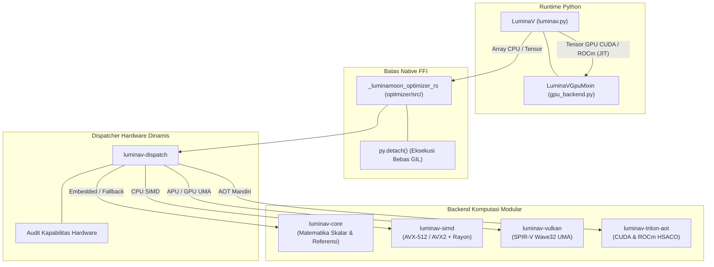

# LuminaV Optimizer: Panduan Rekayasa & Arsitektur Developer

Dokumen ini merupakan spesifikasi teknis internal utama bagi *systems engineer*, pemrogram kernel komputasi, dan peneliti yang berkontribusi pada subsistem **LuminaV Optimizer** di dalam workspace LuminaMoon.

[English Version (README.md)](README.md)

---

## 1. Arsitektur Subsistem & Modularitas

Mesin komputasi optimizer dirancang dengan arsitektur berlapis dan terisolasi: antarmuka runtime Python di lapisan terluar dan Cargo workspace Rust modular (`optimizer/crates/`) di lapisan komputasi perangkat keras:



---

## 2. Navigasi Direktori & Spesifikasi Teknis

| Modul | Crate / Jalur | Fokus & Invarian Utama | Dokumen Spesifikasi |
| :--- | :--- | :--- | :--- |
| **Core Math** | `luminav-core` | Formulasi CLM/TD-CLM, PRNG PCG/XORShift, bukti bias correction, manifold bounding | [01. Core & Math](core/README.id.md) |
| **SIMD Vectorization** | `luminav-simd` | Intrinsik AVX-512 / AVX2 x86_64, masking tail, partisi Rayon, keselarasan cache line | [02. SIMD](simd/README.id.md) |
| **Vulkan Compute** | `luminav-vulkan` | Binding Ash Vulkan 1.3/1.4, shader SPIR-V, zero-copy host UMA, reduksi Wave32 | [03. Vulkan](vulkan/README.id.md) |
| **Triton AOT & Drivers** | `luminav-triton-aot` | Kompilasi AOT, validasi magic ELF64, pemuatan dinamis driver CUDA/HIP, C-API | [04. Triton AOT](triton_aot/README.id.md) |
| **Hardware Dispatch** | `luminav-dispatch` | Heuristik audit hardware (`detector.rs`), ambang batas 131.072 elemen, perutean | [05. Dispatch](dispatch/README.id.md) |
| **Python FFI Bridge** | `optimizer/src/` | PyO3 0.30+, `py.detach()`, validasi anti-aliasing pointer, zero-copy buffer | [06. Python FFI](python_ffi/README.id.md) |
| **Python Engine & GPU** | `python/luminamoon/` | Interop PyTorch/NumPy, kernel AST Triton JIT, sinkronisasi FSDP, checkpoint state | [07. Python Runtime](python_runtime/README.id.md) |

---

## 3. Invarian Pengembang & Standar Rekayasa

1. **Keamanan Memori & Eksekusi Zero-Copy**:
   - Pointer mentah yang melintasi FFI wajib tervalidasi terhadap keselarasan alamat memori asli.
   - Pointer diproteksi dari *aliasing*: pointer parameter mutable, pointer gradien, dan buffer akumulator tidak boleh saling tumpang tindih.
2. **Stochastic Rounding Deterministik**:
   - Setiap parameter mempertahankan *seed* PRNG unik yang diturunkan melalui `derive_kernel_seeds(base_seed, param_idx, step)` untuk menjamin reproduktibilitas penuh antar-thread.
3. **Integritas Status Low-Precision**:
   - Single-buffer TD-CLM memanfaatkan selisih gradien temporal $(g_t - m_{t-1})$ untuk mengeliminasi buffer momen kedua ($v$), memangkas 50% alokasi VRAM tanpa degradasi stabilitas konvergensi.
4. **Kendali GIL**:
   - Seluruh eksekusi multi-core di Rust WAJIB berjalan di dalam blok `py.detach()`, melepaskan GIL CPython untuk mendukung konkurensi sejati pada Python *free-threaded* (PEP 703).

---

## 4. Instruksi Kompilasi & Verifikasi Lokal

```bash
# Kompilasi ekstensi biner rilis secara lokal
maturin develop --release

# Jalankan pengujian unit dan paritas diferensial seluruh crate Rust
cargo test --workspace

# Jalankan suite verifikasi standalone NumPy
python optimizer/tests/test_standalone_numpy.py

# Jalankan suite integrasi training end-to-end PyTorch
python optimizer/tests/test_end_to_end_training.py
```
