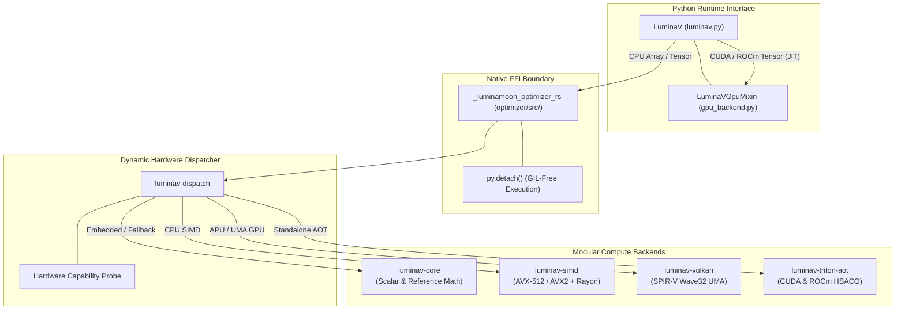

# LuminaV Optimizer: Developer Architecture & Engineering Guide

This portal serves as the primary internal technical specification for systems engineers, kernel programmers, and researchers contributing to the **LuminaV Optimizer** subsystem within the LuminaMoon workspace.

[Versi Bahasa Indonesia (README.id.md)](README.id.md)

---

## 1. Subsystem Architecture & Modularity

The optimizer compute engine is structured as a layered, decoupled system consisting of an outer Python framework interface and a low-level Rust Cargo workspace (`optimizer/crates/`):



---

## 2. Directory Navigation & Technical Specs

| Module | Crate / Path | Focus & Core Invariants | Spec Document |
| :--- | :--- | :--- | :--- |
| **Core Math** | `luminav-core` | Analytical CLM/TD-CLM, PCG/XORShift PRNG, bias correction proofs, bounding | [01. Core & Math](core/README.md) |
| **SIMD Vectorization** | `luminav-simd` | x86_64 AVX-512 / AVX2 intrinsics, tail masks, Rayon chunking, cache alignment | [02. SIMD](simd/README.md) |
| **Vulkan Compute** | `luminav-vulkan` | Ash Vulkan 1.3/1.4, SPIR-V shaders, zero-copy UMA host memory, Wave32 subgroups | [03. Vulkan](vulkan/README.md) |
| **Triton AOT & Drivers** | `luminav-triton-aot` | AOT compilation, ELF64 magic header validation, dynamic CUDA/HIP drivers, C-API | [04. Triton AOT](triton_aot/README.md) |
| **Hardware Dispatch** | `luminav-dispatch` | Runtime capability probing (`detector.rs`), 16,384-element threshold, routing | [05. Dispatch](dispatch/README.md) |
| **Python FFI Bridge** | `optimizer/src/` | PyO3 0.30+, `py.detach()`, pointer anti-aliasing validation, zero-copy buffers | [06. Python FFI](python_ffi/README.md) |
| **Python Engine & GPU** | `python/luminamoon/` | PyTorch/NumPy interop, Triton JIT AST kernels, FSDP collective sync, state dict | [07. Python Runtime](python_runtime/README.md) |

---

## 3. Developer Invariants & Coding Standards

1. **Memory Safety & Zero-Copy Execution**:
   - Pointers passed across the FFI boundary must be verified for 64-byte or native type alignment.
   - Pointers are guarded against anti-aliasing: mutable parameter pointers, gradient pointers, and accumulator buffers must never overlap.
2. **Deterministic Stochastic Rounding**:
   - Every parameter maintains a distinct PRNG seed derived via `derive_kernel_seeds(base_seed, param_idx, step)` to ensure complete reproducibility across threads.
3. **Low-Precision State Integrity**:
   - Single-buffer TD-CLM uses temporal gradient differences $(g_t - m_{t-1})$ to eliminate the second-moment accumulator buffer ($v$), slashing state VRAM footprint by 50% without numerical instability.
4. **GIL Control**:
   - All multi-core Rust operations MUST execute inside `py.detach()`, yielding the CPython GIL to enable true concurrent scaling on free-threaded Python (PEP 703).

---

## 4. Local Build & Test Verification

```bash
# Build release extension locally
maturin develop --release

# Run all Rust crate unit and differential parity tests
cargo test --workspace

# Run standalone NumPy test suite
python optimizer/tests/test_standalone_numpy.py

# Run PyTorch deep learning integration test suite
python optimizer/tests/test_end_to_end_training.py
```
