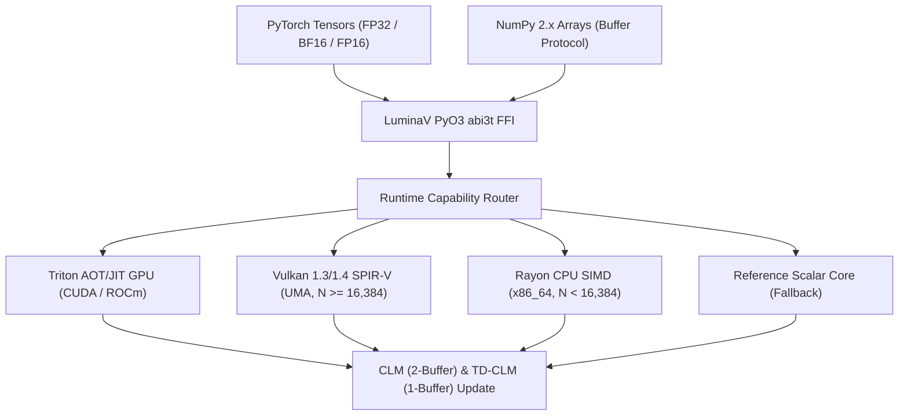

# LuminaV Optimizer: Developer Architecture & Engineering Guide

This directory contains internal technical documentation for contributors working on the **LuminaV Optimizer** subsystem within the LuminaMoon workspace.

---

## 1. Subsystem Architecture & Modularity

The optimizer is structured as a layered system with a Python framework interface and a Rust Cargo workspace (`optimizer/crates/`):



---

## 2. Directory Navigation & Technical Specs

| Module | Crate / Path | Focus & Core Invariants | Spec Document |
| :--- | :--- | :--- | :--- |
| **Core Math** | `luminav-core` | Analytical CLM/TD-CLM, PRNG, bias correction, update bounding | [01. Core & Math](core/README.md) |
| **SIMD Vectorization** | `luminav-simd` | x86_64 AVX-512 / AVX2 intrinsics, tail masks, Rayon chunking, cache alignment | [02. SIMD](simd/README.md) |
| **Vulkan Compute** | `luminav-vulkan` | Ash Vulkan 1.3/1.4, SPIR-V shaders, UMA host memory, Wave32 subgroups | [03. Vulkan](vulkan/README.md) |
| **Triton AOT & Drivers** | `luminav-triton-aot` | AOT compilation, ELF64 header checks, dynamic CUDA/HIP drivers, C-API | [04. Triton AOT](triton_aot/README.md) |
| **Hardware Dispatch** | `luminav-dispatch` | Runtime capability probing (`detector.rs`), 16,384-element threshold, routing | [05. Dispatch](dispatch/README.md) |
| **Python FFI Bridge** | `optimizer/src/` | PyO3 0.30+, `py.detach()`, pointer aliasing checks, buffer access | [06. Python FFI](python_ffi/README.md) |
| **Python Engine & GPU** | `python/luminamoon/` | PyTorch/NumPy interop, Triton JIT kernels, FSDP collective sync, state dict | [07. Python Runtime](python_runtime/README.md) |

---

## 3. Developer Invariants & Coding Standards

1. **Memory Safety & Buffer Access**:
   - Pointers passed across the FFI boundary are checked for alignment.
   - Mutable parameter pointers, gradient pointers, and accumulator buffers are checked to ensure they do not overlap.
2. **Deterministic Stochastic Rounding**:
   - Every parameter uses a deterministic PRNG seed derived via `derive_kernel_seeds(base_seed, param_idx, step)` so results remain reproducible across threads.
3. **Low-Precision State Management**:
   - Single-buffer TD-CLM (Triangle-Defect Convex Lookahead Momentum) uses the triangle inequality envelope $\mathcal{E}_t = \beta_1^2 |m_{t-1}| + (1 - \beta_1^2) |g_t| + \lambda |g_t - m_{t-1}| + \epsilon_{\text{eff}}$ to omit the second-moment accumulator buffer ($v$), reducing optimizer state memory by 50% compared to two-buffer mode.
4. **GIL Release**:
   - Multi-core Rust operations execute inside `py.detach()`, releasing the CPython GIL during computation.

---

## 4. Local Build & Test Verification

```bash
# Build release extension locally
maturin develop --release

# Run Rust crate unit and parity tests
cargo test --workspace

# Run standalone NumPy test suite
python optimizer/tests/test_standalone_numpy.py

# Run PyTorch integration test suite
python optimizer/tests/test_end_to_end_training.py
```
