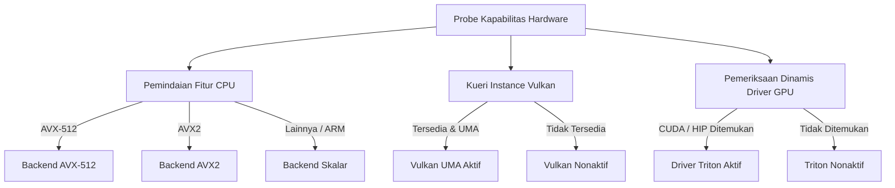
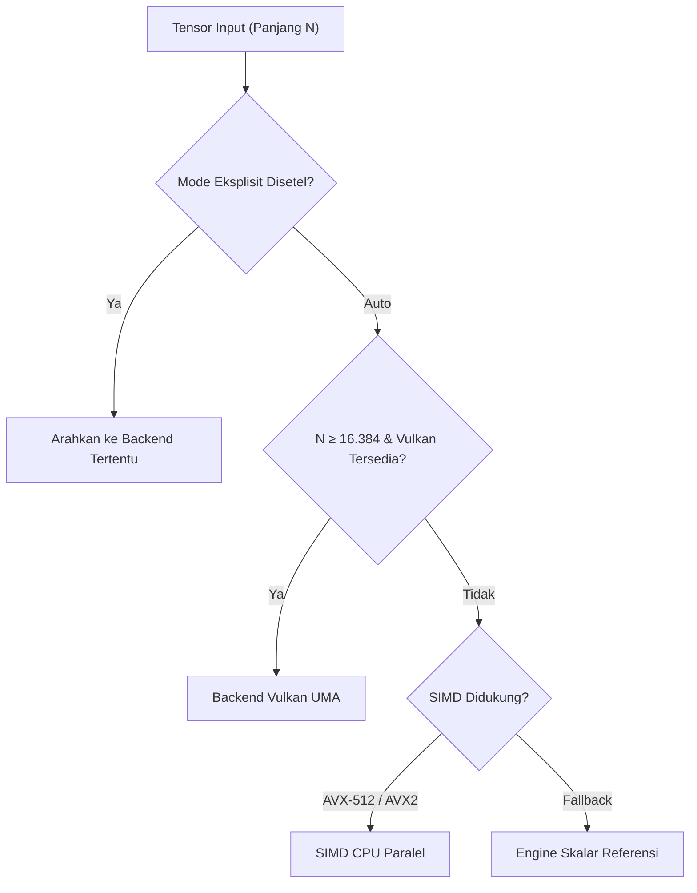

# `luminav-dispatch`: Audit Kapabilitas Hardware & Heuristik Perutean

`luminav-dispatch` bertindak sebagai koordinator inspeksi kemampuan perangkat keras runtime dan mengarahkan beban kerja pembaruan parameter ke backend komputasi yang paling optimal berdasarkan ukuran tensor, ketersediaan arsitektur, dan preferensi konfigurasi.

[English Version (README.md)](README.md)

---

## 1. Mesin Deteksi Hardware (`src/detector.rs`)

Metode audit statis `LuminaV.detect_hardware()` mengaudit kapabilitas mesin host tanpa melempar eksepsi sistem:

---

## 2. Heuristik Perutean Dinamis (`src/router.rs`)

Ketika parameter `execution = "auto"`, jalur eksekusi dipilih secara dinamis:

### Heuristik Ambang Batas 16.384 Elemen (GPU_DISPATCH_THRESHOLD)
Untuk tensor berukuran kecil hingga menengah ($N < 16.384$ elemen, didefinisikan oleh konstanta `GPU_DISPATCH_THRESHOLD = 16_384`), latensi pengiriman *command buffer* dan sinkronisasi pipeline GPU lebih besar daripada waktu komputasi murni. Pada rentang ini, SIMD CPU multi-thread mengeksekusi dengan *cache locality* yang efisien. Untuk tensor besar ($N \ge 16.384$), eksekusi dialihkan ke pipeline komputasi GPU jika backend tersedia.
