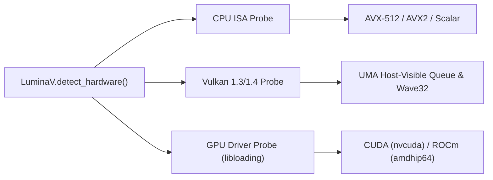
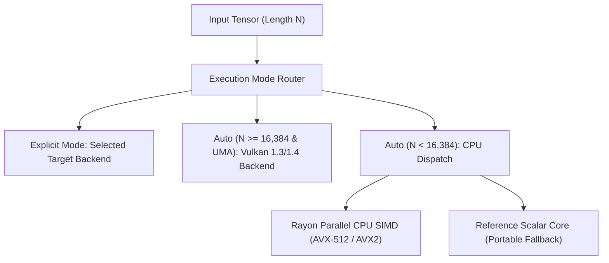

# `luminav-dispatch`: Hardware Capability Probing & Routing Heuristics

`luminav-dispatch` coordinates runtime hardware capability auditing and routes parameter update workloads to the optimal compute backend based on tensor size, architecture availability, and user preferences.

---

## 1. Hardware Detection Engine (`src/detector.rs`)

The static probe method `LuminaV.detect_hardware()` queries host capabilities without throwing exceptions:

---

## 2. Dynamic Routing Heuristic (`src/router.rs`)

When `execution = "auto"`, execution paths are selected dynamically:

### The 16,384 Threshold Heuristic (GPU_DISPATCH_THRESHOLD)
For small and medium tensors ($N < 16,384$ elements, defined by `GPU_DISPATCH_THRESHOLD = 16_384`), GPU command buffer submission and pipeline synchronization latencies outweigh kernel compute speedups. In this regime, multi-threaded CPU SIMD executes with direct cache locality. For large tensors ($N \ge 16,384$), execution shifts to the GPU compute pipeline when available.
