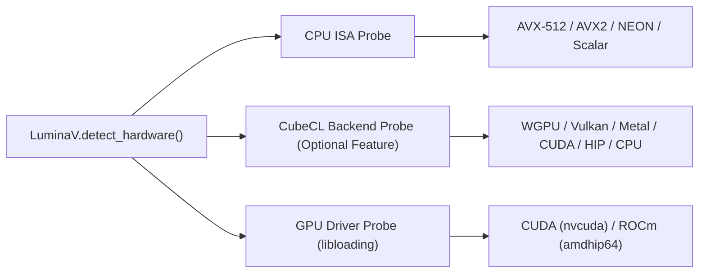
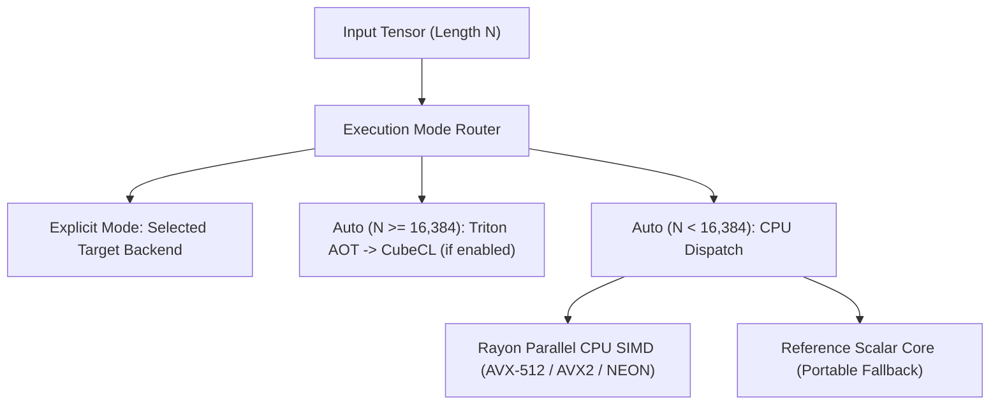

# `luminav-dispatch`: Hardware Capability Probing & Routing Heuristics

`luminav-dispatch` coordinates runtime hardware capability detection and routes parameter updates to the best-matching compute backend based on tensor size, architecture availability, and user preferences.

---

## 1. Hardware Detection Engine (`src/detector.rs`)

The static probe method `LuminaV.detect_hardware()` queries host capabilities without throwing exceptions:

---

## 2. Dynamic Routing Heuristic (`src/router.rs`)

When `execution = "auto"`, execution paths are selected dynamically:

### The 16,384 Threshold Heuristic (`GPU_DISPATCH_THRESHOLD`)
For small and medium tensors ($N < 16{,}384$ elements, defined by `GPU_DISPATCH_THRESHOLD = 16_384`), GPU command submission and synchronization latencies outweigh compute speedups, so multi-threaded CPU SIMD runs directly. For large tensors ($N \ge 16{,}384$), `Auto` tries `TritonAotEngine` first for all four buffer modes (`Dual`, `TdClm`, `T1`, `T2`), then tries `CubeClLuminaEngine` if compiled with a `cubecl-*` backend feature (e.g., `cubecl-wgpu`), and falls back to multi-threaded CPU SIMD (`luminav_simd::step`) if no GPU backend matches.
