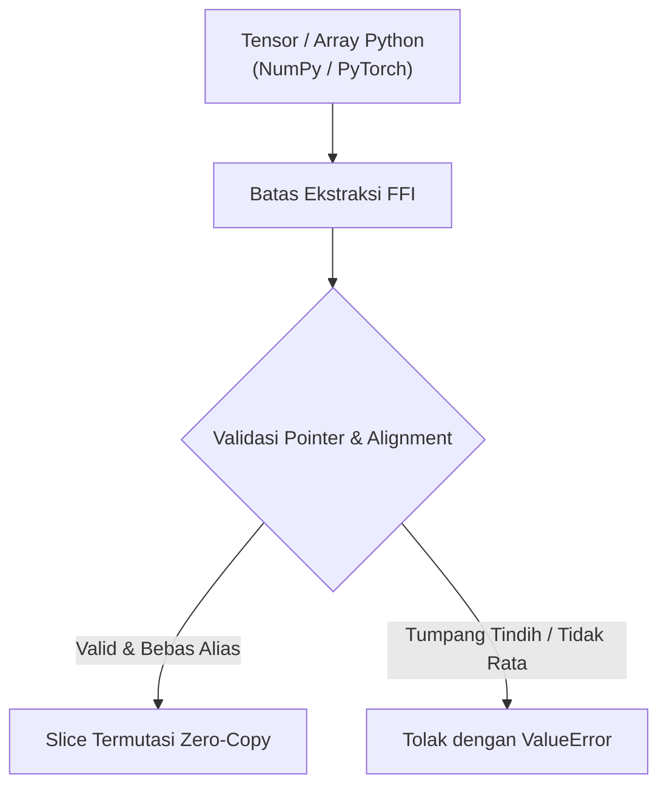

# `optimizer/src/`: Jembatan PyO3 FFI & Invarian Keamanan Memori

Ekstensi biner native `_luminamoon_optimizer_rs` menghubungkan CPython dan Rust melalui PyO3 0.30+, memungkinkan dispatch CPU/GPU multi-thread dengan pelepasan GIL penuh.

[English Version (README.md)](README.md)

---

## 1. Ekstraksi Pointer Zero-Copy & Validasi

Jembatan FFI tidak pernah menyalin atau menduplikasi tensor di atas heap Python. Sebagai gantinya, FFI mengekstraksi alamat fisik memori secara langsung melalui:
- **NumPy 2.x**: `tensor.__array_interface__['data'][0]` atau `ctypes.data`.
- **PyTorch**: `tensor.data_ptr()`.



---

## 2. Proteksi Ketat Anti-Aliasing Pointer

Untuk mencegah kerusakan memori, *data races*, dan *undefined behavior* selama pemrosesan paralel Rayon:

```rust
// Pointer anti-aliasing validation across concurrent tasks
let mut seen_mut_ptrs = HashSet::with_capacity(count * 4);
for it in &items {
    if it.grad_ptr == it.param_ptr || it.grad_ptr == it.exp_avg_ptr {
        return Err(PyValueError::new_err(format!(
            "Pointer aliasing detected: grad_ptr aliases mutable state."
        )));
    }
    for &ptr in &[it.param_ptr, it.exp_avg_ptr, it.scratch_ptr] {
        if !seen_mut_ptrs.insert(ptr) {
            return Err(PyValueError::new_err(format!(
                "Pointer aliasing detected: mutable buffer shared across parameters."
            )));
        }
    }
}
```

---

## 3. Pelepasan GIL Melalui `py.detach()`

Kode PyO3 standar yang menahan GIL akan memblokir thread Python lain. LuminaMoon menggunakan `py.detach()`:

```rust
py.detach(|| {
    // GIL CPython dilepaskan secara total.
    // Rayon mengeksekusi beban kerja di seluruh core CPU secara konkuren.
    step_batch_internal(&items, &config);
});
```

Mekanisme ini menjamin akselerasi linear sejati pada runtime Python *free-threaded* (`abi3t` / Python 3.13t+ PEP 703).
