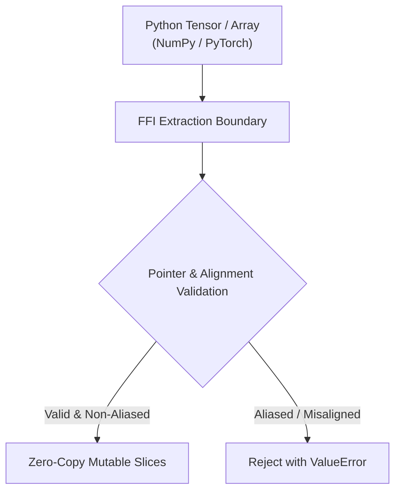

# `optimizer/src/`: PyO3 FFI Bridge & Memory Safety Invariants

The `_luminamoon_optimizer_rs` native extension provides the zero-overhead CPython FFI boundary using PyO3 0.30+, enabling multi-threaded CPU/GPU dispatch with complete GIL liberation.

[Versi Bahasa Indonesia (README.id.md)](README.id.md)

---

## 1. Zero-Copy Pointer Extraction & Validation

The FFI bridge never duplicates or clones tensor data on the heap. Instead, it extracts raw physical memory addresses via:
- **NumPy 2.x**: `tensor.__array_interface__['data'][0]` or `ctypes.data`.
- **PyTorch**: `tensor.data_ptr()`.



---

## 2. Strict Pointer Anti-Aliasing Guards

To prevent memory corruption, data races, and undefined behavior during concurrent Rayon execution:

```rust
// Pointer anti-aliasing validation across concurrent tasks
let mut seen_mut_ptrs = HashSet::with_capacity(count * 4);
for it in &items {
    if it.grad_ptr == it.param_ptr || it.grad_ptr == it.exp_avg_ptr {
        return Err(PyValueError::new_err(format!(
            "Pointer aliasing detected: grad_ptr aliases mutable state."
        )));
    }
    for &ptr in &[it.param_ptr, it.exp_avg_ptr, it.scratch_ptr] {
        if !seen_mut_ptrs.insert(ptr) {
            return Err(PyValueError::new_err(format!(
                "Pointer aliasing detected: mutable buffer shared across parameters."
            )));
        }
    }
}
```

---

## 3. GIL Liberation via `py.detach()`

Standard PyO3 code holding the GIL blocks other Python threads from executing. LuminaMoon uses `py.detach()`:

```rust
py.detach(|| {
    // CPython GIL is completely released.
    // Rayon executes across all CPU cores concurrently.
    step_batch_internal(&items, &config);
});
```

This guarantees true linear speedup on free-threaded Python runtimes (`abi3t` / Python 3.13t+ PEP 703).
