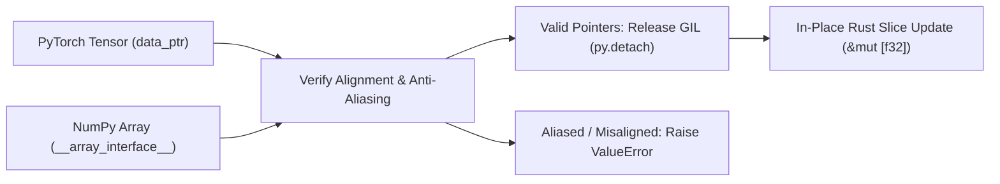

# `optimizer/src/`: PyO3 FFI Bridge & Memory Safety Invariants

The `_luminamoon_optimizer_rs` native extension provides the CPython FFI boundary using PyO3 0.30+, supporting multi-threaded CPU/GPU dispatch with `py.detach()` GIL release.

---

## 1. Direct Pointer Extraction & Validation

The FFI bridge extracts raw physical memory addresses directly (`Float32` buffers are mutated in-place as `&mut [f32]`, while `BFloat16`/`Float16` tensors use thread-local `FfiDecodeWorkspace` buffers in `src/python_ffi/worker.rs`) via:

- **NumPy 2.x**: `tensor.__array_interface__['data'][0]` or `ctypes.data`.
- **PyTorch**: `tensor.data_ptr()`.



---

## 2. Pointer Anti-Aliasing & Buffer Contiguity Guards

To prevent memory corruption, data races, and undefined behavior during concurrent Rayon execution:

- **Byte-Range Overlap Check (`src/python_ffi/mod.rs`)**: Every mutable slice (`param`, `exp_avg`, `exp_avg_sq`, `master_param`, `scratch`) is recorded as a `[start_addr, byte_len)` range and checked via `ranges_overlap` against all other mutable slices and read-only `grad` ranges, catching both identical start pointers and overlapping tensor views/slices before `py.detach()`.
- **Contiguity & Dtype Verification (`src/python_ffi/extract.rs`)**: `extract_ptr_and_len` and `extract_scratch_ptr` verify C-contiguity (`is_contiguous()` / `flags.c_contiguous`), element width, and dtype (`f4` for scratch) before constructing Rust slices.
- **Bounded Thread-Local Decode Workspace (`src/python_ffi/worker.rs`)**: Temporary `f32` decode buffers used for `BF16`/`FP16` CPU steps cap retained capacity at 4,194,304 elements (16 MiB per buffer) via `shrink_to` so single large-layer spikes do not pin worker memory indefinitely.

---

## 3. Releasing the GIL via `py.detach()`

Standard PyO3 code holding the GIL blocks other Python threads from executing. LuminaMoon uses `py.detach()`:

```rust
py.detach(|| {
    // CPython GIL is completely released.
    // Rayon executes across all CPU cores concurrently.
    step_batch_internal(&items, &config);
});
```

This allows concurrent multi-thread execution on free-threaded Python runtimes (`abi3t` / Python 3.13t+ PEP 703).
