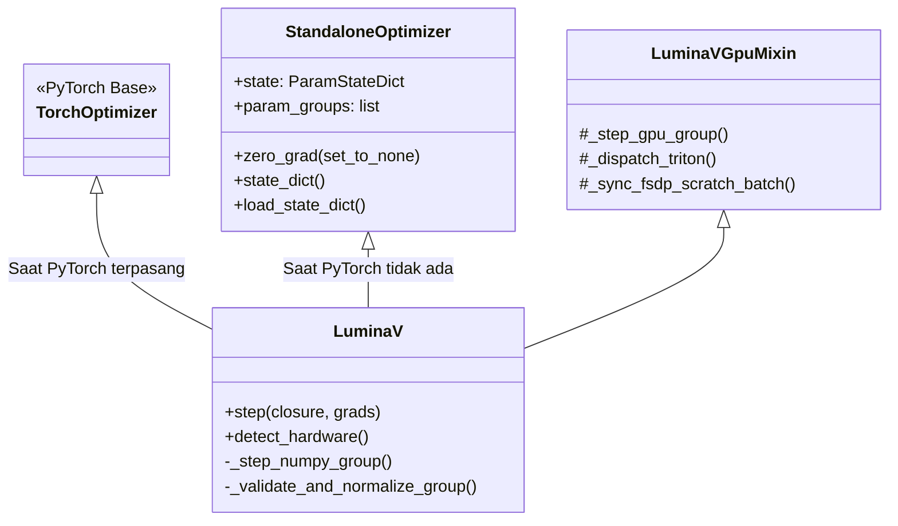

# `python/luminamoon/`: Runtime Python, Triton JIT & Sinkronisasi FSDP

Lapisan Python (`python/luminamoon/optimizer/`) menyediakan integrasi dengan ekosistem machine learning (PyTorch, NumPy), eksekusi GPU Triton JIT, dan sinkronisasi terdistribusi.

[English Version (README.md)](README.md)

---

## 1. Arsitektur Kelas & Pewarisan (Inheritance)



---

## 2. Sinkronisasi Kolektif FSDP Terdistribusi (`gpu_backend.py`)

Saat menjalankan pelatihan terdistribusi pada klaster multi-GPU menggunakan PyTorch Fully Sharded Data Parallel (FSDP):
1. **Penggabungan Reduksi Pass 1 (Coalescing)**:
   Akumulasi cautious mask $\sum \mathcal{M}_i$ dan divergensi gradien digabungkan ke dalam satu tensor scratch pipih per perangkat GPU.
2. **All-Reduce Kolektif**:
   Menjalankan `torch.distributed.all_reduce(..., op=ReduceOp.SUM)` cukup satu kali per langkah untuk seluruh rank GPU, mengeliminasi barrier latensi komunikasi per-tensor.
3. **Mutasi Ternormalisasi Pass 2**:
   Setiap rank menormalkan rasio mask global dan menghitung pembaruan bobot dengan skala pembatasan manifold global yang identik.

---

## 3. Kebersihan Checkpoint & Serialisasi Status

LuminaV membersihkan pointer cache transien GPU dan metadata FFI secara otomatis sebelum serialisasi:

```python
def state_dict(self) -> Dict[str, Any]:
    # Menyaring kunci transien runtime:
    # '_plan', 'p_contig', 'exp_avg_contig', 'exp_avg_sq_contig'
    # Hanya menyimpan status persisten: 'step', 'exp_avg', 'scratch'
```

Hal ini memastikan checkpoint yang disimpan melalui `torch.save()` atau `pickle` tetap bersih, berukuran minimal, dan kompatibel lintas versi.
