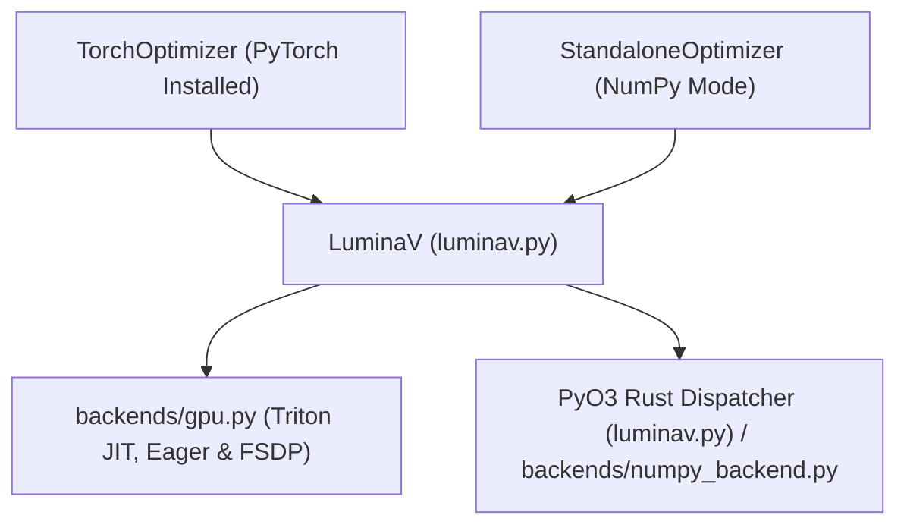

# `python/luminamoon/optimizer/`: Python Engine, Triton JIT & FSDP Synchronization

The Python layer (`python/luminamoon/optimizer/`) integrates `LuminaV` with PyTorch and NumPy, splitting runtime concerns into focused modules (`luminav.py`, `config.py`, `migration.py`, `buckets.py`, `state.py`, `torch_ops.py`, `version.py`, and `backends/{gpu.py, eager.py, fsdp.py, numpy_backend.py, triton/}`).

---

## 1. Module & Dispatch Structure



---

## 2. Distributed FSDP Collective Synchronization (`backends/fsdp.py` & `backends/gpu.py`)

When training across distributed GPU clusters using PyTorch FSDP1, FSDP2 (`DTensor`), HSDP, or DDP:

1. **Pass 1 Reduction Coalescing**:
   Partial cautious masks $\sum \mathcal{M}_i$, raw update norm squares $\sum u_i^2$, and parameter norm squares $\sum w_i^2$ are coalesced into a single flat scratch tensor per device, unwrapping `DTensor` shards via `_to_local_tensor`.
2. **Collective All-Reduce**:
   Executes `torch.distributed.all_reduce(..., op=ReduceOp.SUM)` once per step across the active sharding process group (including 2D HSDP meshes), avoiding per-tensor communication barriers.
3. **Pass 2 Normalized Mutation**:
   Each rank normalizes the global mask ratio and computes parameter updates using identical global bounding scales.
4. **DTensor Bucket Guard (`buckets.py`)**:
   If `fuse_tensors=True` is passed with `DTensor` parameters, bucket coalescing skips those sharded tensors and emits a warning instead of corrupting `DTensor` placements.

---

## 3. Checkpoint Cleanliness & State Serialization (`state.py`)

LuminaV automatically strips transient GPU cache pointers and FFI metadata before serialization:

```python
def state_dict(self) -> dict[str, Any]:
    # Strips TEMP_STATE_DICT_KEYS: 'p_contig', 'exp_avg_contig', 'exp_avg_sq_contig', 'mp_contig', '_plan', '_contig_step', '_validated_sig'
    # Clones 'scratch' and zeroes transient reduction accumulators (indices 0, 1, 2, and 5)
    return {
        k: v for k, v in param_state.items()
        if k not in TEMP_STATE_DICT_KEYS
    }
```

This ensures serialized checkpoints saved with `torch.save()` or `pickle` remain clean and compact.

---

## 4. Contiguous Bucket Fusion & Coalescing (`buckets.py`)

When `fuse_tensors=True` is enabled:

1. **Bucket Partitioning**:
   Parameters within each group are partitioned by `(group_idx, device, dtype)` via `build_contiguous_buckets()`.
2. **View Slicing**:
   Allocates contiguous flat 1D storages (`flat_p`, `flat_m`, `flat_v`, `flat_mp`) and binds individual parameter `p.data` and `state[p]` entries as views into the flat buffer:
   `p.data = flat_p[offset : offset + numel].view(orig_shape)`
3. **Autograd-Managed Gradients**:
   Gradients (`p.grad`) remain allocated and cleared by PyTorch autograd (`zero_grad(set_to_none=True)`) without maintaining a duplicate `flat_g` buffer, while step dispatch forwards per-parameter slices to the active backend.

---

## 5. Bounded Bucket Chunking (`buckets.py`)

To prevent out-of-memory errors when coalescing large models:

1. **Memory Budget Partitioning**:
   Partitions each parameter bucket into contiguous chunks capped at `bucket_cap_mb` (default 500 MB). Single tensors exceeding the limit are placed in dedicated buckets.
2. **Sequential In-Place Migration**:
   Transfers parameter data into the bucket slice-by-slice, releasing original storages (`del old_data`) and calling `gc.collect()` so peak transient initialization memory stays within $\le 500\text{ MB}$.

---

## 6. Triton JIT Pre-Warmup (`backends/triton/dispatcher.py`)

1. **Initialization-Time Pre-Compilation**:
   When `prewarm_jit=True` (default), `prewarm_all_configs()` runs dummy 64-element kernel calls (`lr=0.0`, `weight_decay=0.0`) for both Step 1 two-pass and Step 2+ fused single-pass + post-step EMA paths.
2. **State Decoupling**:
   Internal tensor lookups use `self.state.get(p)` instead of `self.state[p]`, ensuring dummy warmup buffers do not enter user-visible state dictionaries.

---

## 7. Configuration Safety Guards

1. **Un-fused Bucket Cap Warning**:
   Emits a `UserWarning` if `bucket_cap_mb` is set to a non-default value (`!= 500.0`) or overridden in a parameter group while `fuse_tensors=False`, notifying users that bounded chunking requires contiguous fusion.
2. **FSDP Environment Validation**:
   Emits a `logger.warning` if `fsdp_sync=True` is requested without an initialized `torch.distributed` process group, falling back cleanly to local execution (`fsdp_sync = False`).
