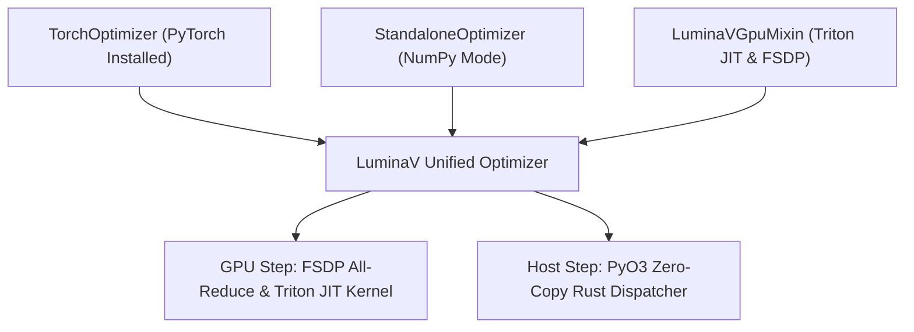

# `python/luminamoon/`: Python Engine, Triton JIT & FSDP Synchronization

The Python layer (`python/luminamoon/optimizer/`) provides clean integration with deep learning ecosystems (PyTorch, NumPy), Triton JIT GPU execution, and distributed collective synchronization.

---

## 1. Class Architecture & Inheritance



---

## 2. Distributed FSDP Collective Synchronization (`gpu_backend.py`)

When training across distributed GPU clusters using PyTorch Fully Sharded Data Parallel (FSDP):
1. **Pass 1 Reduction Coalescing**:
   Partial cautious masks $\sum \mathcal{M}_i$ and gradient divergence values are coalesced into a single flat scratch tensor per device.
2. **Collective All-Reduce**:
   Executes `torch.distributed.all_reduce(..., op=ReduceOp.SUM)` once per step across all GPU ranks, eliminating per-tensor communication barriers.
3. **Pass 2 Normalized Mutation**:
   Each rank normalizes the global mask ratio and computes parameter updates using identical global bounding scales.

---

## 3. Checkpoint Cleanliness & State Serialization

LuminaV automatically strips transient GPU cache pointers and FFI metadata before serialization:

```python
def state_dict(self) -> dict[str, Any]:
    # Filters out runtime transient keys: '_plan', 'p_contig', 'exp_avg_contig'
    # Retains only persistent mathematical states: 'step', 'exp_avg', 'scratch'
    return {k: v for k, v in self.state.items() if not k.startswith('_')}
```

This ensures serialized checkpoints saved with `torch.save()` or `pickle` remain clean, compact, and forward-compatible.
