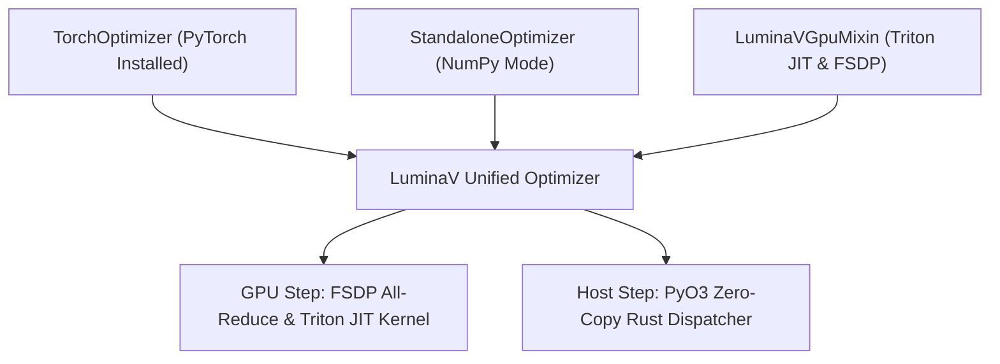

# `python/luminamoon/`: Python Engine, Triton JIT & FSDP Synchronization

The Python layer (`python/luminamoon/optimizer/`) provides clean integration with deep learning ecosystems (PyTorch, NumPy), Triton JIT GPU execution, and distributed collective synchronization.

---

## 1. Class Architecture & Inheritance



---

## 2. Distributed FSDP Collective Synchronization (`gpu_backend.py`)

When training across distributed GPU clusters using PyTorch Fully Sharded Data Parallel (FSDP):

1. **Pass 1 Reduction Coalescing**:
   Partial cautious masks $\sum \mathcal{M}_i$, raw update norm squares $\sum u_i^2$, and parameter norm squares $\sum w_i^2$ are coalesced into a single flat scratch tensor per device.
2. **Collective All-Reduce**:
   Executes `torch.distributed.all_reduce(..., op=ReduceOp.SUM)` once per step across all GPU ranks, eliminating per-tensor communication barriers.
3. **Pass 2 Normalized Mutation**:
   Each rank normalizes the global mask ratio and computes parameter updates using identical global bounding scales.

---

## 3. Checkpoint Cleanliness & State Serialization

LuminaV automatically strips transient GPU cache pointers and FFI metadata before serialization:

```python
def state_dict(self) -> dict[str, Any]:
    # Strips TEMP_STATE_DICT_KEYS: 'p_contig', 'exp_avg_contig', 'exp_avg_sq_contig', 'mp_contig', '_plan', '_contig_step'
    # Clones 'scratch' and zeroes transient reduction accumulators (indices 0, 1, and 2)
    return {
        k: v for k, v in param_state.items()
        if k not in TEMP_STATE_DICT_KEYS
    }
```

This ensures serialized checkpoints saved with `torch.save()` or `pickle` remain clean, compact, and forward-compatible.

---

## 4. Contiguous Bucket Fusion & Coalescing Engine (`luminav.py`)

When `fuse_tensors=True` is enabled:

1. **Bucket Partitioning**:
   Parameters within each group are partitioned by `(group_idx, device, dtype)` via `_build_contiguous_buckets()`.
2. **Zero-Copy View Slicing**:
   Allocates contiguous flat 1D storages (`flat_p`, `flat_g`, `flat_m`, `flat_v`, `flat_mp`) and binds individual parameter `p.data`, `p.grad`, and `state[p]` entries as views into the flat buffer:
   `p.data = flat_p[offset : offset + numel].view(orig_shape)`
3. **Pointer Persistence**:
   `zero_grad(set_to_none=True)` zeroes `flat_g.zero_()` and restores parameter `.grad` views directly, preventing memory fragmentation and pointer dangling across training iterations.

---

## 5. Bounded Bucket Chunking & Memory Allocation Cap (`_partition_into_bounded_chunks`)

To prevent out-of-memory errors when coalescing large models (e.g. 4B+ parameters):

1. **Memory Budget Partitioning**:
   Partitions each parameter bucket into contiguous chunks capped at `bucket_cap_mb` (default 500 MB). Oversized single tensors exceeding the limit are assigned to isolated dedicated buckets.
2. **Sequential In-Place Migration**:
   Transfers parameter data into the bucket slice-by-slice, immediately deleting original storages (`del old_data`, `del old_grad`) and calling `gc.collect()`. This bounds peak transient memory spikes during initialization to $\le 500\text{ MB}$.

---

## 6. Zero-Stall Triton JIT Pre-Warmup Engine (`_prewarm_all_configs`)

1. **Initialization-Time Pre-Compilation**:
   When `prewarm_jit=True` (default), the GPU mixin executes dummy 64-element kernel calls (`lr=0.0`, `weight_decay=0.0`) for both Step 1 two-pass and Step 2+ fused single-pass + post-step EMA code paths.
2. **State Decoupling**:
   Internal tensor lookups use `self.state.get(p)` instead of `self.state[p]`, guaranteeing that dummy initialization buffers never pollute user-visible state dictionaries.

---

## 7. Configuration Safety Guards

1. **Un-fused Bucket Cap Warning**:
   Emits a `UserWarning` if `bucket_cap_mb` is explicitly passed while `fuse_tensors=False`, notifying users that bounded chunking requires contiguous fusion.
2. **FSDP Environment Validation**:
   Emits a `UserWarning` if `fsdp_sync=True` is requested without an initialized `torch.distributed` process group or when world size is 1, falling back gracefully to local execution.
