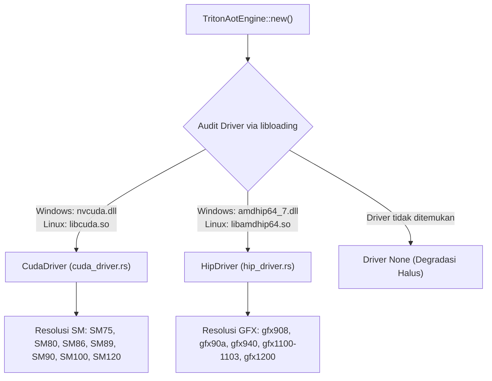

# `luminav-triton-aot`: Kernel Ahead-of-Time & Driver GPU Dinamis

`luminav-triton-aot` menyediakan binding driver GPU dinamis tingkat rendah (NVIDIA CUDA dan AMD ROCm HIP) untuk mengeksekusi kernel Triton yang telah dikompilasi sebelumnya (Ahead-of-Time / AOT) dengan antarmuka C-FFI mandiri.

[English Version (README.md)](README.md)

---

## 1. Audit Driver Dinamis & Resolusi Arsitektur

Untuk mempertahankan dependensi minimum tanpa linking statis pustaka pihak ketiga, crate ini memuat pustaka driver saat runtime menggunakan `libloading`:



---

## 2. Manifest AOT & Validasi Berkas Biner (`src/manifest.rs`)

Kernel AOT dikompilasi menjadi artefak biner target (.cubin atau .hsaco) yang terdaftar di dalam `manifest.json`:
- **Header Magic ELF64**: Memvalidasi header biner untuk membedakan antara biner asli perangkat keras dan *synthetic stub* (`CUDA_STUB_MAGIC`, `ROCM_STUB_MAGIC`).
- **Pengepakan Argumen ABI**: Mengemas pointer buffer dan bidang skalar konfigurasi secara presisi ke dalam tata letak memori C standar yang dibutuhkan oleh entry point kernel Triton.

---

## 3. Antarmuka C-API Mandiri (`src/c_api.rs`)

Crate ini mengekspor antarmuka C murni tanpa ketergantungan runtime Python melalui header [`include/luminav_triton_standalone.h`](../../../optimizer/include/luminav_triton_standalone.h):

```c
typedef void* LuminaVTritonEngineHandle;

LuminaVTritonEngineHandle luminav_triton_engine_create(void);
void luminav_triton_engine_destroy(LuminaVTritonEngineHandle engine);

int32_t luminav_triton_engine_step_f32(
    LuminaVTritonEngineHandle engine,
    float* param,
    const float* grad,
    float* exp_avg,
    float* exp_avg_sq,
    float* scratch,
    uint32_t num_elements,
    float lr,
    float beta1,
    float beta2,
    float eps,
    float tau,
    float lam,
    float bound_ratio,
    float c_min,
    uint32_t step,
    uint8_t buffer_mode,
    uint8_t bound_type,
    uint8_t cautious,
    uint8_t centered_defect,
    uint8_t fused_single_pass
);
```

Arsitektur ini memungkinkan integrasi langsung ke dalam harness inferensi C/C++ atau sistem embedded berkinerja tinggi.
