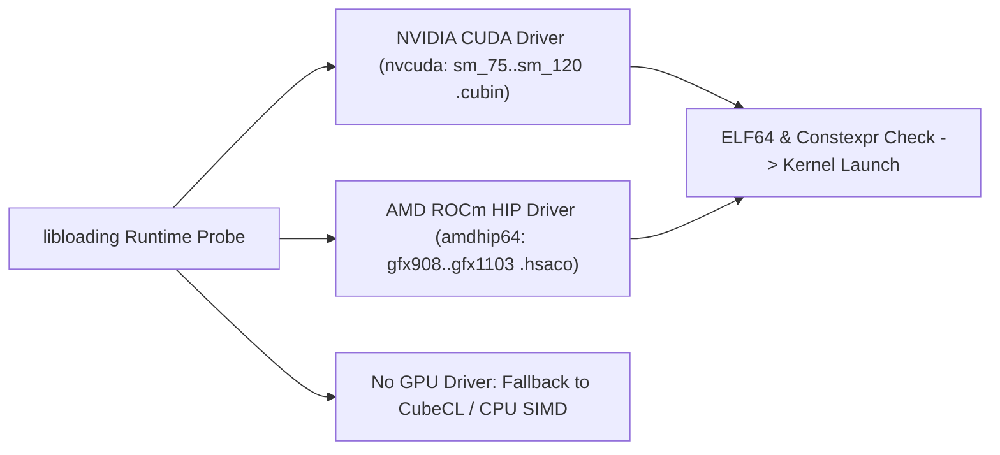

# `luminav-triton-aot`: Ahead-of-Time Kernels & Dynamic GPU Drivers

`luminav-triton-aot` provides low-level dynamic GPU driver bindings (NVIDIA CUDA and AMD ROCm HIP) to execute Ahead-of-Time (AOT) compiled Triton kernels with a standalone C-FFI interface.

---

## 1. Dynamic Driver Probing & Architecture Resolution

To avoid mandatory linked GPU driver dependencies at build time, the crate probes driver shared libraries at runtime using `libloading`:



---

## 2. AOT Manifest & Artifact Inspection (`src/manifest.rs` & `src/step.rs`)

182 GPU ELF64 binaries (14 kernels across 8 NVIDIA CUDA targets `sm_75..sm_120` and 5 AMD ROCm targets `gfx908`, `gfx90a`, `gfx942`, `gfx1100`, `gfx1103`) are pre-compiled by `optimizer/tools/aot_compiler/compile_triton_aot.py` and indexed in `artifacts/manifest.json` (`schema_version = "2.0.0"`, `math_version = "2.0.0"`):

- **ELF64 & Constexpr Validation**: Validates binary headers (`\x7fELF`), guards against synthetic stubs (`is_synthetic_stub_binary`), and verifies runtime `constexpr` flags (`bound_mode`, `dtype_mode`, `state_dtype_mode`, `use_sr`, `cautious`, `has_master`, `is_triangle`) before launch. Unsupported runtime configurations or ISA load mismatches (`is_fallback_eligible()`) fall back cleanly to CubeCL or Rayon CPU SIMD.
- **Triton 3.8 ABI Packing**: Packs device pointers, scalar config fields (`step_i32`, `seed`, `lr`, `beta1`, `beta2`, `eps`, `lam`, `bound_ratio`), and `num_trailing_scratch_ptrs = 2` null trailing scratch pointers expected by Triton 3.8 compiled entry points across both 2-pass (`Dual`, `TdClm`, `T1`, `T2`) and fused single-pass + post-step EMA paths.

---

## 3. Standalone C-API Interface (`src/c_api.rs`)

The crate exposes a standalone C-API declared in [`include/luminav_triton_standalone.h`](https://github.com/cloverx-id/luminamoon/blob/main/optimizer/include/luminav_triton_standalone.h):

```c
typedef struct LuminaVTritonEngine LuminaVTritonEngine;

LuminaVTritonEngine* luminav_triton_engine_create(void);
void luminav_triton_engine_destroy(LuminaVTritonEngine* engine);
const char* luminav_triton_get_platform(const LuminaVTritonEngine* engine);
const char* luminav_triton_get_arch(const LuminaVTritonEngine* engine);

int luminav_triton_step_f32(
    LuminaVTritonEngine* engine,
    float* param,
    const float* grad,
    float* exp_avg,
    float* exp_avg_sq,
    float* master_param,
    float* scratch,
    size_t num_elements,
    float lr,
    float beta1,
    float beta2,
    float eps,
    float weight_decay,
    float tau,
    float lam,
    int buffer_mode,
    int cautious,
    int bound_mode,
    float bound_ratio,
    uint64_t step,
    uint32_t seed
);
```

This allows native C/C++ training engines or embedded inference harnesses to drive LuminaV Triton kernels without a Python interpreter.
