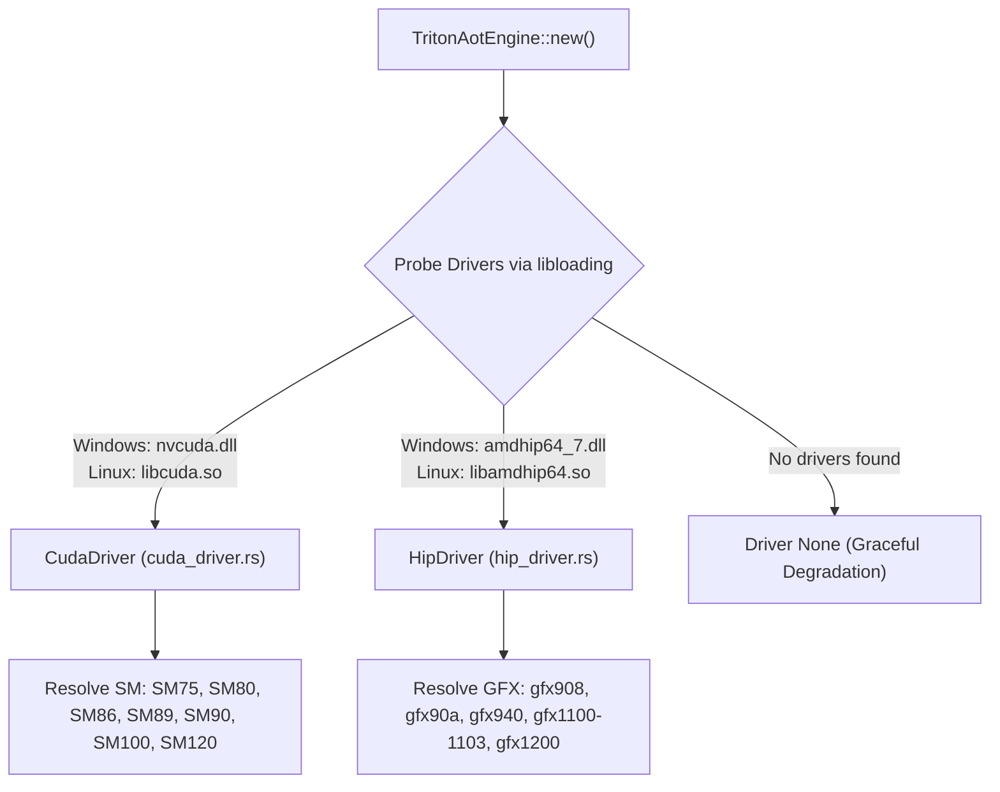

# `luminav-triton-aot`: Ahead-of-Time Kernels & Dynamic GPU Drivers

`luminav-triton-aot` provides low-level dynamic GPU driver bindings (NVIDIA CUDA and AMD ROCm HIP) to execute Ahead-of-Time (AOT) compiled Triton kernels with a standalone C-FFI interface.

[Versi Bahasa Indonesia (README.id.md)](README.id.md)

---

## 1. Dynamic Driver Probing & Architecture Resolution

To maintain zero mandatory linked runtime dependencies, the crate probes driver shared libraries at runtime using `libloading`:



---

## 2. AOT Manifest & Artifact Inspection (`src/manifest.rs`)

AOT kernels are pre-compiled into target binary artifacts (.cubin or .hsaco) registered in `manifest.json`:
- **ELF64 Magic Header**: Pre-validates binary headers against synthetic stubs (`CUDA_STUB_MAGIC = b"// LUMINAV_TRITON_AOT_CUBIN"`, `ROCM_STUB_MAGIC = b"; LUMINAV_TRITON_AOT_HSACO"`).
- **ABI Argument Packing**: Automatically packs pointers and scalar config fields (`step`, `lr`, `beta1`, `beta2`, `eps`, `bound_ratio`) into strict C-compatible memory layouts expected by Triton-generated entry points.

---

## 3. Standalone C-API Interface (`src/c_api.rs`)

The crate exposes a header-only standalone C-API via [`include/luminav_triton_standalone.h`](file:///c:/Users/rifial/Downloads/PROJECT%20LUMI/luminamoon/optimizer/include/luminav_triton_standalone.h):

```c
typedef void* LuminaVTritonEngineHandle;

LuminaVTritonEngineHandle luminav_triton_engine_create(void);
void luminav_triton_engine_destroy(LuminaVTritonEngineHandle engine);

int32_t luminav_triton_engine_step_f32(
    LuminaVTritonEngineHandle engine,
    float* param,
    const float* grad,
    float* exp_avg,
    float* exp_avg_sq,
    float* scratch,
    uint32_t num_elements,
    float lr,
    float beta1,
    float beta2,
    float eps,
    float tau,
    float lam,
    float bound_ratio,
    float c_min,
    uint32_t step,
    uint8_t buffer_mode,
    uint8_t bound_type,
    uint8_t cautious,
    uint8_t centered_defect,
    uint8_t fused_single_pass
);
```

This allows native C/C++ high-performance training engines or embedded inference harnesses to drive LuminaV Triton kernels without a Python interpreter.
